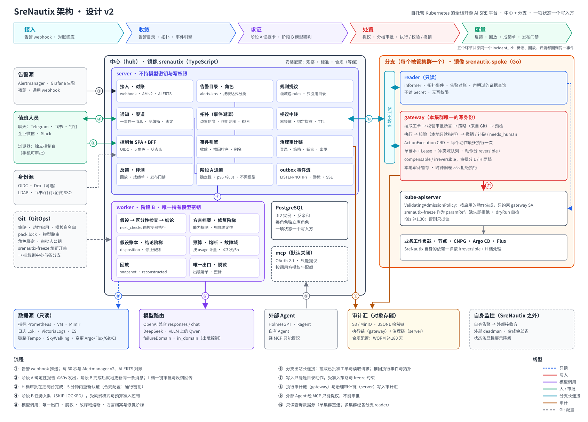

# SreNautix

**自托管 Kubernetes 的全栈开源 AI SRE 平台。**

SreNautix 的处理流程：

1. 从你现有的告警系统接收告警，归并成事件。
2. 在集群拓扑上对候选根因排序。
3. 先由确定性的证据卡给出判定，再让模型研判；模型结论里引用的每一条证据，都由代码逐条校验。
4. 修复只能通过一个独立的网关执行，而且只能是目录里事先声明过的类型化动作。写操作受 Kubernetes 准入策略约束；执行后会校验结果，能撤销的会撤销。
5. 它的准确率在你自己的历史事件上测量，使用你实际在用的模型。

> **状态：设计阶段，目前还没有可以运行的代码。** 要等项目在参考集群上连续 2 周达到自己定下的生产标准，才会发布第一个公开版本（标准见 [POSITIONING.zh-CN.md](POSITIONING.zh-CN.md)）。

## 核心

1. **在拓扑上推断根因**：确定性地把告警归并成事件，并在组件拓扑上为候选根因排序。
2. **证据先行**：模型介入之前，证据卡先对自己的数据给出判定：正常、异常或无法判定。模型给出结论后，代码逐条校验它引用的证据，没有支撑的结论会被降级。
3. **受控执行**：模型永远不持有写凭证。写操作只能由独立网关执行目录里的类型化动作，Kubernetes 准入策略约束动作的形状。
4. **执行后校验与撤销**：每个动作执行后都会检查事先声明的条件。可撤销的动作自动撤销，只能补偿的动作需要再次审批。
5. **在自己的事件上回放**：回放过程防止答案泄露，按模型分别给出分数和置信区间；分数回归就不发布。

定位文档写明了 12 条安全不变量，设计文档为每一条指定了具名的 CI 测试。

## 文档

| 文档 | 内容 |
|---|---|
| [POSITIONING.zh-CN.md](POSITIONING.zh-CN.md) | 为谁服务、解决什么问题、不变量、可证伪的主张、许可 |
| [DESIGN.zh-CN.md](DESIGN.zh-CN.md) | 架构与设计 v2，经过两轮共 11 位质疑者推敲 |
| [architecture.svg](architecture.svg) | 架构图 |

## 许可

- 服务端代码：[AGPL-3.0-or-later](LICENSE)。
- `contract/`、`packages/{packs-sdk,integration-sdk,ui,contract}`、`plugins/`、`packs/`：[Apache-2.0](LICENSE.Apache-2.0)。

为 AGPL 代码贡献需要签署 [CLA](CLA.md)；为 Apache-2.0 部分贡献只需 DCO 签名。详见 [CONTRIBUTING.md](CONTRIBUTING.md)。
