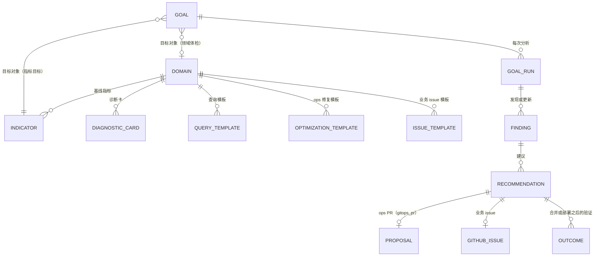
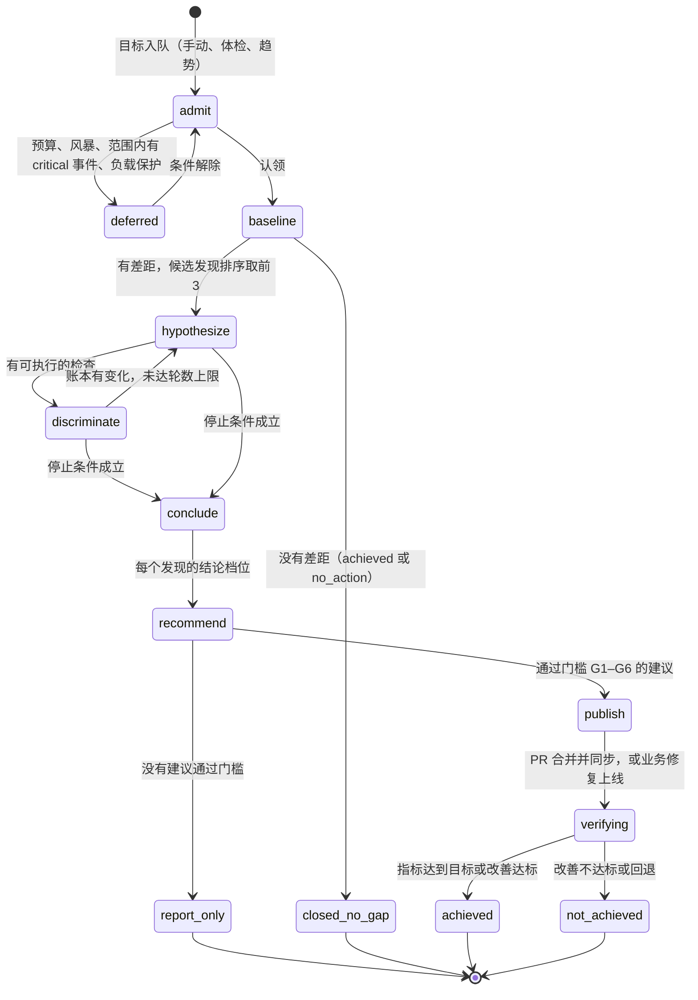
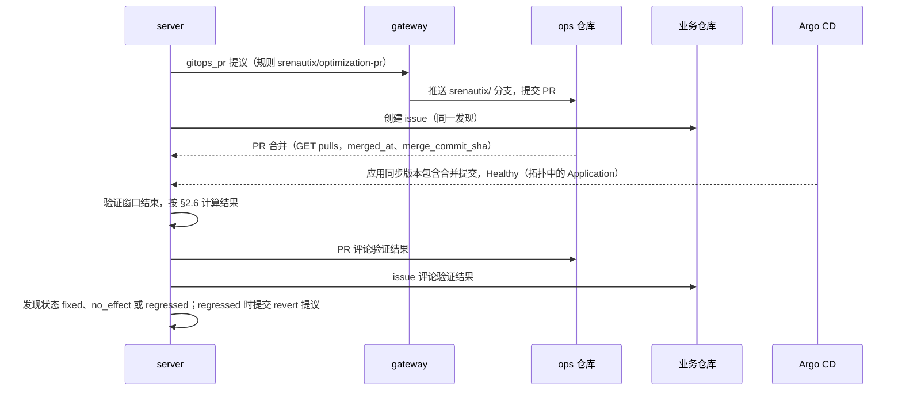
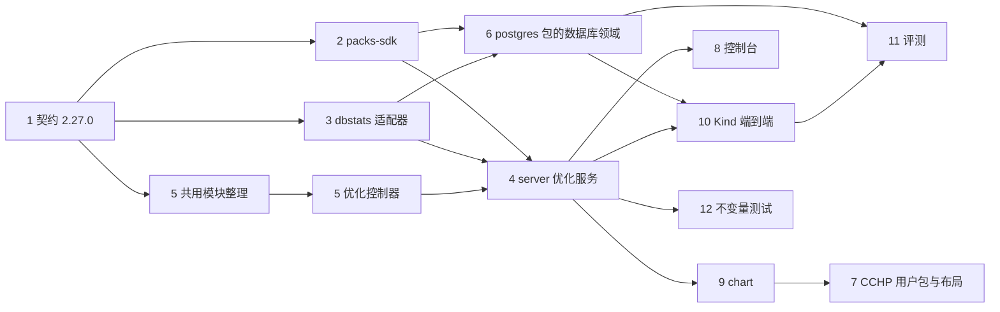

# 0146 目标驱动的主动优化：目标、领域体检与趋势触发，业务 issue 与 ops PR

## 背景

SreNautix 现在只在告警与集群状态进入之后工作：事件收敛 → 阶段 A → 阶段 B 研判 → 自愈 PR 与事件 issue（ADR 0095、0108）。没有告警的性能问题（一条慢语句占了数据库的大部分时间、工作负载的 request 长期是实际用量的三倍、某个阶段的耗时一周比一周高）不会进入这条链路。

用户（第二阶段章程 §4 第 18 条，2026-10-24）要求新增主动优化：

- 可以下达目标，例如"优化 CCHP 某个请求的性能"；也可以设定领域，例如数据库性能、存储性能、流量并发负载性能。SreNautix 按目标自主收集集群与业务信息并分析，在业务仓库创建 issue，在 ops 仓库提交 PR。
- 业务仓库 `CCH-HQ/claude-code-hub-plus` 只创建 issue，不提交 PR。用户已把 GitHub App「SreNautix」安装到业务仓库，与 ops 仓库是同一个安装、同一份凭证（server 已挂载的 Secret `srenautix-github-app`）；安装的权限是 contents、issues、pull_requests 写入，对业务仓库的收窄由 server 的 GitHub 请求白名单完成（§6.4）。
- ops 仓库 `CCH-HQ/cchp-k8s-ops` 可以提交 PR，范围是资源与扩缩容（requests/limits、HPA、副本数）与组件参数（PG/CNPG 的 GUC、Dragonfly、SeaweedFS 配置、连接池等）。补偿控制沿用现有规则：只推送 `srenautix/*` 分支、从不合并、由 Zzhihon 审阅、按小时限速、写入审计（ADR 0025、0108）。
- 三种触发方式都要：在控制台或 Telegram 下达目标；按领域定期体检；检测到异常趋势时自动发起。
- 可读的数据一律只读：指标、拓扑、Kubernetes 只读；Tempo 链路与 Loki 日志（脱敏、截断）；数据库统计（`pg_stat_statements`、`pg_stat_user_tables`、`pg_stat_user_indexes` 等只读视图，不读业务数据行）；业务代码（GitHub App 的 contents 只读权限）。

约束：

- **解耦**（章程 §4 第 13、14 条）：SreNautix 的运行影响业务性能就是 SreNautix 的设计问题。主动分析发出的查询必须有限速与并发上限，业务高峰与数据库压力大时自动让出。
- **SreNautix 自身的状态库**：Zzhihon/SreNautix#13 记录了时间点拓扑查询把 srenautix-pg 的 CPU 顶到 limit，ADR 0144 改为按索引取、子图逐跳取、并发合并与缓存。主动分析不能再给状态库加同类负载。
- **出境**：cchp-k8s-ops#141 批准了两条境外模型路由，出境清单里的数据类别为 alerts、topology、knowledge，加上章程第 12 条的 Kubernetes 容器日志尾部（logs）。主动分析新增的数据类别 sql、traces、code 由用户另行批准（2026-10-24，见末节第 4 条）。

CCHP 现有的数据（2026-10-24 只读核实）：

- CNPG 的 exporter 已经配置了自定义查询：语句 top 20（`cchp_pg_stat_statements`，按总执行时间，语句头 80 个字符，常量已是 `$n`）、会话与等待事件、锁、Timescale 分块与作业。`pg_stat_statements` 已在 `shared_preload_libraries` 中，`track_io_timing` 打开。
- `cchp` 库当前查不到 `pg_stat_statements` 扩展（Database 资源声明了 `ensure: present`，状态为已应用），语句 top 20 的指标因此没有数据。
- Tempo 的 metrics-generator 为 `cch-gateway` 与 `cch-control-plane` 生成 spanmetrics：gateway 每个阶段一个 span（`cchp.gateway.stage.<阶段>`），数据库访问的 span 名带表名（`db select usage_logs`）。gateway 自己的阶段耗时直方图 `cchp_gateway_stage_duration_seconds` 带 `endpoint` 与 `stage` 标签。
- 业务仓库是私有仓库，默认分支 `dev`，约 4800 个非测试 Go 文件（约 73 MB），另有 TypeScript 前端与 SQL 文件。

## 决定

### 1. 概念模型

#### 1.1 指标目录（Indicator）

目标只能引用领域包声明的指标，模型、聊天与控制台都不提交自由的 PromQL、SQL、LogQL 或 TraceQL。一条指标包含：

| 字段 | 内容 |
|---|---|
| `id` | `<包>/<指标>`，例如 `cchp/gateway-stage-p99`、`postgres/db-time-by-statement` |
| `signal` | 引用的信号（§3）；按实体产生序列 |
| `entity` | 实体类型：Kubernetes 对象，或逻辑实体 `pg_statement`、`pg_table`、`pg_index`、`route`、`stage` |
| `params` | 参数的 JSON Schema（可移植子集），例如 `endpoint`、`stage`、`statement` |
| `unit`、`better` | 单位；`lower` 或 `higher` 表示改善方向 |
| `statistic` | 默认统计方式：基线窗口内按小时取值，再取 `p50`、`p95` 或 `max` |
| `load_indicator` | 判定业务高峰用的负载指标（例如请求速率），用于基线覆盖与验证时的时段匹配 |

逻辑实体都挂到拓扑组件上：`pg_statement:<集群>/<库>/<语句指纹>` 挂到 CNPG Cluster，`route:<服务>/<endpoint>` 挂到提供它的工作负载。语句指纹用 libpg-query 对规范化语句计算，PG 升级后 `queryid` 变化时指纹不变。

#### 1.2 Goal

| 字段 | 内容 |
|---|---|
| `goal_id`、`revision` | UUID；规格每修改一次 `revision` 加一 |
| `origin` | `manual`（`channel`: console、telegram、api，`principal`）、`checkup`（领域与计划 id）、`trend`（趋势 id 与实体）、`forecast_alert`（预测类告警的指纹） |
| `subject` | `indicator`：指标 id 与参数；或 `domain`：领域 id。两种都可以带 `scope`（组件、命名空间的白名单） |
| `objective` | 可选。`comparator`（lt、le、gt、ge）、`target`、`unit`、`statistic`、`window`（默认 7d）。领域体检没有目标值时用领域的门槛 |
| `outputs` | 允许的建议类别：`ops_pr`、`business_issue` |
| `budget` | 默认 token 40 万、时长 20 分钟、检查 12 项；后端查询：dbstats 30、traces 10、logs 10、代码文件 200 个或 8 MiB、GitHub 请求 300 |
| `expires_at` | 默认 14 天；到期仍未达成时状态为 `expired`，附最后一次分析的报告 |
| `state` | `queued`、`analyzing`、`recommended`、`verifying`、`achieved`、`not_achieved`、`no_action`、`cancelled`、`expired`、`failed` |

#### 1.3 领域（Domain）与领域包

领域是领域包里的一组内容，新文件 `domains.yaml`（契约 2.27.0）：

| 字段 | 内容 |
|---|---|
| `id`、`title` | 例如 `database`、`compute`、`traffic`、`storage`、`cache` |
| `applies_to` | 组件类型或 kind，例如 `Cluster.postgresql.cnpg.io` |
| `indicators` | 体检时计算基线的指标 |
| `diagnostics` | 诊断卡：引用证据链或卡片，按实体执行，异常即候选发现 |
| `contribution` | 份额卡：某个实体占指标的比例（例如一条语句占数据库执行时间的比例），用于排序与结论阶梯 |
| `templates` | 查询模板，包括 dbstats、traces、logs 类信号的模板（§3），供区分性检查使用 |
| `optimizations` | 适用的 ops 修复模板 id（`remediations.yaml` 中 `applies: goal` 的模板） |
| `issues` | 适用的业务 issue 模板 id（新文件 `issues.yaml`） |
| `gates` | 本领域的门槛参数（§2.5） |
| `trends` | 趋势定义（§5.4） |
| `schedule` | 默认体检计划与时段 |
| `load_guards` | 负载保护卡（§6.2） |

多个包可以给同一个领域补充内容，按现有分层规则合并（`extend`、`patch`、`params`、`disable`）。内置的分配：

| 领域 | 内置包 | CCHP 用户包补充 |
|---|---|---|
| `database` | `postgres` | CNPG Cluster 的布局、exporter 自定义查询的信号、GUC 的允许范围 |
| `compute` | `workload` | 平台约定（内存 request 等于 limit）、gateway 的 HPA 指标 |
| `traffic` | `workload`、`ingress-nginx`、`envoy-gateway` | gateway 阶段耗时、spanmetrics、endpoint 指标 |
| `storage` | `pvc`、`longhorn` | SeaweedFS 的信号与参数 |
| `cache` | `redis` | Dragonfly 的信号与参数 |

#### 1.4 Finding

一个发现是一个实体上的一个问题，跨分析运行持久保存：

| 字段 | 内容 |
|---|---|
| `fingerprint` | `sha256(cluster, domain, kind, entity_key)`，去重的唯一键 |
| `kind` | 领域声明的发现类型，例如 `pg.statement_dominant`、`pg.seq_scan_hot_table`、`pg.temp_spill`、`workload.cpu_overprovisioned`、`hpa.target_low`、`pool.saturated` |
| `entity`、`component` | 逻辑实体或 Kubernetes 对象，以及它挂到的拓扑组件 |
| `gap`、`share` | 指标相对目标或门槛的差距；实体在指标中的份额 |
| `level` | 最近一次分析的结论档位（§2.4） |
| `evidence_fingerprint` | 支持卡与份额卡的判定向量指纹 |
| `status` | `open`、`recommended`、`accepted`、`verifying`、`fixed`、`no_effect`、`regressed`、`rejected`、`suppressed` |
| `cooldown_until` | 被拒绝之后的冷却期限 |

#### 1.5 Recommendation

| 类型 | 去向 | 生成方式 |
|---|---|---|
| `ops_pr` | `gitops_pr` 提议，由 gateway 在 ops 仓库提交 PR | `remediations.yaml` 中 `applies: goal` 的模板，`planRemediation` 生成补丁（ADR 0103），内存中校验（ADR 0108 §4） |
| `business_issue` | 业务仓库的 issue | `issues.yaml` 中的模板，代码定位（§3.5）给出文件、函数与行号 |

两类建议都带确定性计算的预期收益（`estimate`，§2.5）与验证计划（`verify`）。模型写的文字只出现在建议说明里，标注【模型】。

#### 1.6 与事件、研判的关系

| 部分 | 处理 |
|---|---|
| 证据卡、CEL 判定、信号备选与标签档案（DESIGN §6） | 复用；诊断卡、份额卡、负载保护卡都是证据卡 |
| 领域包的加载、分层、`pack.lock`、测试套件 | 复用；新增 `domains.yaml`、`issues.yaml`，`remediations.yaml` 增加字段 |
| 假设账本、检查与机制的对应（ADR 0133）、竞争假设的排除（ADR 0124）、相反证据的上限（ADR 0134）、控制器补选检查（ADR 0137） | 复用，账本的分组键由根因组件扩展为"根因组件或发现" |
| 卡片即检查（ADR 0116）与 server 的检查执行接口 | 复用；执行接口接受目标运行 |
| 模型层：路由、熔断、故障域、方言档案、修复阶梯、预算账本、唯一出口、脱敏、蜜标、出境清单、数值审计 | 复用；出境类别增加 `sql`、`code` |
| `planRemediation`、补丁校验、`gitops_pr` 提议与 gateway | 复用；提议的绑定对象扩展为事件或目标（§8） |
| 事件 issue 服务（ADR 0095）与 GitHub App 的安装令牌（`github/app.ts`） | 复用；issue 服务扩展为多个仓库角色，请求白名单按仓库角色区分（§6.4） |
| 通知的消息模型与渠道（ADR 0125） | 复用；新增目标消息 |
| 评测框架：快照、回放、成绩单、自助法置信区间 | 复用；新增用例类型 `optimization` |
| 事件收敛、阶段 A、处置推导（ADR 0138） | 不参与；目标没有告警成员与处置判断 |
| Goal、指标目录、领域、发现、建议、验证结果、趋势扫描、体检计划、dbstats 集成、代码定位 | 新增 |

### 2. 执行流程

#### 2.1 主线

`baseline`、`recommend`、`publish`、`verifying` 全部由代码执行；只有 `hypothesize` 与 `conclude` 调用模型。没有差距时整次运行不调用模型。

#### 2.2 基线与差距

1. **基线**：按目标的指标或领域的全部指标，在基线窗口（默认 7 天）内按小时取值。覆盖率（有数据的小时数 ÷ 窗口小时数）低于 90%，或窗口里少于 3 个业务高峰（按 `load_indicator`，负载前 20% 的小时），基线判为无法判定，运行以 `failed`（原因 `baseline_insufficient`）结束，消息写明缺少的数据。
2. **差距**：
   - 有目标值：违反目标的小时数占比不低于 10%（`gates.violation_ratio`），或统计值违反目标。
   - 领域体检：领域 `gates` 中的指标门槛，例如数据库领域"单条语句平均执行时间超过 50 ms 且每小时调用超过 1000 次"。
3. **候选发现**：诊断卡在范围内的实体上执行，异常的（卡、实体）成为候选；份额卡给出每个候选在指标中的份额。按"份额 × 差距"排序，前 3 个进入 `hypothesize`，其余写进输出的"未分析的候选"。已有 `fixed` 状态的发现处于验证期内时不进入候选。

#### 2.3 假设、区分性检查与账本

- **输入**：目标、基线表、候选发现与它们的诊断卡和份额卡、拓扑（组件粒度，ADR 0129）、最近 14 天触及范围的变更、领域知识条目、检查目录（卡片检查、查询模板、只读工具）。
- **hypothesize**：一次结构化调用，为每个候选发现提出机制假设，机制要点明预示的症状。症状类型在 ADR 0133 的集合上增加 `seq_scan`、`index`、`temp_spill`、`lock_wait`、`io_read`、`connection_pool`、`cache_miss`、`polling`、`n_plus_one`、`payload_size`、`overprovision`。动态枚举只允许本次运行中存在的发现 id、卡 id 与模板 id。
- **discriminate**：控制器执行 `next_checks`，结果判定成卡，写入账本。账本按发现分组：同一发现上的假设互为竞争假设，不同发现的假设互不影响。支持卡的范围是发现的实体与它挂到的组件。
- **停止条件**：与 DESIGN §7.3 相同，按发现分别判断；全部发现满足停止条件、两轮没有变化，或达到步数、时长、预算上限时进入 `conclude`。
- **conclude**：模型为每个发现选出一个假设并写说明；档位由代码按 §2.4 计算。模型弃权时按 ADR 0120 由代码代选。

#### 2.4 优化结论阶梯

档位名称与 DESIGN §7.3 相同，条件按优化场景定义，全部由代码判定：

| 档位 | 条件 |
|---|---|
| `evidence_consistent` | 同时满足：① 差距成立（§2.2）；② 支持卡中至少一张份额卡表明这个机制对应的实体占指标的比例不低于 `gates.min_share`（数据库领域默认 20%，`compute` 领域按实体自身计算，取 100%）；趋势触发的目标另外要求机制的变化起点不晚于指标恶化起点加 1 小时；③ 机制信号上没有相反的正常卡（ADR 0133 的对应规则）；④ 检验并排除过竞争假设（ADR 0124） |
| `likely` | 有支持卡，不满足上面的全部条件 |
| `inconclusive` | 有假设，没有支持卡；或撞上 ADR 0134 的相反证据上限 |
| `undetermined` | 没有假设 |

#### 2.5 建议的门槛

建议在 server 中按顺序经过 6 道门槛，任何一道不通过都只记录原因（`server.recommendation_attempts`，与 `remediation_attempts` 同样的原因码方式），写进目标报告，不创建 PR 或 issue：

| 门槛 | 规则 | 默认值 |
|---|---|---|
| G1 证据档位 | ops PR 要求 `evidence_consistent`；业务 issue 要求 `likely` 及以上，并且份额不低于 `min_share` | 见 §2.4 |
| G2 预期收益 | 模板的 `estimate.lower`（保守下界，CEL 按卡片的值计算）不低于领域门槛：数据库领域为指标的 10% 或差距的 50% 中较小者；`compute` 领域为 request 的 10%，并且每个工作负载至少 0.2 核或 256 MiB；扩缩容为副本小时减少 10%，变更后 p95 利用率不超过目标的 80% | 领域 `gates` |
| G3 安全约束 | 模板的 `guard`（CEL）全部成立，例如：GUC 的 `context` 属于 user、superuser、sighup（不需要重启）；新值在领域包声明的范围内；CPU request 不低于 14 天 p99 用量；内存遵守布局的平台约定（request 等于 limit），不低于 14 天最大工作集的 1.25 倍，30 天内没有 OOM；有 CPU 利用率 HPA 的工作负载修改 request 时必须同时调整 HPA 目标；单次 PR 的改动幅度不超过当前值的 50% | 模板参数 |
| G4 新颖性 | 同一指纹已有 `open`、`recommended`、`verifying` 的建议时不再生成；`rejected` 的发现 30 天冷却，期间差距扩大 50% 以上才重新生成；同一对象与参数 7 天内合并过 PR 时跳过，等它的验证结束 | `cooldown: 30d` |
| G5 数量 | 每次运行最多 2 个建议；业务 issue 每个仓库每天最多 3 个；优化类 ops PR 每小时最多 1 个、每周最多 5 个，并且只用 gateway 每小时上限中的 1 个名额，另一个名额留给事件的自愈 PR | 配置 |
| G6 时机 | 范围内的组件有活动事件、cchp-prod 有进行中的发布、gateway 冻结状态之外的写入异常时推迟到下一轮 | — |

`estimate` 的写法：`{indicator, unit, lower: <CEL>, expected: <CEL>, basis: <ICU 文案>}`。下界只用卡片里的确定值计算，例如"补索引"的下界为"语句的份额 × `params.min_reduction`（默认 0.5）"，并且只在每次调用返回的行数远小于顺序扫描读取的行数时适用；资源调整的下界就是 request 的差值。

#### 2.6 验证计划

每个建议在创建时写好验证计划：

- **时机**：ops PR 合并之后，等管理这个文件的 Argo 应用的同步版本包含合并提交、并且应用 Healthy；GUC 另外核对 `pg_settings` 中的值等于新值。业务 issue 在修复提交被部署之后开始：发布输入（`release_input`）的版本对应的业务提交包含修复提交（`GET compare`）。
- **窗口**：模板的 `verify.within`（GUC 与资源默认 24 小时并包含一个业务高峰；延迟类默认 3 个工作日）。
- **比较方式**：与基线按"星期 × 小时"匹配的时段比较，按小时取值。改善不低于 `estimate.lower` 的 50% 并且超出噪声带（基线窗口内同一时段的四分位距的一半）时判为 `improved`；守护指标（错误率、其他语句的执行时间、CPU 限流、OOM）恶化超过 10% 时判为 `regressed`；其余为 `no_effect`。
- **回退**：`regressed` 的 ops PR 由 server 提交一个 revert 的 `gitops_pr` 提议（标题前缀 `[回退]`），按普通 PR 流程由人合并。

#### 2.7 优化控制器与阶段 B 控制器的关系

| 方案 | 做法 | 结果 |
|---|---|---|
| 直接复用阶段 B 控制器 | `ResearchCase` 增加目标分支，提示词、处置推导、阶梯条件、提议绑定都按主体类型分支 | 控制器的每一步都要判断主体类型；处置推导与"异常起始早于症状"对目标没有意义；任何改动都要重跑事件评测的门禁 |
| 优化控制器，共用阶段 B 的模块 | 把账本、对应规则、检查执行与补选、证据簿、模型会话、预算、出境、数值审计整理为共用模块；`apps/srenautix/src/optimize/` 写自己的阶段、提示词与阶梯 | 事件研判的行为不变；共用模块的整理由事件评测的 T0 与 T1 证明结果相同 |

采用第二种。共用模块整理是行为不变的重构：`Ledger` 的分组键参数化（默认根因组件），`judgeLadder` 拆出条件计算，`checks.ts`、`targeting.ts`、`evidence.ts`、`numbers.ts`、`validate.ts` 不依赖 `Incident` 类型。研判运行表 `worker.research_runs` 增加 `subject_type`（`incident`、`goal`）与 `goal_id`，`incident_id` 改为可空；`llm_calls`、`tool_calls`、出境清单与控制台的运行明细页沿用。

### 3. 数据接入

#### 3.1 信号与工具

- **信号**：产生证据卡，按 CEL 判定，可以录制快照与回放。基线、差距、份额、门槛、验证中使用的每个数值都必须来自信号卡。
- **工具**：返回不可信文本，由小模型对照 `refutes_if` 判定（`model_judged`），只用于定位与补充上下文，不能决定档位与门槛。
- 模型只选择模板与工具并填写参数，参数按 JSON Schema 校验。查询语句全部写在领域包的模板与适配器里。

#### 3.2 各数据源

| 数据源 | 接入形式 | 执行方 | 权限 | 脱敏与截断 | 单次运行上限 | 出境类别 |
|---|---|---|---|---|---|---|
| VictoriaMetrics（含 exporter 的 PG 统计、spanmetrics、gateway 阶段直方图） | 信号（metrics） | server | 现有只读 | 卡片结果 | 并发 2；区间不超过 14 天；超过 1 天时步长不小于 5 分钟；每个查询不超过 50 条序列 | metrics（已批准） |
| 拓扑、Kubernetes 只读 | 现有（informer 缓存、ADR 0106 工具） | server | 现有只读 | 现有 | kube 工具 10 次 | topology、logs（已批准） |
| PostgreSQL 统计 | 信号（新类型 `dbstats`）与工具 `pg_statement_text` | server | 专用只读角色（§3.3） | 语句重新规范化、去掉注释、每条不超过 4 KiB | 30 次；文本 10 条 | `sql`（已批准） |
| Tempo | 信号（traces：计数与耗时分布）与工具 `trace_exemplar` | server | 现有只读 | span 属性白名单 | 10 次 | traces（已批准） |
| Loki | 信号（logs：`count_over_time`）与工具 `logs_sample` | server | 现有只读 | 现有脱敏，50 行、16 KiB | 10 次 | logs（已批准，见 §3.6） |
| 业务代码 | 工具 `code_locate`（确定性定位）、`code_excerpt` | server | 现有 GitHub App 的安装，按业务仓库角色收窄的请求白名单（§6.4） | 密钥扫描、排除路径 | 200 个文件或 8 MiB | `code`（已批准） |

#### 3.3 dbstats 集成

新集成类别 `contract/integrations/dbstats/v1`，核心级适配器 `postgres`（`packages/integration-sdk/src/dbstats/postgres.ts`）。操作固定，SQL 写在适配器里，只绑定参数：

| 操作 | 内容 |
|---|---|
| `statements.top` | `pg_stat_statements(showtext := false)` 按指定列排序取前 N（不超过 50）：queryid、角色、调用次数、总执行时间与平均值、行数、shared 块的命中与读取、temp 块写入、块读取时间、WAL 字节。不读取语句文本文件 |
| `statements.text` | 按 queryid（不超过 10 个）取语句文本，经 libpg-query 重新规范化（常量换成 `$n`），去掉注释，每条不超过 4 KiB |
| `tables.top` | `pg_stat_user_tables` 与 `pg_statio_user_tables` 按指定列排序取前 N；Timescale 分块按 hypertable 汇总（读取 `_timescaledb_catalog`，PUBLIC 可读），不逐个列出分块 |
| `indexes.usage` | `pg_stat_user_indexes`、`pg_index` 与 `pg_relation_size`：扫描次数、大小、是否唯一 |
| `settings.get` | `pg_settings` 中指定的参数：取值、单位、`context`、来源、`pending_restart` |
| `activity.summary`、`locks.summary` | 按状态与等待事件计数、按锁类型计数，不含语句文本与应用名 |

- **两次采样**：累计计数器需要速率。有 exporter 历史时，信号优先用 VictoriaMetrics 中的 exporter 指标（历史可回放、不增加连接）；dbstats 信号在同一次运行中相隔不少于 300 秒采样两次，按差值计算速率，只用于 exporter 没有覆盖的列与对象。
- **角色**：只授予 `pg_read_all_stats` 与 `pg_read_all_settings`；`CONNECTION LIMIT 2`；角色级设置 `default_transaction_read_only = on`、`statement_timeout = 3s`、`lock_timeout = 200ms`、`idle_in_transaction_session_timeout = 5s`、`work_mem = 4MB`。不授予任何表的 SELECT。
- **权限自检**：适配器启动时与每小时检查一次 `has_table_privilege` 与 `has_any_column_privilege`，能读取任何业务表时集成降级为不可用，并发布状态条件 `DatasourceOverPrivileged`（DESIGN §10.1）。
- **连接**：连接主库的读写入口（统计只在主库上反映业务语句），每个查询在单独的只读事务中执行，`SET LOCAL statement_timeout`。连接池最多 1 个连接，空闲 60 秒关闭。

#### 3.4 Tempo 与 Loki

- **Tempo**：信号用 TraceQL 的计数与耗时分布（`traces.search` 的汇总），模板固定，参数只有服务、span 名、endpoint 与时间窗；`trace_exemplar` 取一条慢链路的 span 树摘要：span 名、耗时、状态，以及白名单属性（`http.route`、`http.request.method`、`http.response.status_code`、`db.system`、`db.operation`、`db.sql.table`、`rpc.method`），其余属性（含 `db.statement`、用户与组织 id、URL 查询串）丢弃。
- **Loki**：信号只用 `count_over_time` 与 `rate`，步长不小于 5 分钟；`logs_sample` 的选择器必须包含目标范围内的命名空间与容器，结果经现有脱敏，最多 50 行、16 KiB。日志原文不进入 issue 与 PR，只给出计数与 Grafana Explore 链接。

#### 3.5 业务代码的读取与定位

- **仓库布局**（server 配置 `optimization.repositories.business`）：仓库、版本规则（`running`：从 ops 仓库的发布输入 `release_input` 的版本解析出业务提交；没有时用默认分支）、代码根目录、包含与排除的 glob（排除测试、生成文件中的数据、`testdata`、`*.pem`、`.env*`、`*secret*`）、语言（Go、TypeScript）、锚点规则、路径到 issue 标签的映射（例如 `internal/gateway/**` → `area/gateway`）。
- **索引**：每个提交读取一次目录树（`GET git/trees/{sha}?recursive=1`），缓存在 server 内存中（最近 3 个提交）；文件内容按 blob sha 缓存，内容不变就不再读取。
- **锚点**：发现给出确定性的锚点。
  - `sql`：规范化语句。候选文件为 Go 与 TypeScript 中的字符串字面量与 `.sql` 文件；用 tree-sitter 取出字符串字面量，用 libpg-query 计算指纹，与语句指纹相等即命中（置信度高）；只有表名命中时置信度低。
  - `span_name`、`metric_name`、`route`：字符串字面量精确匹配（置信度中）。
  - 命中生成代码（例如 sqlc 的查询函数）时，按函数名在候选文件中再找一层调用方。
- **范围收缩**：锚点规则把锚点类型映射到路径 glob，在目录树上筛出候选路径；读取的候选文件不超过 200 个或 8 MiB。
- **结果**：`{repository, commit, path, start_line, end_line, symbol, receiver, match_kind, confidence}`，函数与方法的边界由 tree-sitter 的语法树确定（`web-tree-sitter` 与 Go、TypeScript 语法）。定位不经过模型。
- **给模型的内容**：每个位置给出前后各 20 行的片段，每次运行最多 5 个位置，经密钥扫描与脱敏（出境类别 `code`）；`llm.egress.categories` 不含 `code` 的安装只给出路径、函数名与命中的锚点。

#### 3.6 出境范围与 #141

| 数据 | 出境类别 | 与 #141 的关系 |
|---|---|---|
| 证据卡的结论、数值与表格 | metrics | 已批准 |
| 拓扑、变更、知识条目 | topology、changes、knowledge | 已批准 |
| Kubernetes 容器日志尾部、Loki 日志样本 | logs | 已批准（章程第 12 条按同样的脱敏与截断）；Loki 样本来自业务容器，属于同一类别 |
| PostgreSQL 规范化语句文本 | sql（新增） | 用户另行批准（2026-10-24） |
| Tempo span 摘要 | traces | 用户另行批准（2026-10-24） |
| 业务代码片段 | code（新增） | 用户另行批准（2026-10-24） |

worker 的出境模块按 `llm.egress.categories`（新配置，chart 默认只含 #141 批准的类别，CCHP 的 values 加上 sql、traces、code）检查每个片段；不在其中的类别在进入提示词之前删除，出境清单记录删除次数。

### 4. 输出

#### 4.1 业务 issue

标题：`<前缀> <模板标题>：<实体>`，前缀取 `optimization.title_prefix`。正文各段前有 `<!-- srenautix:issue=<段> -->` 标记，最后是 `<!-- srenautix:finding=<指纹> -->`：

| 段 | 内容 |
|---|---|
| `## 现象` | 指标、基线与目标（或领域门槛）、违反的小时比例、覆盖率、窗口；控制台与 Grafana 链接 |
| `## 证据` | 份额卡、支持卡、相反的卡、执行过的检查与结论档位，最多 6 张；只有数值与链接，不放日志原文 |
| `## 定位` | 仓库与运行中的提交、文件与行号、函数（带接收者）、锚点类型与置信度；有多个位置时按置信度排列，最多 5 个 |
| `## 建议` | 模板的建议文字；模型补充的说明标注【模型】，经数值审计 |
| `## 预期收益` | 下界与期望值、计算依据、前提条件 |
| `## 验证方法` | 指标、窗口、应转为正常的卡；说明部署之后 SreNautix 自动验证并在本 issue 评论结果 |
| `## 分析运行` | 目标与运行的控制台链接 |

标签：`srenautix`、`srenautix:<领域>`、按路径映射的 `area/*`、模板声明的标签（例如 `perf`）。定位到同一个函数的多个发现合并为一个 issue。

#### 4.2 ops PR

与 ADR 0108 的结构相同，分支 `srenautix/goal-<目标 id 前 8 位>-<模板>-<补丁摘要前 6 位>`，标题 `<前缀> <模板标题>：<对象>`。段落：`## 结论`（目标、差距、发现、档位）、`## 证据`、`## 改了什么`、`## 预期收益`（新增）、`## 验证计划`、`## 回滚`、`## 分析运行`。同一发现有业务 issue 时写 `Refs CCH-HQ/claude-code-hub-plus#<n>`，最后是 `<!-- srenautix:goal=<id> finding=<指纹> -->`。提议的规则 id 为 `srenautix/optimization-pr`，gateway 策略为它单独列出自动执行规则。

#### 4.3 ops 修复模板

`remediations.yaml` 的模板增加字段（契约 2.27.0）：`applies`（`incident`、`goal`，默认 `incident`，现有模板的行为不变）、`estimate`、`guard`；`when` 与 `let` 的上下文增加 `goal`、`finding`、`finding_cards`。新类别 `component_param`。

| 模板 | 包 | 类别 | 改动 | 主要依据 |
|---|---|---|---|---|
| `resource-right-size` | `workload` | config_resource | 工作负载（含 CNPG Cluster 的 `spec.resources`）的 CPU、内存 request 与 limit | 14 天用量分位、限流、OOM；遵守布局的平台约定 |
| `hpa-target-tune` | `workload` | config_resource | HPA 的目标利用率与 `minReplicas`，每次不超过 20 个百分点 | 利用率分布、副本小时、延迟影响卡 |
| `replica-count-tune` | `workload` | config_resource | 没有 HPA 的 Deployment、StatefulSet 的副本数 | 每副本负载、就绪副本余量、PDB |
| `pg-guc-tune` | `postgres` | component_param | CNPG Cluster 的 `spec.postgresql.parameters`，只允许 `context` 为 user、superuser、sighup 的参数，包内列出允许的参数与范围（`work_mem`、`maintenance_work_mem`、`random_page_cost`、`effective_io_concurrency`、`effective_cache_size`、`checkpoint_completion_target`、`max_wal_size`、全局 `autovacuum_*`） | temp 块写入、块读取时间、检查点频率、死元组比例 |
| `pool-size-tune` | `postgres` | component_param | 布局声明的连接池参数（环境变量或配置文件中的字段） | 连接等待、池饱和、`max_connections` 余量 |
| `dragonfly-param-tune` | CCHP 用户包 | component_param | Dragonfly 的 `maxmemory`、线程数等布局声明的字段 | 内存余量、淘汰速率、CPU |
| `seaweedfs-param-tune` | CCHP 用户包 | component_param | SeaweedFS 布局声明的参数（并发、压缩、副本放置之外的调优项） | 卷服务器延迟、IO、请求排队 |

需要重启的 PG 参数（`context` 为 postmaster，例如 `shared_buffers`、`max_connections`）不生成 PR，发现的建议段写明需要人工安排重启窗口。

#### 4.4 业务 issue 模板

新文件 `issues.yaml`：`id`、`title`、`domain`、`when`（CEL：`goal`、`finding`、`finding_cards`）、`locate`（锚点列表：`{kind, from: <CEL>}`）、`suggestion`（ICU 文案）、`estimate`、`verify`、`labels`。内置：

| 模板 | 领域 | 依据 |
|---|---|---|
| `slow-statement` | database | 语句的份额高，每次调用读取的块多、行数少（索引或查询改写） |
| `hot-polling` | database | 同一语句调用频率高、每次返回相同规模的结果（缓存或推送） |
| `n-plus-one` | database、traffic | 每个请求的数据库 span 数量多，同一语句在一条链路中重复 |
| `stage-hotspot` | traffic | 某个阶段占请求耗时的比例高，并且随负载上升 |
| `payload-heavy` | traffic | 请求或响应体的大小与阶段耗时相关 |

#### 4.5 去重

- 发现以指纹为唯一键（`server.optimization_findings`）。每次运行先按指纹更新已有发现（`last_seen`、差距、份额、档位），再判断是否生成建议（G4）。
- issue 与 PR 记在 `server.github_issues` 与 `server.gitops_pulls`，键扩展为（主体类型、主体 id、仓库角色）；创建 issue 的请求结果未知时按标记 `srenautix:finding=<指纹>` 在仓库中找回（ADR 0095 第 3 条）。
- 已有 open issue 的发现，每周最多追加一条评论更新差距与份额；差距消失时追加评论说明，并把发现标为 `fixed`（待人确认关闭）。
- issue 被以 "not planned" 关闭、PR 未合并就关闭、控制台或聊天里点了"建议无用"，发现记为 `rejected`，进入冷却期。

#### 4.6 跟踪闭环

业务 issue 的闭环：issue 以 "completed" 关闭或时间线中出现关联的提交之后，server 等待包含修复提交的发布（发布输入的版本 → 业务提交 → `GET compare`），之后按同样的方式验证并评论。

### 5. 触发

#### 5.1 控制台

新增分组"优化"：目标列表（状态、来源、指标、差距、最近运行）、新建目标（选择指标或领域，填写参数与目标值，服务端按基线窗口计算一次预览，预览只用指标信号）、目标详情（基线图、发现、账本、建议与验证结果、出境清单）、发现列表（按领域与状态）。创建目标需要 responder 及以上角色，作用域按范围内组件所在的命名空间检查。

#### 5.2 Telegram

- `/goal 数据库`、`/goal database`：对一个领域做一次体检。
- `/goal <指标 id> [参数=值 ...] <比较符> <目标值> [窗口 7d] [期限 3d]`：例如 `/goal cchp/gateway-stage-p99 endpoint=/v1/messages stage=plan < 50ms`。
- 其他自然语言：小模型把文字映射为目标草稿，动态枚举只包含指标 id、领域 id 与指标标签的取值。
- 每条命令都只生成草稿，机器人回复确认卡片（确认、取消、在控制台编辑）；只有已绑定、角色为 responder 及以上的账号能确认。每个账号每天最多 5 个目标，每个集群同时最多 10 个未结束的目标。
- `/goals` 列出未结束的目标；`/goal_cancel <短 id>` 取消。
- 每个目标在群里一条消息，就地编辑，五段与事件消息相同：现状（目标与基线）、关键问题（发现与档位）、拓扑联系（实体 → 组件 → 调用方）、解决方案（建议、预期收益、验证）、证据链。体检每次运行一条汇总消息，只列有建议或档位变化的发现。
- 更新接收：CCHP 的 bot 目前由 ops-telegram 长轮询，SreNautix 配置为 `updates: none`。正式切换（章程第 16 条）之后由 SreNautix 接管这个 bot 的更新接收（`updates: polling`），ops-telegram 的交互命令迁移到 SreNautix；在那之前目标从控制台下达。

#### 5.3 定期体检

- 每个领域一个计划（cron，默认每周一次），时段由 `optimization.schedule.window` 限定（CCHP 配置在业务高峰之外），多个领域错开，每个集群每天最多 2 次体检。
- 体检的预算：每次 25 万 token；每天的优化用量不超过 `budget.purposes.optimization.daily_tokens`（CCHP 为每天 1500 万中的 300 万）。
- 模型用量按用途分别记账：`worker.daily_usage` 增加 `purpose` 列（`research`、`optimization`、`eval`）。评测的每日预算（CCHP 每天 2000 万）单独计算，优化用例的回放计入评测。
- 研判用量达到每日预算的 60%、进入风暴模式、或范围内有 critical 事件时，体检推迟到下一个时段。

#### 5.4 趋势检测

由 server 的趋势扫描器执行，趋势定义写在领域的 `trends` 中：

| 方法 | 判定 | 例子 |
|---|---|---|
| `drift` | 指标相对过去 7 天同一小时的中位数，比值超过 `ratio` 并持续 `sustain` 小时 | 某个阶段的 p99 比上周同时段高 25%，持续 6 小时 |
| `slope` | 在 `window` 内线性外推，`horizon` 内到达上限 | 存储用量 7 天内到达容量 |
| `headroom` | 用量占上限的 p95 超过 `ratio` 并持续 `sustain` | 连接数长期超过 `max_connections` 的 80% |

- 扫描器每 30 分钟执行一轮，每个趋势一次区间查询，每轮最多 40 次；进入状态要连续满足 `sustain`，退出要连续两轮正常。状态保存在 `server.trend_state`。
- 进入状态时创建来源为 `trend` 的目标，同一（趋势、实体）同时只有一个未结束的目标，结束后冷却 7 天。
- 角色为 forecast 的告警（DESIGN §3.2，不能成为事件根因）在领域启用时创建来源为 `forecast_alert` 的目标，按告警指纹去重。
- 信号可以引用录制规则并保留原始表达式（DESIGN §6.2），开销大的趋势（7 天的直方图分位）用录制规则。

#### 5.5 队列与准入

- 目标的运行进入现有队列（`research_queue` 增加 `subject_type`），优先级低于全部事件原因；同时最多 1 个优化运行，并且只有空闲槽位不少于 2 个时才认领。
- 准入顺序：预算（用途记账）→ 风暴 → 范围内的活动事件 → 负载保护（§6.2）→ 每个目标每 6 小时最多 1 次运行。

### 6. 安全与耦合

#### 6.1 查询的上限

server 为每个后端维护一个信号量与每小时配额，事件研判与主动分析共用信号量，事件研判优先：

| 后端 | 主动分析的并发 | 每小时上限 | 其他限制 |
|---|---|---|---|
| PostgreSQL（dbstats） | 1 | 60 次；语句文本 6 次 | 角色级超时、只读事务、`LIMIT`、不读取语句文本文件做排序 |
| VictoriaMetrics | 2（总数 8） | 600 次 | 区间与步长、序列数（§3.2） |
| Tempo | 1 | 30 次 | 时间窗不超过 30 分钟，`limit` 不超过 20 |
| Loki | 1 | 30 次 | 时间窗不超过 1 小时，必须有命名空间与容器选择器 |
| Kubernetes API | informer 缓存 | kube 工具 60 次 | 现有 APF 清单 |
| GitHub | 2 | 1000 次 | 与事件 issue、变更源、自愈 PR 共用安装的 5000 次每小时额度 |

上限写在 server 配置 `optimization.limits`，导出 `srenautix_optimization_backend_queries_total{backend,outcome}`、`srenautix_optimization_backend_query_seconds{backend}`、`srenautix_optimization_guard_trips_total{guard}`。升级之后的 30 分钟观察项加上这三项。

#### 6.2 负载保护卡

领域的 `load_guards` 是证据卡，在每次直接查询后端之前执行（缓存 1 分钟），任何一张异常就跳过这次查询，结果卡为无法判定，原因 `load_guard`：

- 数据库：主库 CPU 用量超过 limit 的 70%、活动会话超过 `max_connections` 的 70%、复制延迟超过 10 秒、等待锁的会话超过 5 个；
- Tempo、Loki：查询组件的 CPU 超过 limit 的 70%，或写入路径有错误；
- VictoriaMetrics：CPU 超过 limit 的 70% 时整次运行推迟。

手动目标在业务高峰内也可以运行，负载保护照常生效；体检与趋势目标只在配置的时段内运行。

#### 6.3 SreNautix 自身的状态库

- 一次运行只在开始时读取一次当前拓扑（`TopologyStore` 的当前快照），不做按检查的时间点拓扑查询。
- 基线与趋势的计算读取 VictoriaMetrics，结果按（指标、参数、窗口的小时桶）缓存 1 小时，不写入状态库。
- 新表都以指纹或目标 id 建索引；验证循环每 10 分钟一轮，只读取 `verifying` 状态的建议。
- 定期体检与趋势扫描在 ADR 0144 的时间点拓扑查询修复部署到 CCHP 之后启用（§9 的第二阶段）。

#### 6.4 写入路径与 GitHub 权限

- ops PR 只经 gateway 的 `gitops_pr`；gateway 策略中 ops 仓库的 `paths` 增加组件参数文件（CNPG Cluster、Dragonfly、SeaweedFS 的清单与 values），其余补偿控制不变。
- 业务仓库复用现有的 GitHub App「SreNautix」与它的安装：server 已挂载的 Secret `srenautix-github-app`（app-id、installation-id、private-key.pem）与 `github/app.ts` 的安装令牌签发，不新建 App，不新增 Secret。这个安装对业务仓库同样有 contents、issues、pull_requests 的写入权限，收窄只靠请求白名单。
- server 配置 `optimization.repositories.business.repo` 给业务仓库一个仓库角色 `business`。`deniedRequest` 先按请求路径中的仓库取角色，再按角色的白名单判断；不在任何角色里的仓库一律拒绝。`business` 角色的白名单：

  | 方法 | 路径 | 用途 |
  |---|---|---|
  | GET | `/repos/<业务仓库>/contents(/…)` | 读取代码文件 |
  | GET | `/repos/<业务仓库>/git/trees/<sha>` | 读取目录树 |
  | POST | `/repos/<业务仓库>/issues` | 创建 issue |
  | POST | `/repos/<业务仓库>/issues/<n>/comments` | 追加评论 |
  | PATCH | `/repos/<业务仓库>/issues/<n>` | 只允许 `title` 与 `body` 两个字段 |
  | GET | `/repos/<业务仓库>/issues`、`/issues/<n>`、`/issues/<n>/comments` | 按标记找回 issue、评论去重与读取关闭原因（ADR 0095 第 3 条） |
  | GET | `/repos/<业务仓库>/commits/<sha>`、`/compare/<base>...<head>` | 发布版本解析为业务提交，判断修复提交是否已部署（§2.6） |

  其余请求在发出之前以 `GitHubDenied` 拒绝，包括创建与修改 PR、写入 contents、创建分支与引用、代码搜索、修改标签与指派、关闭 issue。
- gateway 也挂载同一个 Secret。gateway 策略的 `gitops.repositories` 只列出 ops 仓库，`gitops_pr` 的执行器按策略核对 `repository`，业务仓库不在其中。

#### 6.5 新增不变量

| # | 不变量 | 测试 |
|---|---|---|
| 13 | 主动分析只经声明的模板与工具访问数据源，模型不写 SQL、PromQL、LogQL、TraceQL | 在录制的模型输出中注入原始查询与未知模板 id，必须被 schema 校验拒绝，后端没有收到请求 |
| 14 | dbstats 凭证不能读取任何业务表的行 | testcontainers 的 PG 上对业务表 SELECT 必须返回权限错误；给角色额外授予 SELECT 后集成必须降级为不可用 |
| 15 | 业务仓库只有 issue 与评论的写入 | 白名单的单元测试覆盖 `business` 角色的每个允许项与拒绝项；模拟 GitHub 服务上对业务仓库建分支、写入 contents、提交 PR、修改 PR、修改 issue 的标签或状态必须在 server 内被拒绝，模拟服务没有收到请求；以业务仓库为 `repository` 的 `gitops_pr` 工单被 gateway 的策略拒绝 |
| 16 | 主动分析的后端查询受上限与负载保护约束 | 负载保护卡异常时后端没有收到请求；超过每小时上限的查询不发出；事件研判在信号量上优先 |

### 7. 评测

- **用例类型 `optimization`**（`eval-case.schema.json`）：快照包含基线窗口的指标序列、诊断卡与份额卡的结果、两次 dbstats 采样、拓扑、业务仓库在当时提交的目录树与读取过的文件（blob sha 与内容）；标注包含期望的发现（类型与实体）、可接受的模板、期望的位置（路径与函数）、是否为良性用例（不应有任何建议），以及已知的实际收益。
- **标注来源**：
  - Kind 场景：缺索引的慢语句、`work_mem` 不足导致的 temp 写入、CPU request 过大、高频轮询、良性的正常负载；
  - CCHP 的已知性能问题：ops 仓库 `operations/reports` 中的记录，以及业务仓库中合并过的性能修复 PR（用合并之前的指标历史重建快照，修复改动的文件与函数作为期望位置）；
  - 已经调优、没有问题的组件作为良性用例。
- **指标**：发现的召回@3 与精确率；定位的文件命中@3 与函数命中@1；模板选择准确率；良性用例的建议数（应为 0）；预期收益的校准（实际 ÷ 下界的分布）；采纳率（合并的 PR ÷ 提交的 PR，以 completed 关闭的 issue ÷ 创建的 issue）；合并后的改善率（`improved` ÷ 完成验证的建议）；每个目标的 token 与后端查询数。按模型路由分别给出，带自助法置信区间。
- **门禁**：门槛、预期收益、去重与定位是确定性代码，在 T0 用夹具测试；模型相关的指标在 T1 回放，与事件评测分开报告；采纳率与改善率来自线上，每周写进评测报告，不作为门禁。

### 8. 契约变更（2.27.0）

| 契约 | 变更 |
|---|---|
| `goal.schema.json`（新） | Goal、GoalSpec、GoalRunSummary |
| `optimization-output.schema.json`（新） | 运行输出：基线、候选发现、按发现分组的账本、结论、建议与门槛记录、`validation_notes` |
| `finding.schema.json`、`recommendation.schema.json`（新） | Finding、Recommendation、Outcome |
| `pack.schema.json` | `DomainsFile`（领域、指标、趋势、负载保护）、`IssuesFile`、`Remediation` 的 `applies`、`estimate`、`guard`；`Signal.kind` 增加 `dbstats`；`RepositoryLayout` 增加业务仓库的代码布局 |
| `integrations/dbstats/v1`（新） | 操作与结果的 schema |
| `proposal.schema.json` | `ProposalCreate` 增加 `subject`（`incident` 或 `goal` 与 id）；目标的绑定字段语义为：`incident_version` 取目标的 `revision`，`root_component` 取发现挂到的组件，`evidence_fingerprint` 取发现的证据指纹。审批断言 v1 与 gateway 的绑定核对不变 |
| `openapi.yaml` | `/v1/goals`（创建、列出、读取、取消）、`/v1/goals/{id}/runs`、`/v1/findings`、`/v1/recommendations`；研判任务的上下文接口按 `subject_type` 返回目标运行的输入；检查执行接口接受 dbstats、traces、logs 模板与代码工具 |
| `events.schema.json` | `goal.created`、`goal.run.concluded`、`finding.updated`、`recommendation.updated`、`outcome.verified` |
| `notify.schema.json` | 消息增加 `kind: goal` |
| `eval-case.schema.json` | 用例类型 `optimization` |

## 考虑过的方案

- **用集群状态检测器（ADR 0105）发现趋势**：检测器的输入是 informer 中对象的当前状态，输出是合成告警并进入事件。趋势来自指标序列，进入事件会触发阶段 B 研判与事件消息，与目标的流程和消息都不相符。
- **只用录制规则加告警规则发现趋势**：每增加一个趋势都要修改观测仓库的规则并同步，阈值与持续时间不在领域包里，不能随包测试与回放。趋势扫描器沿用领域包的信号，开销大的信号仍然可以引用录制规则。
- **为目标合成一个事件**：会进入事件收件箱、评测与通知，事件的收敛、处置推导与重研上限都会作用在目标上。
- **只用 exporter 指标、不直接连接数据库**：exporter 的语句头只有 80 个字符，代码定位需要完整的规范化语句；表与索引的细节也不在 exporter 中。直接连接只用于这些内容，并受 §3.3 与 §6 的约束。
- **下载业务仓库的打包文件在 server 中检索**：业务仓库的文件合计约 224 MB，每个提交下载一次超出 server 的内存上限；目录树加按需读取与 blob 缓存能把每次运行的读取量控制在 8 MiB 以内。
- **用 GitHub 的代码搜索缩小候选文件**：代码搜索只索引默认分支（业务仓库是 `dev`），运行中的版本常常落后于它；目录树按运行中的提交读取，锚点规则筛出的候选已经在读取上限之内。

## 结果

- 用户可以在控制台或 Telegram 下达目标，按领域定期体检，趋势异常时自动发起；每次分析给出基线、发现、证据档位、建议、预期收益与验证计划。
- 证据足够、收益达到门槛的问题，在业务仓库创建带定位的 issue，在 ops 仓库提交带补丁的 PR；合并或部署之后自动验证并在 PR 与 issue 上评论结果，回退时提交 revert 提议。
- 主动分析对业务数据库、Tempo、Loki、VictoriaMetrics 与 SreNautix 状态库的查询都有并发、配额与负载保护，查询量与耗时以指标导出。
- 事件研判的行为与评测结果不变。

## 实现计划

### 9.1 交付顺序

| 阶段 | 内容 | 前提 |
|---|---|---|
| 一 | 手动下达目标（控制台与 API）+ 数据库领域 + PG 统计（exporter 信号与 dbstats）+ ops PR（`pg-guc-tune`、`resource-right-size`）+ 业务 issue（`slow-statement`、`hot-polling`）+ PR 与 issue 的验证闭环 | 末节第 1–3 条的 cchp-k8s-ops PR 经用户审阅合并 |
| 二 | 定期体检 + `compute` 领域（`hpa-target-tune`、`replica-count-tune`）+ Telegram 的 `/goal` 命令与体检汇总消息 | ADR 0144（#13 的修复）部署到 CCHP；Telegram 命令在正式切换、SreNautix 接管 bot 之后启用 |
| 三 | `traffic` 领域（Tempo、Loki 的信号与工具，`stage-hotspot`、`n-plus-one`、`payload-heavy`）+ endpoint 级目标 + 趋势检测（含 forecast 告警）+ `pool-size-tune` | 第二阶段完成 |
| 四 | `storage` 与 `cache` 领域（SeaweedFS、PVC、Dragonfly 的信号与参数模板）+ 多集群的 dbstats（reader 执行） | reader 协议增加读取请求 |

### 9.2 第一阶段

| # | 工作项 | 子系统（负责子代理） | 契约 | 工作量（人日） |
|---|---|---|---|---|
| 1 | 契约 2.27.0：§8 全部条目，生成 TS 类型，Go 与 TS 的黄金夹具 | `contract/`、`packages/contract`（core-foundation） | 变更 | 3 |
| 2 | packs-sdk：`domains.yaml`、`issues.yaml` 的加载与校验；`dbstats` 信号；模板的 `applies`、`estimate`、`guard` 与目标上下文；包测试支持 dbstats 夹具 | `packages/packs-sdk`（packs） | 使用 | 4 |
| 3 | integration-sdk：dbstats 的 postgres 适配器（固定 SQL、两次采样、libpg-query 规范化、权限自检、上限），一致性测试（testcontainers 的 PG 16 与 17，预加载 `pg_stat_statements`） | `packages/integration-sdk`、`integrations/postgres-stats`（packs） | 使用 | 3 |
| 4 | server：目标 API 与存储、队列与准入、用途记账；基线与差距；候选发现；门槛 G1–G6；发现与建议的存储与去重；提议的目标绑定；issue 服务的多仓库角色与按角色的 GitHub 请求白名单；代码定位（目录树缓存、tree-sitter、libpg-query 指纹）；负载保护与信号量；验证循环（合并、同步、窗口、评论、revert 提议）；指标与治理审计 | `apps/srenautix/src/optimize`、`github`、`remediation`、`scheduler`、`api`（hub-server） | 使用 | 10 |
| 5 | worker：共用模块整理（行为不变，事件评测 T0 与 T1 结果相同）；优化控制器、提示词（zh、en）、优化结论阶梯；出境类别 `sql`、`code` 与 `llm.egress.categories` | `apps/srenautix/src/research`、`optimize`、`llm`、`prompts`（hub-worker） | 使用 | 6 |
| 6 | postgres 包的数据库领域：指标（语句执行时间份额、平均执行时间、temp 写入、顺序扫描比例、缓存命中）、诊断卡、份额卡、dbstats 模板、负载保护卡、`pg-guc-tune`、`slow-statement`、`hot-polling`；workload 包的 `resource-right-size`；夹具在 Prometheus、VictoriaMetrics 与 PG 上执行 | `packs/postgres`、`packs/workload`（packs） | 使用 | 5 |
| 7 | CCHP 侧（cchp-k8s-ops，各自一个 PR 交用户审阅）：恢复 `pg_stat_statements` 扩展并查明缺失原因；CNPG 的 `managed.roles` 增加 `srenautix_stats`、SealedSecret、`cchp-data` 的网络策略；exporter 增加表与索引统计查询；CCHP 用户包与布局（CNPG Cluster 的文件角色、exporter 指标的信号补充 `extends`、GUC 范围、业务仓库的代码布局与锚点规则、发布输入到业务提交的解析）；values 的 `llm.egress.categories` 加上 sql、traces、code | `platform/data/postgresql/prod`、`platform/srenautix`（cchp-rollout） | 使用 | 3 |
| 8 | 控制台：优化分组的四个页面；通知的目标消息（发送与编辑） | `web/console`、`packages/ui`、`notify`（console、hub-server） | 使用 | 4 |
| 9 | chart：dbstats 凭证挂载、server 到数据库的网络策略模板、`optimization` 配置（含业务仓库角色）、gateway 策略的路径与规则 | `deploy/helm`（platform-ops）；gateway 策略（spoke-gateway） | 无 | 1.5 |
| 10 | Kind 端到端：shop 的 postgres 预加载 `pg_stat_statements`，loadgen 产生缺索引的慢语句与 temp 写入；本地 Git 服务增加业务仓库与 GitHub REST 的目录树、contents、issue 接口；场景 `missing-index`（issue 定位正确）、`work-mem-spill`（PR 正确）、`benign-load`（没有建议）、合并之后的验证与评论 | `deploy/kind`、`eval/scenarios`（platform-ops） | 无 | 4 |
| 11 | 评测：`optimization` 用例的导出、回放与评分；8 个标注用例（Kind 4 个、CCHP 4 个） | `apps/srenautix/src/eval`（eval） | 使用 | 4 |
| 12 | 不变量 13–16 的测试 | `test/invariants`（hub-server、spoke-gateway） | 无 | 2 |
| 13 | DESIGN.zh-CN.md 增加主动优化一节，`docs/server`、`docs/worker`、`docs/packs` 按最终状态更新 | `docs`（各负责方） | 无 | 1 |

合计 50.5 人日。

**验收**：

- Kind：`missing-index` 创建的 issue 定位到执行这条语句的函数（函数命中），预期收益下界与实际改善同号；`work-mem-spill` 提交的 PR 只修改 `work_mem` 一行，合并同步后 temp 写入下降，PR 上有验证评论；`benign-load` 没有任何 PR 与 issue；全部场景中 dbstats 的查询数不超过上限，负载保护卡异常时没有查询发出。
- 评测：8 个标注用例的发现召回@3 不低于 80%，文件命中@3 不低于 70%，良性用例的建议数为 0；事件评测的 T0、T1 与整理前相同。
- CCHP：在数据库领域上执行一次手动目标，结果是一个经用户审阅、定位正确的业务 issue 或 ops PR，或者是带有基线与门槛记录的 `no_action`；运行期间 dbstats 每小时不超过 60 次查询、p95 耗时不超过 200 ms，业务 PG 主库的 CPU 用量与前后各一小时相比没有可测量的增加，srenautix-pg 的 CPU 增加不超过 5%。

### 9.3 第二阶段

| # | 工作项 | 子系统 | 契约 | 工作量（人日） |
|---|---|---|---|---|
| 1 | 体检计划：cron、时段、错开、每日次数、按用途的预算与推迟 | server `optimize/schedule`（hub-server） | 增量（`GoalSpec.origin.checkup`） | 3 |
| 2 | `compute` 领域：指标与诊断卡、`hpa-target-tune`、`replica-count-tune`、`resource-right-size` 与 HPA 的联动约束 | `packs/workload`（packs） | 无 | 5 |
| 3 | Telegram：`/goal`、`/goals`、`/goal_cancel`，自然语言草稿（小模型、动态枚举），确认卡片，体检汇总消息；`updates: polling` 接管现有 bot | `channels/telegram`、`notify`、worker（hub-server、hub-worker） | 增量 | 5 |
| 4 | 评测：`compute` 领域的 Kind 场景（CPU request 过大、HPA 目标过低）与 CCHP 用例 | `eval`（eval、platform-ops） | 无 | 3 |
| 5 | 控制台：体检计划页 | `web/console`（console） | 无 | 2 |

合计 18 人日。验收：每周体检在配置时段内运行，用量不超过优化用途的每日预算；Telegram 下达的目标在确认之后进入队列，未绑定账号的命令被拒绝；`compute` 领域的 Kind 场景通过，良性用例没有建议。

### 9.4 第三阶段

| # | 工作项 | 子系统 | 契约 | 工作量（人日） |
|---|---|---|---|---|
| 1 | traces 与 logs 的模板和工具（span 属性白名单、计数信号、样本工具） | `packages/packs-sdk`、server、worker（packs、hub-server、hub-worker） | 增量 | 5 |
| 2 | `traffic` 领域：endpoint 与阶段指标、`stage-hotspot`、`n-plus-one`、`payload-heavy`；CCHP 用户包的 gateway 阶段与 spanmetrics 信号 | `packs/workload`、CCHP 用户包（packs、cchp-rollout） | 无 | 5 |
| 3 | 趋势扫描器：`trends` 的三种方法、状态与迟滞、forecast 告警创建目标、冷却 | server `optimize/trends`（hub-server） | 增量 | 5 |
| 4 | `pool-size-tune` 与连接池指标 | `packs/postgres`（packs） | 无 | 2 |
| 5 | 评测：traffic 与趋势的用例（Kind 注入阶段延迟、N+1） | `eval`（eval、platform-ops） | 无 | 4 |

合计 21 人日。验收：endpoint 级目标能从 gateway 阶段直方图得到基线并定位到阶段与代码；趋势扫描每轮查询不超过 40 次；注入的阶段延迟在 `sustain` 之后创建目标；Tempo 与 Loki 的查询不超过 §6.1 的上限。

### 9.5 第四阶段

| # | 工作项 | 子系统 | 契约 | 工作量（人日） |
|---|---|---|---|---|
| 1 | `storage` 领域：PVC 与 SeaweedFS 的指标、诊断卡、`seaweedfs-param-tune` | `packs/pvc`、CCHP 用户包（packs、cchp-rollout） | 无 | 5 |
| 2 | `cache` 领域：Dragonfly 的指标、诊断卡、`dragonfly-param-tune` | `packs/redis`、CCHP 用户包（packs、cchp-rollout） | 无 | 4 |
| 3 | 多集群：reader 执行 dbstats（reader 协议的读取请求），中心不持有成员集群的数据库凭证 | `internal/spoke/reader`、server（spoke-reader、hub-server） | 变更（reader 协议） | 6 |
| 4 | 评测：storage 与 cache 的用例 | `eval`（eval） | 无 | 3 |

合计 18 人日。验收：两个领域的 Kind 场景与良性用例通过；多集群安装中，成员集群的 dbstats 由 reader 执行，中心的配置里没有成员集群的数据库凭证。

## 已决定的事项（用户，2026-10-24）

1. **恢复 CCHP 的 `pg_stat_statements` 扩展**：`cchp` 库当前没有这个扩展，exporter 的语句 top 20 因此没有数据。在业务 PG 上恢复扩展（Database 资源已经声明，`shared_preload_libraries` 已包含，不需要重启），并查明扩展缺失的原因。属于章程 §2.1 的改动，以 cchp-k8s-ops 的 PR 交用户审阅。
2. **dbstats 的直接连接**：在 CNPG Cluster 的 `managed.roles` 中增加角色 `srenautix_stats`（§3.3 的权限与角色级设置），口令封装为 SealedSecret 只挂载到 server，`cchp-data` 的网络策略放行 srenautix server 到主库 5432 端口。属于章程 §2.1 的改动，以 cchp-k8s-ops 的 PR 交用户审阅。
3. **exporter 增加表与索引统计**：在 `cchp-postgres-metrics-queries` 增加两条自定义查询（表统计按 hypertable 汇总的前 30 条、索引使用情况的前 30 条），提供可回放的历史与验证用的速率。属于章程 §2.1 的改动，以 cchp-k8s-ops 的 PR 交用户审阅。
4. **出境类别**：`sql`（规范化语句，常量为 `$n`，去掉注释）、`traces`（白名单属性的 span 摘要）、`code`（业务代码片段，每个位置前后 20 行、每次运行最多 5 个位置）三类全部批准，经两条境外路由发给模型，出境清单照常记录。
5. **Telegram 命令的接收**：正式切换（章程第 16 条）之后由 SreNautix 接管现有 bot 的更新接收，ops-telegram 的交互命令迁移到 SreNautix；在那之前目标从控制台下达。
6. **预算与时段**：优化用途每天 300 万 token（从每天 1500 万中划出），每个目标 40 万，每次体检 25 万；体检与趋势目标只在业务高峰之外的时段运行（CCHP 为工作日 UTC 19:00 之后与周末）；手动目标不限时段，负载保护照常生效。
7. **ops PR 的范围细节**：需要重启的 PG 参数（`shared_buffers`、`max_connections` 等）不生成 PR，只在建议中说明；资源调整遵守"内存 request 等于 limit"的平台约定；gateway 策略中 ops 仓库的允许路径增加 CNPG Cluster、Dragonfly、SeaweedFS 的清单。
8. **issue 与 PR 的标题前缀与标签**：标题前缀 `[优化]`；业务 issue 的标签为 `srenautix`、`srenautix:<领域>`、`perf` 与按路径映射的 `area/*`，不指派处理人；ops PR 照常请求 Zzhihon 审阅。
9. **业务仓库的 GitHub 请求白名单**：复用现有 App 的安装与 Secret `srenautix-github-app`；写入只有创建 issue、追加评论与修改 issue 的标题和正文；读取为 contents、目录树，以及为找回 issue、评论去重与部署验证所需的 issues、comments、commits、compare（§6.4）。
