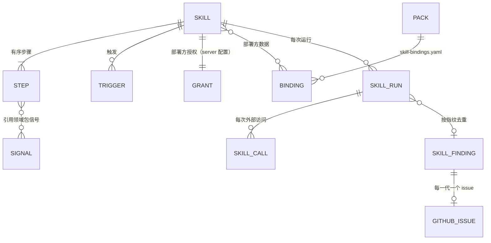

# 0181 可热插拔的技能：清单、能力白名单、预算与热加载

## 背景

SreNautix 现有三条分析链路，各自固定在代码里：

- 事件链路：告警收敛 → 阶段 A → 阶段 B 研判 → 自愈 PR 与事件 issue（ADR 0095、0108）；
- 主动优化：目标 → 领域体检与假设账本 → 业务 issue 与 ops PR（ADR 0146）；
- 覆盖缺口：没有告警目录条目的告警 → ops 仓库 issue（ADR 0171）。

部署方经常需要一类"遇到某种信号就按固定步骤排查、把结果写成 issue"的能力。典型是内存终止（OOMKilled、Pod 被驱逐、工作集持续贴近 limit）：排查步骤在不同工作负载上相同（区分容器 limit 与节点压力、看 Go 的存活堆是否贴着 GOMEMLIMIT、取前后 30 分钟的序列、读上一次退出的日志、在 48 小时里找反例排除反向因果、把可疑路径映射到代码），差别只在工作负载自己的指标、日志事件与代码位置。把它写进阶段 B 会让事件研判的提示词与预算变大，研判只在事件里运行，并且部署方的模型入口就是被排查的服务时研判会被熔断；写进主动优化会让它依赖目标、基线与结论阶梯，主动优化只在业务低谷运行。

用户（2026-11-02）决定：SreNautix 增加通用的、可以热插拔的技能（skill）机制，一个技能是一个目录，带清单与说明，由宿主加载与执行；第一个技能是内存终止根因（`oom-rootcause`），只读排查，在业务仓库自动开 issue，同一根因再次出现时在已有 issue 下评论，不开 PR；部署方特有的内容（指标、日志事件、代码路径提示）留在部署方的领域包里。

约束沿用现有设计：模型与技能都不持有写凭证（不变量 1）；写入只有类型化动作（不变量 2）；业务仓库只有 issue 与评论（不变量 15）；SreNautix 自身的运行影响业务性能就是 SreNautix 的设计问题（第二阶段章程 §4 第 13、14 条）。

## 决定

### 1. 概念



| 概念 | 内容 |
|---|---|
| 技能（skill） | 一个目录：清单 `skill.yaml`、可选的说明 `SKILL.md`、绑定 schema、输出模板、测试。只包含数据与说明，没有可执行内容 |
| 宿主（host） | server 中执行技能的部分（`apps/srenautix/src/skills/`）：加载与校验、触发、调度、按步骤执行、能力与预算检查、去重与投递、审计与指标 |
| 步骤类型（step kind） | 宿主内置、带版本的操作，例如 `metrics.range@v1`、`analyze.suspects@v1`、`issue.publish@v1`。技能只能组合已有的步骤类型，新的步骤类型随 SreNautix 版本发布 |
| 能力（capability） | 步骤类型访问外部系统所需的权限。清单声明需要的能力，部署方在 server 配置里授予，宿主还要具备对应的数据源或凭证；有效能力是三者的交集 |
| 绑定（binding） | 领域包提供给某个技能的部署方数据（指标信号、日志事件、代码路径提示、运维选项），按技能的绑定 schema 校验 |
| 运行（run） | 一次触发或手动请求对应一次运行，记录技能的版本与摘要、触发、输入、每个步骤与每次外部访问、预算用量与终态原因码 |
| 发现（finding） | 运行的输出按指纹去重之后的记录；每一代对应业务仓库的一个 issue |

领域包描述"这个系统是什么"（信号、组件、告警目录、证据卡、runbook、代码路径提示），技能描述"遇到这种情况按什么步骤查"。技能引用领域包的信号与绑定，领域包不引用技能的步骤。

### 2. 技能目录与清单

| 文件（相对技能目录 `<技能名>/`） | 内容 |
|---|---|
| `skill.yaml` | 清单（`contract/schemas/skill.schema.json`） |
| `SKILL.md` | 可选：给人与以后的模型步骤看的说明，宿主不执行它 |
| `binding.schema.json` | 绑定数据的 JSON Schema；`binding.required` 为 true 时必须有 |
| `templates/<名字>.md` | 输出模板（Mustache） |
| `tests/<用例>.yaml` | 测试用例 |

目录中出现约定之外的文件（脚本、二进制、其他扩展名）时不加载。以 ConfigMap 挂载时子目录文件写成 `<子目录>__<文件名>`，加载时还原；kubelet 生成的 `..data`、`..<时间戳>` 不属于技能内容。

`skill.yaml` 的字段：

| 字段 | 内容 |
|---|---|
| `api_version` | `srenautix.io/skill/v1` |
| `name`、`version` | 名字（小写字母、数字与连字符，等于目录名）与语义化版本 |
| `title`、`description`、`maturity` | `zh-CN` 与 `en` 文案；`stable`、`beta`、`draft` |
| `min_srenautix_version`、`contract` | 最低的 SreNautix 版本与兼容的契约范围（`>=2.45.0 <3.0.0`）；不满足时不加载 |
| `params` | 参数与默认值；部署方在 server 配置 `skills.params.<技能名>` 覆盖，只能覆盖声明过的参数，类型必须相同 |
| `inputs` | 手动运行输入的 JSON Schema |
| `binding` | `required`：只在绑定了的工作负载上运行；`schema`：`binding.schema.json` |
| `triggers` | 触发（§4） |
| `debounce` | `settle`：第一次触发之后等多久再运行，期间同一对象的触发并入这次运行；`coalesce`：同一对象两次运行之间的最短间隔 |
| `scope.kinds` | 运行对象的种类（Deployment、StatefulSet、DaemonSet） |
| `capabilities` | 需要的能力与参数（§7.1） |
| `budgets` | `run`：每次运行的时长、指标查询数、日志查询数与行数、Kubernetes 读取数、GitHub 请求数、代码文件数与字节数；`hourly`：每个技能每小时的运行数、新开 issue 数与评论数 |
| `steps` | 有序步骤（§3），最多 40 个 |
| `outputs` | `fingerprint`：参与指纹的值；`issue`：标题、正文与评论模板（中英文）、标签 |

### 3. 步骤

每个步骤有 `id`、`uses`（步骤类型与版本）、`with`（参数）、可选的 `needs`（依赖的步骤）、`when`（条件）与 `optional`。

- **引用**：`with`、`when`、输出指纹与标签中的值是常量或引用。引用是恰好一个键的对象：`{param: 名}`、`{input: 路径}`、`{binding: data.路径}`（或 `binding: id`）、`{step: 步骤 id, field: 点分路径}`，可以出现在任意层级。技能里没有表达式语言；过滤、排序与统计都在步骤类型里。
- **顺序**：步骤按声明的顺序执行；`needs` 只能指向之前声明的步骤，因此没有环。引用的步骤必须是直接或间接依赖的步骤。
- **条件**：`when` 的取值成立（true、非空数组、非空对象、非空字符串、非零数）时执行；否则记为 `skipped`，输出为步骤类型声明的空值，依赖它的步骤照常执行。
- **可选**：`optional: true` 的步骤遇到数据源错误时记为 `failed`、输出为空值，运行继续；能力、作用范围与预算的拒绝总是终止运行。

宿主 v1 的步骤类型（`GET /v1/skill-host` 列出类型、需要的能力与参数）：

| 步骤类型 | 能力 | 输出 |
|---|---|---|
| `kube.read@v1` | `kube.read` | `pod_status`：运行对象的 Pod 状态摘要（容器、重启、最近一次终止、内存 limit；不含环境变量与卷）；`events`：命名空间中这些 Pod 的事件；`pod_logs_previous`：上一次退出的容器日志尾部，经脱敏与截断（ADR 0106） |
| `trigger.occurrences@v1` | `metrics.query_range` | 窗口内的发生（Pod、容器、时刻、原因、时刻的来源）：领域包信号的区间查询，Pod 状态中最近一次终止的时刻（更精确，10 分钟内的同一 Pod 的发生改用它），以及触发带来的发生；标出这个工作负载上以前的运行没有报告过的发生（`new`） |
| `metrics.range@v1` | `metrics.query_range` | `around`：每次发生前后的窗口，每个信号在这个 Pod 上的序列；`history`：整个工作负载的一段历史。查询只引用领域包的信号，按信号备选与标签档案渲染（DESIGN §6.2），选择器由宿主按运行对象生成；没有可用备选的信号没有数据 |
| `logs.events@v1` | `logs.query` | 按绑定声明的日志事件（消息、JSON 字段、可选的数值下限）生成 LogQL，选择器固定为运行对象的命名空间、Pod 与容器；只保留声明的字段，其余内容在解析之后丢弃 |
| `logs.extract@v1` | 无 | 从已经读到的日志文本中按同样的事件声明取出字段 |
| `analyze.memory_kind@v1`、`analyze.suspects@v1`、`analyze.top@v1`、`analyze.profiles@v1` | 无 | 确定性分析：内存终止的分类；嫌疑项的检验、分组与置信度；日志记录的排序与份额；堆画像的文件名与命令（算法见 [docs/skills/oom-rootcause.zh-CN.md](../skills/oom-rootcause.zh-CN.md)） |
| `code.locate@v1` | `code.read` | 在业务仓库默认分支的头上按字面量找出行号，链接固定到这个提交；模式不再出现时记为提示失效 |
| `issue.related@v1` | 无 | 绑定声明的已有 issue 加上本技能在同一对象上开过的 issue |
| `issue.publish@v1` | `issue.write` | 按指纹决定开新 issue、评论或只计数（§7.5） |

`analyze.*`、`logs.extract`、清单与绑定的校验、引用与模板放在 Apache-2.0 的 `packages/packs-sdk`（`skills/`）；访问外部系统的步骤类型由宿主实现。分析算法要经过 SreNautix 的代码审查、测试与发布，技能的热插拔只改变组合方式与数据。v1 的步骤类型不含模型调用。

### 4. 触发

| 种类 | 内容 |
|---|---|
| `metric` | 一个领域包 metrics 信号，加上可选的 `condition`（`gt`、`ge`、`lt`、`le` 与数值或参数）与 `for`（最近这么久的每个点都满足）。宿主每 `interval`（默认 60 秒）在绑定的工作负载（`binding.required`）或作用范围内的命名空间上查询一次，每条满足条件的序列按 Pod 解析到工作负载 |
| `alert` | 标签匹配器（每个标签取值之一）；告警开始触发时，按告警的 namespace 与 statefulset、deployment、daemonset 标签，或 Pod 的拓扑属主解析到工作负载 |
| `kube` | server 的 informer 缓存中 Pod 状态的变化：容器最近一次终止的原因在 `terminated_reasons` 中（每个容器的每次终止一次，只看 15 分钟内的终止），或 Pod 以 `pod_reasons` 中的原因结束（例如 Evicted）。复用集群状态检测器读取的对象（ADR 0105），不另外 watch |
| `manual` | `POST /v1/skills/{name}/runs`：responder 及以上的角色，对象必须在角色绑定的作用域内；可以给出参考时刻 `at`（7 天内），排查过去的时段 |

触发与手动请求都先登记为等待中的运行：同一（集群，技能，对象）最多一个等待中的运行，新的触发并入它。开始时刻取状态库的时钟：触发为 settle 之后，手动运行为立即，并且都不早于同一对象上一次运行开始之后 coalesce。告警风暴期间（DESIGN §7.5）不评估指标触发，也不开始新的运行。

### 5. 绑定与领域包

领域包新增文件 `skill-bindings.yaml`（契约 2.45.0，`pack.schema.json` 的 `SkillBindingsFile`）：

```yaml
bindings:
  - skill: oom-rootcause # 技能名
    id: api-gateway # 绑定 id，进入指纹
    workloads: [{ kind: StatefulSet, namespace: shop, name: api-gateway }]
    data: {} # 按技能的 binding.schema.json 校验
```

- 绑定随领域包加载（启动时），按领域包的分层规则合并（`patch`、`disable skill_bindings/<id>`），内容进入 `pack.lock`。
- 每次加载技能时校验它的全部绑定：data 符合技能的绑定 schema；data 中名为 `signal` 的字符串都是加载的领域包里的信号；（技能，id）唯一；一个工作负载对同一技能最多一个绑定。不满足时这个技能的新版本不加载。
- 清单引用的信号（触发、`trigger.occurrences`、`metrics.range`、`analyze.memory_kind`）必须是 metrics 信号，每个备选都能渲染。

部署方特有的内容都在部署方的领域包里；技能目录里只有通用的步骤、参数与模板。

### 6. 热加载

#### 6.1 来源

| 来源 | 内容 | 信任 |
|---|---|---|
| `builtin` | 镜像内的 `/app/skills`（仓库 `skills/`），随 SreNautix 版本发布 | 镜像签名 |
| `dir` | 挂载的目录：每个技能一个 ConfigMap（chart 的 `skills.userConfigMaps`），整卷挂载，kubelet 原地更新文件 | Git：ConfigMap 由 Argo CD 从部署方的 Git 同步，审阅、同步与回退和部署方的其他配置相同 |

server 配置 `skills.sources` 按顺序列出来源，同名技能后者覆盖前者。只扫描 `skills.enabled` 中的技能。

#### 6.2 加载与重新加载

server 的每个实例每 `skills.reload_interval`（默认 60 秒）扫描一次来源，对内容摘要变化的技能逐个执行：

1. 文件只能是约定的数据文件；按 `skill.schema.json` 校验清单；契约范围与最低版本；
2. 步骤类型与版本是宿主支持的，参数名与必填参数，引用的参数、输入、绑定与步骤都存在，`needs` 只指向之前的步骤；每个步骤需要的能力都在清单的 `capabilities` 中，声明的每个能力都有步骤使用，至少一个 `issue.publish@v1`；
3. 模板能够解析，不含不转义的写法与 partial；
4. 绑定 schema 能够编译，领域包中这个技能的绑定都通过校验，引用的信号存在且能渲染；
5. 摘要：目录内全部文件按路径排序，`<路径>\0<sha256>\n` 的 sha256。

全部通过才替换这个技能，写审计 `skill.loaded`（含上一个摘要）；任何一步失败时保留上一个可用版本，记录原因，写审计 `skill.load_rejected`，状态条显示 `SkillLoadFailed`。目录中删除的技能卸载（`skill.unloaded`），已有的发现与 issue 不受影响。正在执行的运行使用开始时的版本，运行记录保存版本与摘要。触发、运行与投递只在主实例上执行，其余实例加载技能用于接口。

领域包仍然只在启动时加载：绑定随领域包的版本变化，chart 的 `checksum/packs` 注解让领域包的变化滚动 server（ADR 0143）。技能本身的变化不需要重启，也不需要重新构建镜像。

#### 6.3 启用、授权、暂停与回退

- **启用与授权**（server 配置 `skills.enabled`、`skills.grants.<技能名>`，chart 同名 values）：默认都为空，加载的技能都不运行。有效能力是清单声明、配置授予与宿主具备（指标数据源、日志数据源、Kubernetes 只读、GitHub App 与仓库角色）的交集，参数取更严的一边（对象取交集、行数取较小者、仓库角色必须相同）。清单要求的能力有任何一项没有得到时，技能处于 `missing_grant`，不接受运行，状态条显示 `SkillCapabilityMissing`。修改配置需要重启 server。
- **作用范围**：清单的 `scope.kinds` 与配置 `skills.scope.<技能名>`（`namespaces`、`kinds`）的交集。
- **暂停与恢复**（`PATCH /v1/skills/{name}`，admin）：立即生效，保存在 `server.skill_overrides`，写审计 `skill.paused`、`skill.resumed`；暂停的技能不接受触发，手动运行返回 409，已经等待中的运行以 `unavailable` 结束。
- **回退**：在 Git 中回退技能的 ConfigMap，下一轮重新加载生效；紧急时先暂停。

### 7. 执行与约束

#### 7.1 能力白名单

运行只能通过宿主为这次运行创建的 `SkillContext` 访问外部系统；步骤得到的是 `SkillContext` 包装过的访问，拿不到 GitHub App、数据源或 Kubernetes 客户端本身。每次访问在发出请求之前依次检查：

1. 能力在有效能力中（`kube.read` 还要检查读取的对象在授予的对象中）；
2. 请求在运行对象之内：Kubernetes 读取只限运行对象的命名空间与名字符合控制器命名规则的 Pod；指标与日志的选择器由宿主按运行对象生成；代码读取与 issue 写入只限授予的仓库角色，且经 GitHub App 的仓库角色白名单（ADR 0146 §6.4）；
3. 预算有余量（§7.2）；
4. 技能共用的后端并发名额（`skills.concurrency`：指标、日志、Kubernetes、GitHub）。

任何一项不满足时请求不发出，记一条 `denied` 或 `budget` 的访问记录，运行以 `capability_denied` 或 `budget_exhausted` 结束；被拒绝的访问另写审计 `skill.call_denied`。

| 能力 | 宿主的实现 | 参数 |
|---|---|---|
| `metrics.query_range` | 阶段 A 的证据数据源（`EvidenceSource`），只执行领域包信号的渲染结果 | 无 |
| `logs.query` | 同一数据源的 Loki 适配器 | `max_lines` |
| `kube.read` | server 的集群只读权限（`clusterRead`），与阶段 B 的只读检查相同的摘要、脱敏与截断 | `objects`：`pod_status`、`events`、`pod_logs_previous` |
| `code.read` | GitHub App 的业务仓库角色，目录树与文件内容缓存（`optimize/code/tree.ts`） | `repo_role` |
| `issue.write` | GitHub App 的仓库角色：创建 issue、评论、读取 issue | `repo_role`：`business` 或 `ops` |

能力表里没有写入集群、写入配置、写入 Git 内容、开 PR、执行命令或读取 Secret 的能力；增加这类能力需要新的 ADR 与不变量测试。

#### 7.2 预算与限速

- **每次运行**：清单的 `budgets.run` 与 `skills.limits` 取较小者。超出时运行以 `budget_exhausted` 结束，结果不投递；超过时长时同样。
- **每小时**：每个技能的运行数、新开 issue 数与评论数（`budgets.hourly`，最近 1 小时）。运行达到上限时推迟 10 分钟；issue 与评论达到上限时保持等待，10 分钟后再试。
- **同一仓库**：新开 issue 的合计按事件 issue、覆盖 issue 与技能 issue 计算（`github/issues.ts` 的 `openedLastHour`），上限为 `skills.max_issues_per_hour`，不填时取 `issues.max_per_hour`。

#### 7.3 数据与脱敏

- 日志只按绑定声明的字段进入运行，其余内容在解析之后丢弃；请求体、响应体与用户数据不在任何声明的字段里。字段有类型（字节数、整数、布尔、时长、路径、请求 id、组织 id），组织 id 只保留绑定声明的前缀长度。
- Pod 状态只取摘要，不含环境变量与卷；上一次退出的日志尾部经脱敏与截断，只经 `logs.extract@v1` 取出声明的字段。
- 模板只能读取步骤的输出、参数、运行对象与发现；渲染时每个值都处理成在普通文本、代码片段与表格单元格中都安全的文字（去掉反引号、换行与控制字符，`|` 写成 `\|`，打断 @ 提及、`#` 编号引用、Markdown 链接与 HTML 标签）。不转义的写法与 partial 在加载时被拒绝（不变量 9）。
- 堆画像等文件只以文件名出现：路径按绑定声明的模式校验，issue 中给出取出与分析的命令，SreNautix 不执行这些命令，也没有执行它们需要的能力。

#### 7.4 审计、运行状态与原因码

治理审计链（DESIGN §16.3）记录：`skill.loaded`、`skill.load_rejected`、`skill.unloaded`、`skill.paused`、`skill.resumed`、`skill.run_started`、`skill.run_finished`（版本、摘要、原因码、预算用量、发现、被拒绝的访问数）、`skill.call_denied`、`skill.finding_recorded`、`github.skill_issue_opened`、`github.skill_issue_comment`、`github.skill_issue_failed`、`github.skill_issue_closed`。每次外部访问写一行 `server.skill_run_calls`（契约 `SkillCall`：能力、操作、查询原文或对象、结果大小、是否截断、耗时、结果）。

运行状态：`pending`、`running`、`succeeded`、`failed`。终态原因码登记在原因码表的 `skill_run` 分组（阶段 `skill`，ADR 0172）：`published`、`commented`、`counted`、`no_occurrence`、`budget_exhausted`、`capability_denied`、`datasource_error`、`binding_missing`、`unavailable`、`interrupted`、`step_failed`。主实例开始工作时，上一个主实例留下的 `running` 运行记为 `interrupted`。

#### 7.5 去重、再次出现与投递

- **指纹**：`sha256(技能名, 集群, outputs.fingerprint 的值)`（JCS 规范化，取前 32 个十六进制字符）。内存终止根因为（绑定 id、主因的第一个代码路径、主因的机制 id、请求体字节份额最高的组织前缀或 `*`）。
- **发现**：`server.skill_findings` 以（集群，技能，指纹，代）为键，记录仓库、issue、状态、出现次数、上一代 issue 的编号与冷却期限。每次运行在一个事务里锁住这个指纹最新的一代，先读 issue 的状态（关闭时记下 completed 或 not planned），再决定：

| 最新一代的状态 | 这次运行 |
|---|---|
| 没有 | 开第 1 代 issue |
| 等待开出、结果未知或打开 | 在这一代的 issue 下评论（issue 还没有开出时等它开出） |
| 以 completed 关闭（修复后再次出现） | 开下一代 issue，正文开头写"修复后再次出现"并引用上一代 |
| 以 not planned 关闭 | 关闭之后 30 天内只计数，不开 issue、不评论；30 天之后开下一代 |
| 开出失败重试用尽 | 开下一代 |

- **只投递新的发生**：每次运行把它的发生记进 `server.skill_occurrences`；同一工作负载上以后的运行只在有新的发生时投递，否则以 `no_occurrence` 结束。
- **开出**：正文第一行是标记 `<!-- srenautix:skill=<技能名>/<指纹>/<代> -->`。创建请求的结果未知（超时、连接中断、5xx）时状态记为 `unknown`，下一次先按标记在仓库中找回，找不到才再创建；结果明确的失败按退避重试，最多 8 次（与 ADR 0171 相同）。打开的 issue 每小时核对一次是否已被关闭。
- **标签与标题**：标签为绑定声明的标签加 `srenautix` 与 `srenautix:<技能名>`；标题前缀取 `skills.title_prefix`，不填时取 `notify.prefix`。

### 8. 可观测性与接口

- **指标**：`srenautix_skill_loaded{skill,version,source}`、`srenautix_skill_load_failures_total{skill}`、`srenautix_skill_runs_total{skill,trigger,outcome}`、`srenautix_skill_run_seconds{skill}`、`srenautix_skill_calls_total{skill,capability,outcome}`（`ok`、`denied`、`budget`、`error`）、`srenautix_skill_budget_exhausted_total{skill,budget}`、`srenautix_skill_issues_total{skill,repo,outcome}`。
- **状态条**：`SkillLoadFailed`（最新内容没有通过校验，旧版本继续运行；或 `skills.enabled` 中的技能不在任何来源中）、`SkillCapabilityMissing`（清单要求的能力没有授予或宿主不具备）。
- **接口**（`contract/openapi.yaml` 的 `skills` 标签）：`GET /v1/skill-host`、`GET /v1/skills`、`GET|PATCH /v1/skills/{name}`、`GET|POST /v1/skills/{name}/runs`、`GET /v1/skill-runs/{run_id}`（运行、每次外部访问与发现）。授权写在每个操作的 `x-srenautix-roles` 与 `x-srenautix-external`（不变量 6）。

### 9. 契约变更（2.45.0）

- `contract/schemas/skill.schema.json`：清单、触发、步骤、引用、能力、预算、输出；
- `contract/schemas/skill-run.schema.json`：运行、触发记录、步骤记录、用量、外部访问、发现、技能摘要、宿主、请求体；
- `pack.schema.json`：`SkillBindingsFile`、`SkillBinding`，用户层 `disable` 增加 `skill_bindings/<id>`；
- `condition.schema.json`：`SkillLoadFailed`、`SkillCapabilityMissing`；
- `reason-codes.schema.json` 的阶段增加 `skill`，原因码表增加 `skill_run` 分组；
- `openapi.yaml`：§8 的接口。

### 10. 新增不变量

| # | 不变量 | 测试 |
|---|---|---|
| 17 | 技能只能经授予的能力访问外部系统 | `test/unit/skill-context.test.ts`：没有授予的能力、运行对象之外的命名空间与 Pod、超出预算的访问都不调用后端，并记下被拒绝的访问；`test/integration/skills-host.test.ts`：没有授予 `pod_logs_previous` 时这次读取没有到达 Kubernetes，运行以 `capability_denied` 结束并写审计；没有授予清单要求的能力时技能为 `missing_grant`，不接受运行 |
| 18 | 技能不能引入可执行内容，也不能扩大写入范围 | `packages/packs-sdk/test/skills-manifest.test.ts`：未知步骤类型、未声明的能力、未知能力、不转义的模板写法、目录中的脚本都不加载；契约的能力只有只读访问与 `issue.write`，写入只有 `issue.publish@v1` |

### 11. 第一个技能：内存终止根因

`skills/oom-rootcause`：触发为容器 OOM 重启（`workload/container_oom_restarts`）、工作集持续超过 limit 的 85%、informer 中容器以 OOMKilled 终止、Pod 被驱逐，以及手动运行；步骤为分类、前后 30 分钟的序列、48 小时的历史、日志事件与上一次退出的日志、嫌疑项的检验与反例、大请求与组织份额、堆画像、代码定位、相关 issue 与投递。只用确定性步骤。清单、绑定、算法、模板与测试见 [docs/skills/oom-rootcause.zh-CN.md](../skills/oom-rootcause.zh-CN.md)。内置领域包 `go-runtime` 提供 Go 运行时的信号，`workload` 包增加 `container_oom_restarts`、`container_memory_rss`、`container_memory_limit`、`container_cpu_cores`、`pod_node_memory_available`。

### 12. 不在范围内

- 写入类能力：修改资源 limit、GOMEMLIMIT、运行时配置，重启或驱逐 Pod，开 PR。需要时另写 ADR，并经类型化动作与 gateway。
- 技能中的脚本、WASM、容器镜像与自带的 MCP 服务器；模型调用的步骤类型。
- OCI 制品作为技能来源；定时触发。
- 聊天渠道里的技能命令（Telegram 的更新接收在正式切换之前由旧系统持有，ADR 0146 已决定事项第 5 条）。
- 多集群：技能只在中心所在的集群上运行（`kube` 触发与 Kubernetes 只读都来自 server 自己的 informer 与只读权限）。
- 技能之间的调用与组合。

## 考虑过的方案

- **作为主动优化的一个领域**（ADR 0146）：目标、基线、结论阶梯与业务低谷的时段都不适合由 OOM 触发、需要在几分钟内给出结果的排查；领域体检不提供"同一根因再次出现时评论"的语义。
- **作为阶段 B 研判里的一个步骤**：只能在事件里运行，增加事件研判的提示词与预算；模型路由经过被排查的服务时研判被熔断，排查随之消失。
- **把步骤写进领域包**：领域包只在启动时加载并进入每次研判的 `pack.lock`，步骤的修改会滚动 server 并改变事件研判的输入；领域包的信任模型只覆盖数据。
- **只用 OCI 制品作为来源**：每次修改都要构建、签名、推送并改 digest，单集群的部署方多出一条发布流程；Git → ConfigMap 与部署方的其他配置同样经审阅、同步与回退。
- **绑定放在技能 ConfigMap 旁边**：改绑定不需要重启，但同一份领域数据分在领域包与技能两处，绑定引用的信号要跨两套加载流程校验。
- **允许技能携带脚本或 WASM**：执行内容绕过代码审查与发布，资源占用与外部访问难以由宿主约束，与不变量 1、2 冲突。
- **在技能里使用表达式语言**：引用加上步骤类型里的确定性算法已经覆盖需要；表达式会让清单的静态校验（引用的步骤、参数与能力）无法完整进行。

## 结果

- 迁移：新轨道 `skills`，建 `server.skill_overrides`、`server.skill_runs`、`server.skill_run_calls`、`server.skill_findings`、`server.skill_finding_comments`、`server.skill_occurrences`、`server.skill_cursors`，只增不删。
- 配置：server 配置新增 `skills`（`sources`、`builtin_dir`、`reload_interval`、`interval`、`enabled`、`grants`、`scope`、`params`、`limits`、`concurrency`、`max_issues_per_hour`、`title_prefix`，`apps/srenautix/src/skills/config.ts`）。代码定位读取的业务仓库沿用 `optimization.repositories.business`（主动优化关闭时也可以配置），issue 写入的 `ops` 角色仓库为 `issues.repo`。
- chart：`skills.userConfigMaps`（整卷挂载到 server 的 `/etc/srenautix/skills/<名字>/<名字>`）、`skills.enabled`、`skills.grants`、`skills.scope`、`skills.params`、`skills.limits`、`skills.maxIssuesPerHour`、`skills.titlePrefix`。技能的 ConfigMap 变化不滚动 server。
- 镜像：`/app/skills`。
- 代码：`packages/packs-sdk/src/skills/`（清单与绑定、引用、模板、`analyze.*`、`logs.extract`）；`apps/srenautix/src/skills/`（加载与重新加载、触发、调度、`SkillContext`、步骤、去重与投递、接口、指标）；`skills/oom-rootcause`；内置领域包 `go-runtime` 与 `workload` 的新信号；控制台状态条的两种条件。
- 测试：见 §10 与 [docs/skills/oom-rootcause.zh-CN.md](../skills/oom-rootcause.zh-CN.md) §7；chart 的 `tests/skills_test.yaml`。

## 已决定的事项（用户，2026-11-02）

1. **技能的来源**：镜像内置加 Git → ConfigMap 目录，每 60 秒重新加载。
2. **部署方绑定的位置**：部署方领域包的 `skill-bindings.yaml`，复用领域包的分层、`pack.lock` 与测试；改绑定随领域包滚动 server。
3. **内存终止根因只用确定性步骤**：机制段落由绑定声明的机制文字与代码位置组成，标为"推断，领域包声明的机制"。部署方的模型入口经过被排查的服务时，内存终止期间模型调用正好被熔断，确定性步骤不受影响。
4. **关闭之后再次出现**：以 completed 关闭的开新 issue 并引用旧 issue；以 not planned 关闭的只计数，30 天冷却之后再开（§7.5）。
