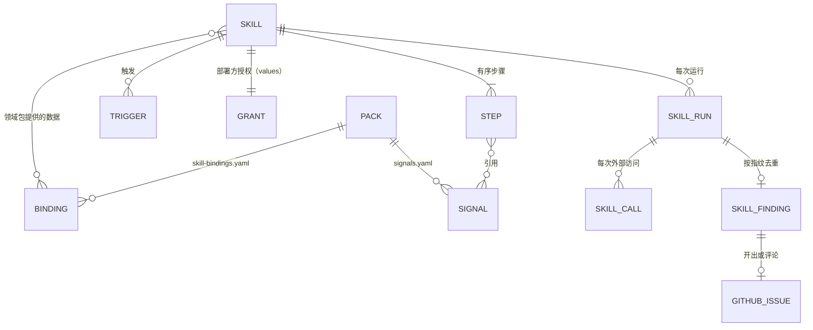

# 0181 可热插拔的技能：清单、能力白名单、预算与热加载

## 背景

SreNautix 现有三条分析链路，各自固定在代码里：

- 事件链路：告警收敛 → 阶段 A → 阶段 B 研判 → 自愈 PR 与事件 issue（ADR 0095、0108）；
- 主动优化：目标 → 领域体检与假设账本 → 业务 issue 与 ops PR（ADR 0146）；
- 覆盖缺口：没有告警目录条目的告警 → ops 仓库 issue（ADR 0171）。

部署方经常需要一类"遇到某种信号就按固定步骤排查、把结果写成 issue"的能力。典型是内存终止（OOMKilled、节点内存压力驱逐）：排查步骤在不同工作负载上相同（区分容器 limit 与节点压力、看 Go 的存活堆是否贴着 GOMEMLIMIT、取前后 30 分钟的序列、读上一次退出的日志、在 48 小时里找反例排除反向因果、把可疑路径映射到代码），差别只在工作负载自己的指标名、日志事件与代码位置。把它写进阶段 B 会让事件研判的提示词与预算变大，并且研判只在事件里运行；写进主动优化会让它依赖目标、基线与结论阶梯，并且主动优化只在业务低谷运行。

用户（2026-11-02）决定：

- SreNautix 增加通用的、可以热插拔的技能（skill）机制，思路与 Claude Code 的 skills 相同：一个技能是一个目录，带清单与说明，由宿主按需加载；
- 第一个技能是内存终止根因（`oom-rootcause`）：只读排查，在业务仓库自动开 issue，同一根因再次出现时在已有 issue 下评论，不开 PR（"方案 1"）；
- 部署方特有的内容（指标名、日志事件、代码路径提示）留在部署方的领域包里。

约束沿用现有设计：模型与技能都不持有写凭证（不变量 1）；写入只有类型化动作（不变量 2）；业务仓库只有 issue 与评论（不变量 15）；主动分析的查询受上限与负载保护约束（不变量 16）；SreNautix 自身的运行影响业务性能就是 SreNautix 的设计问题（第二阶段章程 §4 第 13、14 条）。

## 决定

### 1. 概念



| 概念 | 内容 |
|---|---|
| 技能（skill） | 一个目录：清单 `skill.yaml`、可选的说明 `SKILL.md`、输出模板、绑定数据的 schema、测试。只包含数据与说明，不包含可执行代码 |
| 宿主（host） | server 中执行技能的部分：加载与校验、触发、按步骤执行、能力与预算检查、去重与投递、审计与指标 |
| 步骤类型（step kind） | 宿主内置、带版本的操作，例如 `metrics.range@v1`、`analyze.suspects@v1`、`issue.publish@v1`。技能只能组合已有的步骤类型；新的步骤类型随 SreNautix 版本发布 |
| 能力（capability） | 步骤类型访问外部系统所需的权限，例如 `metrics.query_range`、`kube.read`、`code.read`、`issue.write`。清单声明需要的能力，部署方在 values 里授予；有效能力是两者的交集 |
| 绑定（binding） | 领域包提供给某个技能的数据，按清单的绑定 schema 校验。技能描述步骤，绑定提供部署方的指标、日志事件、代码路径提示与运维选项 |
| 运行（run） | 一次触发或手动请求对应一次运行，记录技能的版本与摘要、触发、输入、每个步骤与每次外部访问、预算用量、结果 |
| 发现（finding） | 运行的输出按指纹去重后的记录；一个发现对应业务仓库的一个 issue |

技能与领域包的分工：领域包描述"这个系统是什么"（信号、组件、告警目录、证据卡、runbook、代码路径提示），技能描述"遇到这种情况按什么步骤查"。技能引用领域包的信号与绑定，领域包不引用技能的步骤。

### 2. 技能目录与清单

| 文件（相对技能目录 `<技能名>/`） | 内容 |
|---|---|
| `skill.yaml` | 清单（`contract/schemas/skill.schema.json`） |
| `SKILL.md` | 可选：llm 步骤的说明，进入提示词的低信任槽位 |
| `binding.schema.json` | 可选：绑定数据的 JSON Schema（可移植子集） |
| `templates/<输出>.<语言>.md` | 输出模板（Mustache） |
| `tests/<用例>.yaml` | 测试：夹具与期望输出 |

清单与说明分成两个文件：清单由宿主按 JSON Schema 校验，说明只在 llm 步骤中作为低信任文本进入提示词，不参与校验与执行。

`skill.yaml` 的字段：

| 字段 | 内容 |
|---|---|
| `api_version` | `srenautix.io/skill/v1` |
| `name`、`version` | 名字（小写字母、数字与连字符）与语义化版本 |
| `title`、`description` | `zh-CN` 与 `en` 文案 |
| `maturity` | `stable`、`beta`、`draft`，含义与领域包相同（DESIGN §6.3） |
| `min_srenautix_version`、`contract` | 最低的 SreNautix 版本与兼容的契约范围（例如 `>=2.45.0 <3.0.0`） |
| `params` | 参数与默认值（阈值、窗口）；部署方在 values 的 `skills.params.<技能名>` 覆盖，按清单给出的类型校验 |
| `inputs` | 运行输入的 JSON Schema；触发产生的输入与手动运行的输入都按它校验 |
| `binding` | `required`（没有绑定时不运行）与 `schema`（`binding.schema.json`） |
| `triggers` | 触发定义（§4） |
| `debounce` | `settle`：第一次触发之后等待多久再运行，收集同一对象上的其他发生；`coalesce`：运行结束之后多久内的同一对象的新触发并入已有发现，不另起运行 |
| `scope` | 默认作用范围：组件类型、命名空间；部署方在 values 收窄 |
| `capabilities` | 需要的能力与它们的参数（§7.1） |
| `budgets` | `run`：每次运行的时长、各后端的查询数、日志行数、Kubernetes 读取数、GitHub 请求数、代码文件数与字节数、token；`hourly`：每小时的运行数、新开 issue 数、评论数 |
| `steps` | 有序步骤（§3） |
| `outputs` | `fingerprint`（参与指纹的字段，§7.6）与各输出的模板、标签、标题 |

### 3. 步骤

每个步骤有 `id`、`uses`（步骤类型与版本）、`with`（参数）、可选的 `when`（CEL 条件）与 `needs`（依赖的步骤）。宿主按依赖关系执行，没有依赖关系的步骤并发执行，并发数受预算与后端信号量约束。步骤的输出按步骤类型的输出 schema 校验之后才进入后续步骤；后续步骤与模板只能读取这些输出、输入、参数与绑定。`when` 为假的步骤记为 `skipped`，输出为步骤类型声明的空值（空列表、null），依赖它的步骤照常执行。

`with` 中的值可以是常量，也可以是 CEL 表达式（`${{ }}` 包裹），在 packages/core 已有的 CEL 环境与序列函数库上求值，变量为 `inputs`、`params`、`binding`、`steps.<id>.output`。CEL 只做取值、过滤与比较，没有任何外部访问。

内置步骤类型（v1）：

| 步骤类型 | 需要的能力 | 输出 |
|---|---|---|
| `trigger.occurrences@v1` | `metrics.query_range` | 本次运行涉及的发生：Pod、容器、时刻、触发；手动运行时按触发的信号在 `history` 窗口内查找 |
| `metrics.instant@v1`、`metrics.range@v1` | `metrics.query`、`metrics.query_range` | 序列表：每个信号、每个 Pod 的时间点与取值。查询只引用领域包的信号（`<包>/<信号>`），按信号备选与标签档案渲染（DESIGN §6.2），`$selector` 由宿主按运行的对象生成 |
| `logs.events@v1` | `logs.query` | 结构化日志记录：宿主按绑定声明的事件（容器、消息、格式、字段）生成 LogQL，用 JSON 或 logfmt 的解析库取出声明的字段，其余内容丢弃 |
| `kube.read@v1` | `kube.read` | Pod 状态摘要（`kube_pod_status`）、事件、上一次退出的容器日志尾部；日志尾部只经 `logs.extract@v1` 进入后续步骤 |
| `logs.extract@v1` | 无 | 从已经读到的日志文本中按同样的事件声明取出字段 |
| `analyze.memory_kind@v1`、`analyze.suspects@v1`、`analyze.top@v1` | 无 | 确定性分析：内存终止的分类、嫌疑项的检验与排序、记录的排序与截断（算法见 docs/skills/oom-rootcause.zh-CN.md） |
| `compute@v1` | 无 | 一组 CEL 表达式的结果 |
| `code.locate@v1` | `code.read` | 代码位置：按绑定的路径与模式（RE2）在业务仓库的提交上找出行号，生成固定到提交的链接；模式不再命中时记为提示失效 |
| `issue.related@v1` | `issue.write`（读取 issue） | 相关 issue：本技能在同一对象上开过的其他 issue，加上绑定声明的已有 issue |
| `llm.draft@v1` | `llm.generate` | 模型写的段落，按输出 schema 校验，引用的证据行由代码核对（DESIGN §7.2），在 issue 中标注【模型】 |
| `issue.publish@v1` | `issue.write` | 按指纹去重、渲染模板、开 issue 或评论（§7.6） |

`analyze.*` 是纯函数，放在 Apache-2.0 的 `packages/skills-sdk`，与夹具测试一起发布；访问外部系统的步骤类型由宿主实现。技能不能提供脚本、WASM 或其他可执行内容：分析算法要经过 SreNautix 的代码审查、测试与发布，技能的热插拔只改变组合方式与数据。

`llm.draft@v1` 由 worker 执行：server 把步骤的输入（其他步骤的输出与 `SKILL.md`）作为任务放进现有的研判队列，用途为 `skill`，从模型每日预算中划出技能的份额（worker 配置 `budget.purposes.skill.daily_tokens`，与主动优化的 `budget.purposes.optimization.daily_tokens` 同样的写法；0 或没有时不执行 llm 步骤）；路由的故障域与熔断照常生效（ADR 0080、DESIGN §8.1），出境模块按 `llm.egress.categories` 删除不允许的类别（ADR 0146 §3.6）。模型不可用、被熔断或超出预算时，这个步骤的结果为 `skipped`，后续步骤照常执行，模板中模型的段落写明没有生成的原因。

### 4. 触发

| 种类 | 内容 |
|---|---|
| `metric` | 一个领域包信号，加上可选的 `condition`（CEL，变量 `value`、`params`）与 `for`（持续时长）。宿主每 `interval`（默认 60 秒）执行一次，每条满足条件的序列按标签（namespace、pod、container）解析出对象 |
| `alert` | 告警标签匹配器（与 `notify.business_impact_alerts` 的写法相同，ADR 0166），告警开始触发时产生一次 |
| `kube` | informer 或 reader 上报的对象状态变化：容器以某个原因终止（`last_terminated.reason`）、Pod 被驱逐（`status.reason`）、节点条件（例如 `MemoryPressure=True`）。复用集群状态检测器的对象状态（ADR 0105），不另外 watch |
| `schedule` | cron，按 server 的时区 UTC |
| `manual` | `POST /v1/skills/{name}/runs`（控制台与 API），输入按清单的 `inputs` 校验，角色至少为 responder，作用域按角色绑定判断 |

对象解析：Pod 经拓扑的 `owned_by` 解析到工作负载，运行的对象是工作负载。对象不在作用范围内（清单的 `scope` 与 values 的 `skills.scope` 的交集）时不产生运行。`debounce.settle` 内同一对象的触发合并为一次运行；`debounce.coalesce` 内的新触发作为已有发现的发生追加，按 §7.6 评论。

### 5. 绑定与领域包

领域包新增文件 `skill-bindings.yaml`（契约 2.45.0）：

```yaml
bindings:
  - skill: oom-rootcause        # 技能名
    id: api-gateway              # 绑定 id，进入指纹
    applies_to:                  # 组件类型，或具体的工作负载
      workloads: [{kind: StatefulSet, namespace: shop, name: api-gateway}]
    data: { ... }                # 按技能的 binding.schema.json 校验
```

- 绑定按领域包的分层规则合并（`extend`、`patch`、`disable`，DESIGN §6.3），内容进入 `pack.lock`。
- 绑定引用的信号必须在加载的领域包中存在，宿主在加载时检查。
- 技能新版本要求的绑定字段在已加载的绑定里没有时，这个技能的新版本被拒绝加载，旧版本继续运行，状态条显示原因。
- 一个对象匹配多个绑定时取最具体的一条（具体工作负载优先于组件类型），同样具体时加载失败。

部署方特有的内容都在部署方的领域包里：指标名与信号、日志事件与字段、代码路径与模式、运维选项的文案、已有 issue 的编号。技能目录里只有通用的步骤、算法参数与模板。

### 6. 热加载

#### 6.1 来源

| 来源 | 内容 | 信任 |
|---|---|---|
| `builtin` | 镜像内的 `/app/skills`（仓库 `skills/`），随 SreNautix 版本发布 | 镜像签名 |
| `dir` | 挂载的目录：每个技能一个 ConfigMap，整卷挂载（不用 `subPath`，kubelet 原地更新文件），子目录文件以 `<子目录>__<文件名>` 为键，与用户领域包的约定相同 | Git：ConfigMap 由 Argo CD 从 Git 同步，chart 把 `skills.revision`（部署方填写的提交或内容摘要）写进 ConfigMap 的 `.revision` 键，加载时记入审计 |
| `oci` | `skills.oci.sources_file`（同样在挂载目录里）列出的制品，固定到 digest，先用 cosign 校验签名再用 oras 拉取，与 OCI 领域包相同（DESIGN §6.3） | cosign 签名与 digest |

三种来源的比较与选择见 §待决定的事项第 1 条。同名技能出现在多个来源时，按 `skills.sources` 的顺序后者覆盖前者，被覆盖的版本在控制台与审计中可见；覆盖不改变授权，授权只来自 values（§6.4）。

#### 6.2 加载与重新加载

server 的每个实例每 `skills.reload_interval`（默认 60 秒）扫描一次来源，对内容摘要变化的技能逐个执行：

1. 读取目录，按 `skill.schema.json` 校验清单，按 `api_version` 与 `contract` 判断兼容；
2. 检查每个步骤类型与版本是宿主支持的，`needs` 没有环，CEL 表达式能够编译，模板能够解析且只引用已声明的输出字段；
3. 检查每个步骤类型需要的能力都在清单的 `capabilities` 里，预算不超过宿主的上限（`skills.limits`）；
4. 绑定 schema 能够编译，加载的领域包中这个技能的绑定都能通过校验，引用的信号存在；
5. 计算摘要：目录内全部文件按路径排序后 JCS 序列化取 sha256；配置了 `skills.lock_file` 时摘要必须与锁文件一致；
6. 全部通过后原子替换这个技能；任何一步失败时保留上一个可用版本，状态条显示 `SkillLoadFailed`，写审计 `skill.load_rejected`。

正在执行的运行使用开始时的版本，运行记录保存版本与摘要。目录中删除的技能卸载：不再接受触发，已有的发现与 issue 不受影响。只有主实例执行运行，其余实例加载技能用于接口与控制台。

领域包仍然只在启动时加载：绑定随领域包的版本变化，chart 的 `checksum/packs` 注解让领域包的变化滚动 server（ADR 0143）。技能本身的变化不需要重启，也不需要重新构建镜像。

#### 6.3 版本与兼容

- 清单的 `api_version` 不兼容地变化时升为 `v2`，宿主同时支持当前与上一个版本（DESIGN §19 的 N-1）。
- 步骤类型各自带版本（`@v1`）。宿主在 `GET /v1/skills/host` 列出支持的步骤类型、版本与能力；清单引用宿主不支持的版本时不加载。
- 技能的 `contract` 范围不包含宿主的契约版本时不加载。

#### 6.4 启用、授权、暂停与回滚

- **启用与授权**（values，server 配置 `skills`）：`skills.enabled` 列出允许运行的技能；`skills.grants.<技能名>` 给出授予的能力与能力参数（例如 `issue.write` 的目标仓库角色、`kube.read` 的对象种类）。默认两者都为空，加载的技能都不运行。清单要求、而 values 没有授予的能力，使技能处于 `disabled_capability` 状态并在状态条说明缺少哪一项。修改 values 需要重启 server。
- **暂停与恢复**（接口，`PATCH /v1/skills/{name}`，admin）：暂停的技能不接受触发，手动运行返回 409；状态保存在 `server.skill_overrides`，写审计 `skill.paused` 与 `skill.resumed`，不需要重启。
- **回滚**：`dir` 来源在 Git 中回退提交，下一轮重新加载生效；`oci` 来源把 digest 改回旧值；紧急情况下先暂停。

### 7. 执行与约束

#### 7.1 能力白名单

运行只能通过宿主为这次运行创建的 `SkillContext` 访问外部系统；步骤类型的实现拿不到数据源、Kubernetes 客户端、GitHub 客户端或模型路由的引用。`SkillContext` 的每个方法在发出请求之前依次检查：

1. 能力在有效能力集合中（清单声明 ∩ values 授予）；
2. 请求在运行的作用范围内：Kubernetes 读取只限运行对象所在的命名空间与它的 Pod；日志查询由宿主按绑定的事件声明生成，选择器固定为运行对象的命名空间与 Pod；代码读取只限授予的仓库角色；issue 写入只限授予的仓库角色，且只有创建 issue、评论与读取 issue；
3. 预算有余量（§7.2）；
4. 后端的信号量与负载保护（ADR 0146 §6.1、§6.2）。

任何一项不满足时请求不发出，记一条被拒绝的调用（`skill.call_denied`），步骤失败，运行以对应的原因码结束。

| 能力 | 宿主的实现 | 参数 |
|---|---|---|
| `metrics.query`、`metrics.query_range` | 阶段 A 的证据数据源（`EvidenceSource`），只执行领域包信号的渲染结果 | 无 |
| `logs.query` | 同一数据源的 Loki 适配器 | `max_lines` |
| `kube.read` | 阶段 B 的只读工具（`KubeTools`，ADR 0106），结果经脱敏与截断 | `objects`：`pod_status`、`events`、`pod_logs_previous` |
| `code.read` | GitHub App 的业务仓库角色（ADR 0146 §6.4），目录树与文件内容缓存（`optimize/code/tree.ts`） | `repo_role` |
| `issue.write` | GitHub App 的仓库角色白名单（`github/app.ts`） | `repo_role`：`business` 或 `ops` |
| `llm.generate` | worker 的研判队列与唯一出口（DESIGN §8.4） | `egress_categories` |

能力表里没有任何写入集群、写入配置、写入 Git 内容、开 PR、执行命令或读取 Secret 的能力；增加这类能力需要新的 ADR 与不变量测试。

#### 7.2 预算与限速

- **每次运行**：清单的 `budgets.run` 与 values 的 `skills.limits` 中较小者。超出时步骤失败，运行以 `skill/budget_exhausted` 结束，已经得到的结果保留在运行记录里，不投递。
- **每小时**：每个技能的运行数、新开 issue 数、评论数（`budgets.hourly`，滑动 1 小时窗口）。达到上限时触发进入等待，issue 保持 `pending`，10 分钟后再试。
- **共享上限**：同一仓库最近 1 小时新开的 issue 数按事件 issue、覆盖 issue 与技能 issue 的合计判断（`github/issues.ts` 的 `openedLastHour` 加上技能的发现），与 `issues.max_per_hour` 比较。
- **后端信号量**：与事件研判、主动分析共用 ADR 0146 §6.1 的信号量，事件研判优先，技能与主动分析其次；技能的查询同样经负载保护卡。
- **模型**：worker 的 `budget.purposes.skill.daily_tokens`，从模型每日预算中划出；每次运行另受 `budgets.run.tokens` 约束。

#### 7.3 数据与脱敏

- 日志只按绑定声明的字段进入运行，其余内容在解析之后立即丢弃；请求体、响应体与用户数据不在任何声明的字段里。字段有类型（字节数、整数、时长、路径、请求 id、组织 id），组织 id 只保留绑定声明的前缀长度。
- Kubernetes 日志尾部与 Pod 状态经 `redactText` 脱敏（ADR 0106），日志尾部只经 `logs.extract@v1` 取出声明的字段。
- 模板只能读取步骤的输出；渲染时每个值都做 Markdown 转义，模板语法里的不转义写法在加载时被拒绝（不变量 9）。
- 堆画像等文件只以文件名出现：文件名按绑定声明的模式校验，issue 中给出取出与分析的命令，SreNautix 不执行这些命令，也没有执行它们需要的能力。

#### 7.4 审计

治理审计链（DESIGN §16.3）记录：`skill.loaded`、`skill.load_rejected`、`skill.unloaded`、`skill.paused`、`skill.resumed`、`skill.run_started`、`skill.run_finished`（技能、版本、摘要、触发、对象、预算用量、结果、原因码）、`skill.call_denied`、`github.skill_issue_opened`、`github.skill_issue_comment`、`github.skill_issue_failed`、`github.skill_issue_closed`。每次外部访问写一行 `server.skill_run_calls`（能力、操作、参数、时间窗、结果大小、是否截断、耗时、错误），与 worker 的工具调用记录（契约 ToolCall）同样的字段。

#### 7.5 运行的状态与原因码

运行状态：`pending`（等待 `settle` 或每小时上限）、`running`、`succeeded`、`failed`、`cancelled`。终态都带原因码，登记在原因码注册表（ADR 0172）的 `skill/*` 组：`skill/published`、`skill/commented`、`skill/no_finding`、`skill/budget_exhausted`、`skill/capability_denied`、`skill/datasource_error`、`skill/binding_missing`、`skill/paused`、`skill/superseded`。

#### 7.6 去重与投递

- **指纹**：`sha256(技能名, 集群, outputs.fingerprint 列出的字段值)`。字段由技能声明，例如内存终止根因为（绑定 id、主因的代码路径、主因的机制 id、组织前缀）。
- **发现**：`server.skill_findings` 以（技能，集群，指纹）为键，记录仓库、issue 编号与地址、状态、首次与最近一次出现、出现次数；每次发生记在 `server.skill_finding_occurrences`。
- **开出**：issue 正文第一行是标记 `<!-- srenautix:skill=<技能名>/<指纹> -->`。创建请求的结果未知（超时、连接中断、5xx）时状态记为 `unknown`，下一次先按标记在仓库中找回，找不到才再创建；结果明确的失败按退避重试，最多 8 次（与 ADR 0171 相同）。
- **再次出现**：同一指纹的 issue 仍然打开时，在 issue 下追加一条评论：新的发生、证据表中变化的行、置信度的变化；一轮里的多次发生合在一条评论里。
- **关闭之后**：见 §待决定的事项第 4 条。
- **标签与标题**：标签为绑定声明的标签加 `srenautix` 与 `srenautix:<技能名>`；标题前缀取 `skills.title_prefix`，不填时取 `notify.prefix`。

### 8. 可观测性

- **指标**：`srenautix_skill_loaded{skill,version,source}`（1 为当前加载的版本）、`srenautix_skill_load_failures_total{skill,reason}`、`srenautix_skill_runs_total{skill,trigger,outcome}`、`srenautix_skill_run_seconds{skill}`、`srenautix_skill_calls_total{skill,capability,outcome}`（`ok`、`denied`、`quota`、`load_guard`、`error`）、`srenautix_skill_budget_exhausted_total{skill,budget}`、`srenautix_skill_issues_total{skill,repo,outcome}`（`opened`、`recovered`、`commented`、`deferred`、`retry`、`failed`、`closed`）。
- **状态条**：`SkillLoadFailed`（技能与原因）、`SkillCapabilityMissing`（缺少的授权），经现有的条件发布（`console-bff/conditions.ts`）。
- **控制台**："技能"页列出每个技能的版本、来源、摘要、状态、有效能力、预算、最近的运行与发现；运行详情页显示触发、输入、步骤时间线、每次外部访问（查询原文、时间窗、结果大小）、预算用量、输出与 issue 链接；admin 可以暂停与恢复，responder 可以手动运行。
- **接口**：`GET /v1/skills`、`GET /v1/skills/{name}`、`PATCH /v1/skills/{name}`、`POST /v1/skills/{name}/runs`、`GET /v1/skills/{name}/runs`、`GET /v1/skill-runs/{run_id}`、`GET /v1/skills/host`。授权矩阵由 OpenAPI 生成（不变量 6）。

### 9. 契约变更（2.45.0）

- `contract/schemas/skill.schema.json`：清单、触发、步骤、能力、预算、输出；
- `contract/schemas/skill-run.schema.json`：运行、步骤记录、外部访问记录、发现；
- `contract/schemas/skill-steps.schema.json`：每个内置步骤类型的参数与输出；
- `pack.schema.json`：`SkillBindingsFile`、`UserLayer` 的 `extend.skill_bindings` 与 `disable skill_bindings/<id>`；
- `openapi.yaml`：§8 的接口；
- `reason-codes.json`：`skill/*` 组；
- `events.schema.json`：`skill.run.started`、`skill.run.finished`。

### 10. 新增不变量

| # | 不变量 | 测试 |
|---|---|---|
| 17 | 技能只能经授予的能力访问外部系统 | 清单声明 `metrics.query_range` 的技能在步骤里请求 `kube.read`、对授权之外的仓库角色开 issue、读取运行对象之外的命名空间，都必须被 `SkillContext` 拒绝，后端（真实 Loki、envtest、模拟 GitHub 服务）没有收到请求，审计有 `skill.call_denied`；收回 values 的授权并重启后技能处于 `disabled_capability` |
| 18 | 技能不能引入可执行内容，也不能扩大写入范围 | 清单中出现未知步骤类型、未知能力、不转义的模板写法、`SKILL.md` 之外的可执行文件时加载被拒绝；能力注册表与本 ADR §7.1 的表格一致，任何写入类能力出现时 CI 失败 |

### 11. 第一个技能：内存终止根因

`skills/oom-rootcause`：触发为容器 OOMKilled、`container_oom_events_total` 增加、内存压力驱逐、工作集持续超过 limit 的 85%；步骤为分类（容器 limit 与节点压力；Go 服务的存活堆是否贴着 GOMEMLIMIT、GC 是否连续运行）、前后 30 分钟的序列、日志事件与上一次退出的日志、48 小时的相关性与反例检验、代码定位、堆画像的文件名与命令、去重后开 issue 或评论。完整的清单、绑定 schema、算法、模板与测试见 [docs/skills/oom-rootcause.zh-CN.md](../skills/oom-rootcause.zh-CN.md)。这个技能不使用 `llm.draft@v1`（§待决定的事项第 3 条）。

### 12. 不在范围内

- 写入类能力：修改资源 limit、GOMEMLIMIT、运行时配置，重启 Pod，开 PR。需要时另写 ADR，并经类型化动作与 gateway。
- 技能中的脚本、WASM、容器镜像与自带的 MCP 服务器。
- 聊天渠道里的技能命令（Telegram 的更新接收在正式切换之前由旧系统持有，ADR 0146 已决定事项第 5 条）。
- 多集群的分支 reader 上执行技能：技能在中心执行，分支只提供拓扑、对象状态与查询。
- 技能之间的调用与组合。

## 考虑过的方案

- **作为主动优化的一个领域**（ADR 0146）：目标、基线、结论阶梯与业务低谷的时段都不适合由 OOM 触发、需要在几分钟内给出结果的排查；领域体检不提供"同一根因再次出现时评论"的语义。
- **作为阶段 B 研判里的一个步骤**：只能在事件里运行，增加事件研判的提示词与预算；模型路由经过被排查的服务时（部署方的模型入口就是这个服务）研判被熔断，排查随之消失。
- **把步骤写进领域包**：领域包只在启动时加载并进入每次研判的 `pack.lock`，步骤的修改会滚动 server 并改变事件研判的输入；领域包的信任模型只覆盖数据。
- **允许技能携带脚本或 WASM**：分析可以更灵活，但执行内容绕过代码审查与发布，资源占用与外部访问难以由宿主约束，与不变量 1、2 冲突。
- **由外部 Agent 经 MCP 执行**：外部 Agent 只能提议（不变量 6），也拿不到 GitHub App 的凭证，开 issue 与评论无法完成。

## 结果

- 迁移：新轨道 `skills`，建 `server.skill_versions`、`server.skill_overrides`、`server.skill_runs`、`server.skill_run_calls`、`server.skill_findings`、`server.skill_finding_occurrences`，只增不删。
- 配置：server 配置新增 `skills`（`sources`、`reload_interval`、`lock_file`、`enabled`、`grants`、`scope`、`params`、`limits`、`title_prefix`、`oci.sources_file`），worker 配置新增 `budget.purposes.skill`；业务仓库的布局从 `optimization.repositories.business` 移到 `github.repositories.business`，主动优化与技能共用，旧写法由 `upgradeRaw` 迁移并记录弃用警告；仓库角色在 `optimization.enabled` 关闭时同样包含业务仓库。
- chart：`skills.userConfigMaps`（整卷挂载）、`skills.revision`、`skills.oci`、`skills.enabled`、`skills.grants`、`skills.scope`、`skills.params`、`skills.titlePrefix`；server 的 Pod 不因技能 ConfigMap 的变化滚动。
- 代码：`packages/skills-sdk`（清单与绑定的加载与校验、`analyze.*` 纯函数、`srenautix-skill lint|test` 命令）；`apps/srenautix/src/skills/`（加载与重新加载、触发、调度、`SkillContext`、各步骤类型、去重与投递、接口、指标）；`skills/oom-rootcause`；内置领域包 `go-runtime`（Go 运行时信号）与 `workload` 新增的内存信号。
- 测试：`packages/skills-sdk` 的单元测试覆盖每个 `analyze.*`；`srenautix-skill test` 在真实的 Prometheus、VictoriaMetrics 与 Loki 上装入夹具执行整个技能，Kubernetes 与 GitHub 的读取用录制的快照（DESIGN §14.2），输出与期望的 issue 正文逐字比较；`test/integration/skills-*.test.ts`（真实 PostgreSQL 与内存中的 GitHub）覆盖重新加载与保留旧版本、授权缺失、暂停、指纹去重、找回、评论、每小时上限与共享上限；不变量 17、18 进入 `test/invariants/`。
- 文档：`docs/skills/README.zh-CN.md`（机制与编写）、`docs/skills/oom-rootcause.zh-CN.md`（第一个技能）；DESIGN §1.1、§6.3、§16.1、§18 增加技能。

## 待决定的事项

1. **技能的来源**：
   - A（建议）：`builtin` + `dir`（Git → ConfigMap，整卷挂载，60 秒重新加载）+ 可选的 `oci`。部署方的技能与它的其他配置一样经 Git 与 Argo CD 审阅、同步与回退，信任来源与用户领域包、角色绑定、策略相同；OCI 用于跨集群分发与第三方技能。
   - B：只用 OCI（cosign + digest）。每次修改都要构建、签名、推送制品并改 digest，单集群的部署方多出一条发布流程。
   - C：放进领域包。修改技能会滚动 server，热插拔不成立。
2. **部署方绑定的位置**：
   - A（建议）：部署方领域包的 `skill-bindings.yaml`。绑定是指标名、日志事件与代码路径这类领域数据，复用领域包的分层、`pack.lock` 与测试；修改绑定随领域包滚动 server。
   - B：放在部署方技能 ConfigMap 旁边，随技能热加载。修改不需要重启，但同一份领域数据分散在领域包与技能两处，绑定引用的信号要跨两套加载流程校验。
3. **内存终止根因是否使用模型**：
   - A（建议）：只用确定性步骤。机制段落由绑定声明的机制文字与代码位置组成，标为"推断（领域包声明）"。部署方的模型入口经过被排查的服务时，内存终止期间模型调用正好被熔断，确定性步骤不受影响。
   - B：增加 `llm.draft@v1`，模型读取代码片段（出境类别 `code`，每个位置前后 20 行、最多 5 个位置）与证据表，写出本次的机制说明，标注【模型】，消耗技能的 token 份额；模型不可用时这一段写明没有生成。
4. **issue 关闭之后再次出现**：
   - A（建议）：以 completed 关闭的 issue，同一指纹再次出现时开新 issue，标题写"修复后再次出现"，正文引用旧 issue；以 not planned 关闭的不再开 issue、不再评论，只在状态库计数，30 天后冷却结束。
   - B：一律在已关闭的 issue 下评论，不开新 issue。
   - C：关闭之后一律不再报告。
