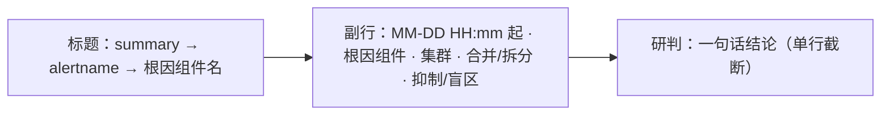

# 0190 收件箱的一行显示问题陈述

## 背景

收件箱的一行以事件标签（`<命名空间>-<名称>-<MMDD-HHmm>`）为标题，副行是事件 ID 的前几位与根因组件键。值班的人扫一眼收件箱想知道的是「出了什么问题、什么时候开始、在哪个组件和集群」，标签和 UUID 回答不了第一个问题，组件键又长又难读。告警的 summary 注解与研判的一句话结论已经在状态库里，`IncidentSummary` 里没有，前端要逐个打开事件才拿得到。

通知标题里已经有一个「症状短语」：正在触发的 symptom 告警，没有时取正在触发的 critical 告警，再没有时取全部成员。收件箱的问题陈述用同一组告警，同一个事件在通知与收件箱里讲的是同一个问题。

## 决定

### 1. 契约：`IncidentSummary.headline`

契约 2.52.0 给 `IncidentSummary` 加必填字段 `headline`，为 `IncidentHeadline` 或 null：

| 字段 | 含义 |
|---|---|
| `alert_id`、`alertname` | 头条告警 |
| `summary` | 头条告警的 `summary` 注解，没有时取 `description` 注解，都没有（或为空字符串）时为 null。注解原文，按不可信文本显示 |
| `started_at` | 头条告警的 `starts_at` |
| `research_summary` | 最近一次完成的研判的一句话结论（`ResearchRunSummary.summary`）；没有完成的研判或结论为空时为 null |

字段必填、不接受多余字段，`summary` 与 `research_summary` 可以为 null。事件没有仍在其中的成员告警（成员全部经拆分、合并离开）时 `headline` 为 null。

### 2. 头条告警的选取

`apps/srenautix/src/incident/headline.ts`：

- `headlineMembers` 给出头条告警组：正在触发的 symptom 告警；没有时取正在触发的 critical 告警；再没有时取传入的全部告警。通知的症状短语（`notify/compose.ts`）与收件箱都调用它，规则只有一份。
- `headlineMember` 只取仍在事件中的成员（`left_version` 为 null），在头条告警组里取 `starts_at` 最早的一条，同时开始时取 `alert_id` 较小的。结果只取决于事件的成员，同一个事件版本每次读到的头条告警相同。
- `alertStatement` 从告警注解取问题陈述：`summary`，其次 `description`。

### 3. 服务端的读取

`GET /v1/incidents` 组装一页摘要时，对这一页的所有头条告警批量读一次告警状态表取注解，最近一次完成的研判与已有的研判结论查询共用同一条 SQL（多取 `summary` 一列）。一页摘要的查询数不随事件数增长。头条告警已经不在告警状态表时 `summary` 为 null，标题退回告警名。

### 4. 收件箱的一行

- 标题：`headline.summary`，没有时为 `headline.alertname`；`headline` 为 null 时为根因组件的显示名，没有根因时为「根因未定位」。
- 副行：开始时刻（头条告警的 `started_at`，`headline` 为 null 时用事件的 `first_firing_at`）按本地时区写成「MM-DD HH:mm 起」，接着是根因组件的显示名与集群。
- 研判结论单独一行，前面是机器人图标，超出宽度时截断，完整内容在截断提示里。没有结论时不显示这一行。
- 头条告警名（标题用了注解时）、根因组件键、事件标签与事件 ID 放在整行的悬停提示里，可以复制，不占可见位置。
- 整行链接的可访问名称是「事件：<标题>，<开始时刻> 起，根因 <组件>，集群 <集群>」，屏幕阅读器读到的顺序与可见顺序一致。中文与英文文案都在 `packages/ui/src/i18n`。

右侧的处置判断、结论阶梯、严重度、持续时长、研判新鲜度、待审批数与反馈状态不变。

## 考虑过的方案

- **前端从事件详情取注解**：收件箱一页最多 500 条，逐个读详情是 N+1 次请求，事件流每次失效都要重复。
- **服务端拼好标题字符串**：标题、副行与悬停提示的取舍和语言有关，契约给结构化的字段，文案留在界面层；Grafana 插件与控制台共用同一套组件，显示一致。
- **按严重度或告警名排序选头条告警**：通知标题已经按角色与严重度选症状告警，收件箱另立一套规则会让同一个事件在两处讲不同的问题。

## 结果

- 收件箱的每一行直接读出问题陈述、开始时刻、根因组件与集群，以及最近一次研判的结论；标签与 UUID 不再占可见位置。
- 通知的症状短语与收件箱的问题陈述来自同一个函数，改规则只改一处。
- `IncidentSummary` 多了一个必填字段，控制台与 Grafana 插件共用的 `@srenautix/ui` 按 2.52.0 读取。
