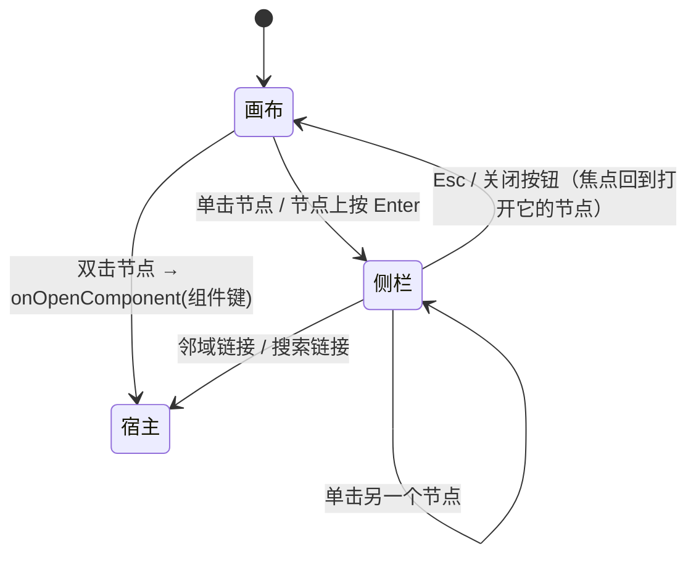

# 0191 根因子图的缩放、全屏与节点导航

状态：部分取代（见 0197）

## 背景

事件详情与拓扑页的邻域图共用 `@srenautix/ui` 的 `Subgraph`（`@xyflow/react` 加 elkjs 分层布局）。原来的画布只能按 xyflow 的默认方式操作：滚轮直接缩放画布，鼠标停在图上时页面滚不动；没有缩放按钮，触控板以外的设备不好调整视口；节点只能看，不能从一个组件继续查它的告警、邻域与相关事件。组件多时 320 像素高的画布看不清，也没有全屏。

这个组件同时运行在控制台与 Grafana 插件里，宿主的路由各不相同，Grafana 插件里没有拓扑页与搜索页。

## 决定

### 1. 缩放与平移

| 操作 | 结果 |
|---|---|
| 普通滚轮 | 滚动页面，画布不动 |
| 触控板双指捏合、Ctrl + 滚轮 | 缩放画布（xyflow 的 `zoomOnPinch`，浏览器把捏合报告为带 `ctrlKey` 的 wheel 事件） |
| ⌘ + 滚轮 | 缩放画布 |
| 拖动画布 | 平移 |
| 双击画布 | 无动作（双击留给节点） |
| 左下角控制条 | 放大、缩小、适配视图、全屏 |

xyflow 的 wheel 处理在 `preventScrolling` 为 true 时总会拦截滚轮，为 false 时只在带 `ctrlKey` 的事件上缩放。画布设 `zoomOnScroll={false}`、`panOnScroll={false}`，`preventScrolling` 只在按住 ⌘ 时为 true（`useKeyPress('Meta')`），同时 `zoomActivationKeyCode` 为 `['Meta', 'Control']`：普通滚轮交还给页面，⌘ 与 Ctrl 加滚轮都缩放。

节点不能拖动、不能连线、不能被 xyflow 选中（`nodesDraggable`、`nodesConnectable`、`elementsSelectable` 都为 false），节点位置始终是布局给出的位置。

### 2. 全屏

控制条最后一个按钮用 Fullscreen API 把画布连同侧栏一起全屏（`aria-pressed` 表示当前状态）：

- 进入前记下当前视口；画布尺寸变化之后适配一次视图，之后用户的缩放不再被打断。
- 退出时（按钮、Esc 或浏览器自己退出，都经 `fullscreenchange`）恢复进入前的缩放与位置。
- 浏览器不支持全屏（`document.fullscreenEnabled` 为 false，例如宿主 iframe 没有 `allow="fullscreen"`）时不显示按钮；`requestFullscreen` 被拒绝时撤销保存的视口，页面保持原样。

### 3. 小地图

节点数超过 `MINIMAP_MIN_NODES`（10）时右下角显示小地图，可以拖动与缩放。根因加两跳邻居通常只有几个节点，这时小地图只占位置。

### 4. 节点的单击、双击与键盘

- 单击节点（或节点获得焦点时按 Enter）在画布右侧打开组件侧栏：显示名与组件键、角色、类型、跳数、成员告警（宿主给了 `alertLabel` 时显示告警名，否则显示 alert_id），以及「以它为中心查看拓扑邻域」与「搜索这个组件的事件」两个链接。打开时焦点移到侧栏标题，Esc 或关闭按钮关闭侧栏并把焦点还给打开它的节点。
- 侧栏是画布旁边的非模态区域：全屏时它在全屏元素里面，单击另一个节点直接切换内容。视口宽度不超过 720 像素时侧栏排到画布下方。
- 双击节点调用 `onOpenComponent(组件键)`，由宿主决定去哪里；没有提供时双击无动作。
- 节点的可访问名称是「<显示名>，<角色>，<告警数>」，键盘说明经 xyflow 的 `ariaLabelConfig` 本地化；画布的 `role="group"` 带一段只给屏幕阅读器的操作说明。

### 5. 与宿主的边界

`Subgraph` 不依赖任何路由：

- `SubgraphProps` 新增 `clusterId`、`alertLabel`、`onOpenComponent`，都可选。
- `Links` 新增可选的 `topology(clusterId, component)` 与 `search(q, clusterId)`。侧栏只在宿主提供了 `clusterId` 与对应链接时显示链接。

控制台提供全部四项：`/topology?cluster&view=neighborhood&component` 与 `/search?cluster&q`，事件详情与拓扑页的双击都导航到这个组件的邻域。Grafana 插件不提供拓扑与搜索链接，也不提供 `onOpenComponent`：侧栏只显示组件信息与告警。

### 6. 拓扑页的 `component` 参数

控制台拓扑页的邻域视图把中心组件写进 URL 的 `component` 参数（`route-params.ts` 的 `topologySearch`，空字符串与非字符串按没有处理）。输入框提交与节点双击都更新这个参数，输入框随 URL 同步；邻域链接可以分享、可以用浏览器后退回到上一个中心。

### 7. 节点对象保持不变

xyflow 收到新的节点对象时会重置它的测量尺寸，测量完成前隐藏节点，获得焦点的节点因此失去焦点。节点数组只在布局结果或组件显示名变化时重建，选中状态经 React context 传给节点组件、不写进节点对象，键盘用户打开、关闭侧栏后焦点仍在原来的节点上。

### 8. 主题

控制条、小地图与焦点框的颜色映射到设计令牌（`--sn-panel`、`--sn-raise`、`--sn-text`、`--sn-line`、`--sn-bg`、`--sn-focus`），浅色与深色主题跟随令牌切换，不使用 xyflow 自带的配色。

## 考虑过的方案

- **滚轮直接缩放（xyflow 默认）**：事件详情是长页面，子图在中间，鼠标经过画布时页面滚不动，用户为了继续往下读要先把鼠标移出画布。
- **用已有的 Sheet 抽屉显示组件信息**：Sheet 是挂在 body 上的模态对话框，画布全屏时它在全屏元素之外看不到；模态遮罩也让人无法点另一个节点直接切换。
- **组件内部直接跳转到拓扑页**：Grafana 插件没有拓扑页，组件里写死控制台路径会在插件里产生坏链接；交给宿主的回调与可选链接后两个宿主各自决定。
- **一直显示小地图**：节点少时小地图与画布内容几乎相同，占掉右下角的空间。

## 结果

- 在事件详情里滚动页面不再被子图拦住；需要细看时捏合、Ctrl/⌘ + 滚轮或控制条缩放，组件多时全屏，退出后回到原来的视口。
- 从根因子图的任一节点可以看到它的告警，并一步进入以它为中心的拓扑邻域或它的事件搜索；邻域的中心写在 URL 里，可以分享与后退。
- 键盘可以完成全部操作：Tab 到节点，Enter 打开侧栏，Esc 关闭并回到节点。
