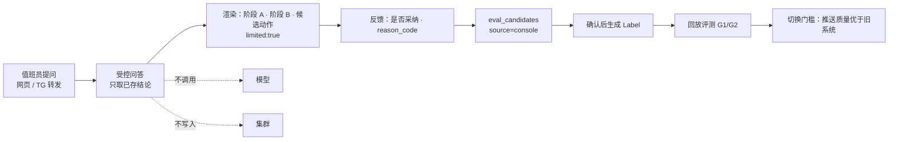

# 0192 受控事件问答与标注反哺

## 背景

`POSITIONING.zh-CN.md` 的「不做」里写有一条：「不提供自由格式的执行能力，也不做『和集群聊天』」。这条排除项针对的是两类形态：不给模型自由格式的写能力，不把系统做成可以任意发问、任意调模型、现场查数据的通用聊天机器人。它同时挡住了一个值班场景里确实需要的能力：值班员在 TG 群里看到一条事件消息，想问「这条最可能是什么原因、有什么证据、能做什么」，不必先打开控制台、找到事件、点进详情页。

PR #62 落了 `POST /v1/incidents/{incident_ref}/ask`（A1 后端）。它是单轮、锚定单个事件、复用 `research.request` 权限的受控接口：返回已存的阶段 A 报告、阶段 B 结论与已存在的候选动作，带 `limited: true`；问题文本只回显与计长度，不进 SQL、不进提示词、不变成动作参数；没有结论时经 `scheduler.admit(..., 'manual')` 触发一次既有研判队列，返回 202。它不新调模型、不读 Secret、不给写权限。

要把它扩成「网页全局对话框 + TG 里转发事件消息」的形态，就会碰到 :72 的字面排除。此时有两条路：删掉排除项，或者把「受控问答」与「自由聊天」的边界写清楚。删掉排除项会让 §9 不变量第 9 条（不可信文本不变控件）、§16.4（`untrusted_text`）、§16.1 授权矩阵（未分类路由 CI 失败）失去可引用的定位依据；外部读者也无法区分「这个系统能聊天」和「这个系统的模型不持有写凭证」。

第二阶段还缺一样东西：研判质量。项目页记第 3 轮 G1/G2 未达标、两个真实根因都判错；`POSITIONING.zh-CN.md` 的「可以证伪的主张」要求回放评测根因 top-1 ≥60%、用例 ≥30 个真实事件、人工反馈每周 ≥10 条。当前标注候选来自 `feedback`、`pr_closed`、`issue_not_planned`、`console` 四种来源（`apps/srenautix/src/eval/candidates.ts`），值班员在控制台里问了什么、是否采纳了建议，没有进入评测样本。

## 决定

### 1. 保留排除项，补一段受控边界

`POSITIONING.zh-CN.md` 的「不做」里保留原句，紧随其后补一段说明。受控事件问答的定义必须同时满足下面五条，缺一条就落回「自由聊天」，不在本 ADR 授权范围内：

| # | 边界 | 现有依据 |
|---|---|---|
| 1 | 锚定一个或一组已存在的事件、研判运行或证据卡；不提供对集群、指标、日志的通用发问 | `DESIGN.zh-CN.md` 附录 C：不提供通用数据源代理 |
| 2 | 答案只由已存结论组成：阶段 A 报告、阶段 B 运行结论、已存在的候选动作。不现场调模型生成新答案 | `roles/worker.ts:46` 唯一持有密钥；`llm/types.ts:151` 的 `LlmPhase` 固定 5 值 |
| 3 | 问题文本视为不可信文本：只回显与计长度，不进 SQL、不进提示词、不变成动作、目标或参数，审计只记长度 | 承诺第 9 条；`DESIGN §16.1` 注入语料测试；`DESIGN §16.4` `untrusted_text` |
| 4 | 动作只生成 `awaiting_approval` 提议，不创建、不审批、不执行、不改策略 | 承诺第 2、6 条；`DESIGN §9.3`；`approve → 断言 → gateway` |
| 5 | 每个新操作在 OpenAPI 带 `x-srenautix-roles` 与 `x-srenautix-external`；MCP 工具表同步扩充；授权矩阵 CI 对未分类路由失败 | `DESIGN §16.1` 第 6 行；`contract/openapi.yaml` 头部说明 |

`worker`、`server`、console-bff、mcp 的角色边界不变：模型密钥只在 worker；外部 Agent 只能提议；写操作只经 gateway 的类型化动作。

### 2. 问答与标注反哺是两条独立轨道

- **入口轨**：收集真实提问与采纳反馈。用 `eval/candidates.ts` 已有的 `source: 'console'`、`reason_code`、`reason` 字段承载，不新建表、不新建样本类型。
- **评测轨**：候选经 `confirmEvalCandidate` 确认后由 `candidateLabel()` 生成 `Label`，进回放评测。问题文本本身不进标注文件；标注只记事件、结论、是否被采纳与原因码。
- 两条轨道分开的理由：入口形态不能提升诊断准确率，标注语料才能。把「多一个聊天框」当成质量改进会误判切换门槛。

### 3. 分三批落地，本 ADR 只授权定位变更

| 批次 | 内容 | 边界 |
|---|---|---|
| A | 网页全局对话框 + 标注反哺 | 不改 :72 以外的定位条款；复用 `research.request`；不新增权限常量 |
| B | TG 自由入站与事件消息转发 | `config/server.ts` 的 `updates` 从 `none` 切到 `webhook`/`polling` 需要 `webhook_secret_file` 并核对 bot 冲突；群作用域与消息限流单独验收 |
| C | MCP / 外部 Agent 开关 | `roles/mcp.ts` 的 `enabled` 与 Helm 部署单元；仍只在集群内、仍只提议；工具表与授权矩阵同步 |

多轮会话与 SSE 不做：当前代码没有 `text/event-stream` / `EventSource` 基础设施，而「不现场调模型」下追问只能重放已存结论，新增会话状态、断线重放与审计边界换不来相应价值。

### 4. 标注反哺接现有链路，不另写体系

`apps/srenautix/src/eval/candidates.ts` 的 `pendingEntry` 已有 `source: 'console'`、`reason_code`、`reason`；`apps/srenautix/src/eval/labels.ts` 的 `Label` 已有 `roots`、`disposition`、`mechanism_expect`、`noise`、`evidence` 等评分维度；`DESIGN §9` 已定义 `false_positive`、`not_actionable`、`wrong_fix` 等原因码（ADR 0174）。批次 A 只把「提问 + 是否采纳」写成一条 `source: 'console'` 的候选，其余走 `listEvalCandidates` / `confirmEvalCandidate` / `dropEvalCandidate` 的既有流程（ADR 0175）。

### 5. 本 ADR 不授权的内容

不改 `contract/openapi.yaml`、不新增 `PERMISSIONS` 常量、不打开 `mcp.enabled`、不切 `notify.telegram.updates`、不实现 SSE、不写任何 A2 实现代码；不改 `cchp-k8s-ops`、不签名发布、不触发 Argo sync。定位边界与实现 PR 分开，实现 PR 各自描述验证结果。

## 考虑过的方案

- **删掉 `POSITIONING.zh-CN.md:72` 的整条排除项**：入口可以随意做，但会同时松开「自由格式执行」的语义，把承诺第 2、6、9 条和 §16.1 授权矩阵推到没有上位依据的位置。开源项目的外部读者无法从文档判断模型是否持有写凭证。
- **把「和集群聊天」改写成「不做通用聊天」**：措辞更短，但「通用」没有可校验的定义，授权矩阵 CI 无法据此判定一条新路由是否越界。现在保留原句、补五条可逐项检查的边界。
- **一次性实现 A2 全部六层**：全局框、TG 入站、多轮 SSE、MCP 开关、标注反哺挤在一个 PR 里。定位变更被埋在两千行代码里，CI 与 kind-e2e 面最大；`srenautix` Application 是 manual sync，回滚也慢；G1/G2 不会因为入口变多而改善。
- **维持 A1、完全不碰 :72**：零定位争议，但 TG 里转发事件消息这个最贴近值班场景的形态无法落地，标注样本也仍缺真实提问语料。
- **新建一张问答标注表**：`eval_candidates` 已有 `source: 'console'` 与原因码字段，新建表会多一套写入、去重与导出路径，且和 ADR 0175 的候选确认流程并行。

## 结果

- `POSITIONING.zh-CN.md:72` 的原句保留；受控事件问答与自由聊天的边界写成五条可检查的条件，外部读者能把「能问事件」与「模型不持有写凭证」区分开。
- 授权矩阵 CI 继续以 OpenAPI 标注与 MCP 工具表为事实源；新增问答接口时未分类路由会失败。
- 批次 A 的标注候选能直接进既有回放评测，给「可以证伪的主张」里的 G1/G2 补真实标注语料；入口形态不再被误当成质量改进。
- 本 ADR 只改文档。定位边界已可审，实现、部署与上线仍按批次各自授权。
