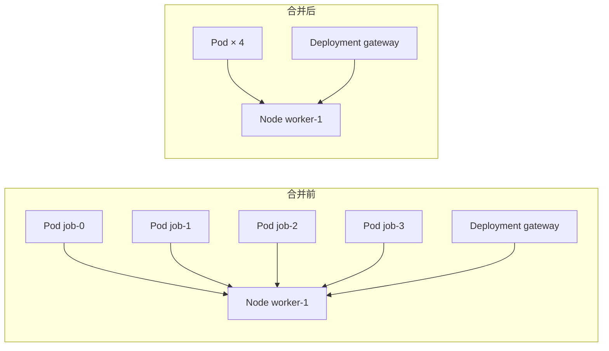

# 0197 组件多的子图：滚轮缩放、同类合并、突出与查找

状态：已采纳

## 背景

ADR 0191 给根因子图加了缩放、全屏与节点侧栏。拓扑页的邻域图用的是同一个 `Subgraph`，在 Kubernetes 拓扑上暴露出四个问题：

- **放不大，也缩不到全图。** 画布沿用 xyflow 默认的缩放范围 0.5–2。两跳邻域经过 Node 时会带上这个节点上的全部 Pod，一百多个节点在 0.5 倍下放不进画布；想细看一个节点时又只能到 2 倍。
- **不知道怎么缩放。** 普通滚轮滚动页面，缩放要按住 Ctrl 或 ⌘，这条说明只写给了屏幕阅读器。拓扑页上画布就是页面的主要内容，高度却只有 320 像素。
- **节点和标注互相遮挡。** 每条边都带「关系 · 来源 置信度」的标注，几十条边的标注盖住了节点；看不出一个组件连着谁。
- **小地图是空的。** 画布不处理 `onNodesChange`，xyflow 量出的节点尺寸没有写回节点对象，小地图只画有尺寸的节点，所以一个也没画。

## 决定

### 1. 缩放范围与滚轮

缩放范围改为 0.1–4。适配视图（初次显示、控制条按钮、全屏、重新布局）最多放大到 2 倍，只有两三个节点的子图不会被撑满画布。

| 画布的位置 | 普通滚轮 | Ctrl/⌘ + 滚轮、双指捏合 |
|---|---|---|
| 嵌在长页面里（事件详情） | 滚动页面；画布上方出现「按住 Ctrl 或 ⌘ 再滚动，可以缩放画布」，1.6 秒后消失 | 缩放 |
| 页面的主要内容（`primary`，拓扑页邻域图） | 缩放 | 缩放 |
| 全屏 | 缩放 | 缩放 |

`SubgraphProps` 新增 `primary`。`primary` 的画布高度是 `max(420px, 100dvh − 300px)`，侧栏的最大高度与画布相同。

### 2. 同类合并

`foldSubgraph`（`packages/ui/src/domain/subgraph-fold.ts`，纯函数）把满足下面全部条件的组件合并成一个节点：

- 角色是邻居，没有告警，不是根因；
- 类型、命名空间、跳数相同；
- 边的集合相同：连到同一批组件，方向与关系也相同；
- 这样的组件不少于 4 个（`FOLD_MIN`）。

成员的边改接到合并后的节点上，同一对端点、同一关系只留一条，置信度取成员中最低的。根因、候选、成员与带告警的组件从不合并，事件里需要逐个看的组件始终单独画出。

合并后的节点显示「类型」与「N 个同类组件 · 命名空间」。单击打开侧栏：成员列表（宿主提供了拓扑链接时每个成员链接到它的邻域）与「在图上展开这一组」；双击直接展开。画布左上角的「合并同类组件」开关关掉全部合并，再打开时回到全部合并的状态。布局变化后画布重新适配视图。

合并在浏览器里做，接口返回的子图不变：导出、MCP 与研判读到的仍然是完整的子图。

### 3. 突出与边的标注

鼠标指向一个节点，或侧栏里显示着一个节点时，只有它和直接相连的组件正常显示，其余节点与边变淡，它的边加粗并换成强调色。优先级：鼠标指向的节点，其次是查找命中，最后是侧栏里的节点。

画布上的节点超过 10 个（`MINIMAP_MIN_NODES`，按合并后的数量算）时，边的标注只显示在被突出的节点的边上；不超过 10 个时全部显示，与原来相同。

### 4. 查找

子图的组件超过 10 个时左上角显示查找框，按显示名与组件键做不区分大小写的子串匹配；合并的节点按成员匹配。命中的节点加框，其余变淡，旁边显示命中数。回车依次把命中的节点移到画布中央（缩放不到 1 倍时放大到 1 倍），Esc 清空。

### 5. 节点尺寸

节点对象写明宽高（204×68，与 CSS 的外框相同，`box-sizing: border-box`），elkjs 的布局、小地图与查找定位都用这组数字。原来布局按 180×52 计算，而节点实际渲染为 202×66。小地图节点的颜色改用 `--sn-edge`，在浅色面板上看得见。

### 6. 拓扑页

- 邻域范围可以选 1 跳或 2 跳（接口的 `hops` 参数），写在 URL 的 `hops` 参数里；默认 2 跳时不写。
- 覆盖表的组件名链接到以它为中心的邻域，不需要手工输入组件键。

## 考虑过的方案

- **所有位置都让普通滚轮缩放。** 事件详情是长页面，鼠标经过子图时页面滚不动（ADR 0191 否决的原因没有变）。提示加上按位置区分，两处都不需要用户猜。
- **在服务端合并或截断邻域。** 接口的子图同时给导出与研判用，截断会让它们看不到组件；合并只是显示方式，放在组件里。
- **按命名空间画分组框（elk 的层级布局）。** 一个节点上的 Pod 分属多个命名空间时框与框之间的边仍然很多，节点数也没有减少；同类合并直接减少节点数，并且保留「连到谁」的信息。
- **换成力导向布局。** 位置每次都不同，根因在哪一层看不出来；分层布局的方向（依赖从左到右）是读图的依据。
- **一直显示全部标注，只调小字号。** 缩小到全图时任何字号都读不出来，放大后又互相遮挡。

## 结果

- 一个 Node 上的几十个 Pod、一个工作负载引用的十几个 ConfigMap 在图上各占一个节点；需要时展开某一组或关掉合并。
- 拓扑页用滚轮就能从全图缩放到单个节点；事件详情里滚动页面不受影响，想缩放时有提示。
- 指向一个组件就能看清它连着谁、每条边的关系与来源。
- 小地图画出节点。
