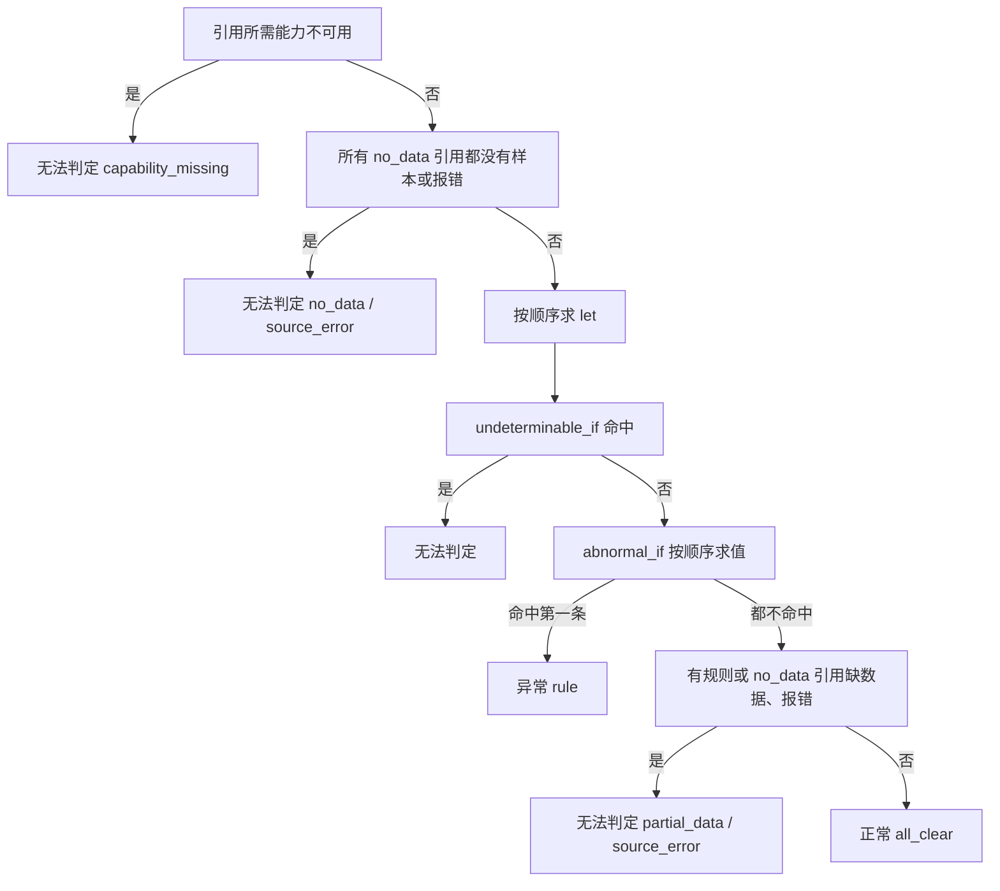

# 编写领域包

领域包只包含数据：告警目录、信号、证据链、检查项、规则提议、处置手册、知识、混沌实验与测试。SreNautix 的进程加载它们，第三方代码不随包运行。`packs/_example` 演示了全部文件，编写新包时从它复制。

SDK 在 `packages/packs-sdk`（Apache-2.0），命令行入口是 `srenautix pack`。

## 目录结构

| 文件 | 结构（`contract/schemas/pack.schema.json`） | 内容 |
|---|---|---|
| `pack.yaml` | 根对象 | 名称、版本、成熟度、`requires` 与 `optional` 能力、最低 SreNautix 版本 |
| `signals.yaml` | `SignalsFile` | 信号与备选查询 |
| `components.yaml` | `ComponentsFile` | 组件类型（按种类与标签匹配拓扑节点）与 operator 约定 |
| `alerts.yaml` | `AlertsFile` | 告警目录：告警名、角色、实体映射、关联的证据链 |
| `chains.yaml` | `ChainsFile` | 证据链：证据卡、排除规则、处置手册 |
| `checks.yaml` | `ChecksFile` | 与告警无关、按实体种类运行的检查项 |
| `rules.yaml` | `RulesFile` | 规则提议：条件满足时提议动作目录中的动作 |
| `remediations.yaml` | `RemediationsFile` | 修复补丁模板：条件满足时生成 GitOps 仓库的补丁，经 `gitops_pr` 开 PR |
| `domains.yaml` | `DomainsFile` | 主动优化的指标目录与领域：诊断卡、份额卡、模板、门槛、趋势、体检计划、负载保护卡 |
| `issues.yaml` | `IssuesFile` | 主动优化的业务仓库 issue 模板：适用条件、代码定位的锚点、建议、预期收益与验证计划 |
| `rca-params.yaml` | `RcaParams` | 根因排序参数；修改需要通过回放门禁 |
| `action-requests.yaml` | `ActionRequestsFile` | 动作启用申请，经 Git PR 合入策略后生效 |
| `knowledge/*.yaml` | `KnowledgeFile` | 知识条目，`learned_from` 写来源链接 |
| `runbooks/*.md` | Markdown | 处置手册，证据卡的 `links` 可以指向其中的锚点 |
| `prompts/*.md` | Markdown | 提示词片段，按低信任处理，启用前需要管理员批准差异 |
| `chaos/*.yaml` | `ChaosFile` | 混沌实验：注入清单、时长、预期根因与告警 |
| `tests/*.yaml` | `PackTestFile` | 夹具测试 |
| `tests/replay/*.json` | `QuerySnapshot` | 录制的查询邻域快照，供 `--replay` 使用 |

目录中出现约定之外的文件时，加载失败。

## 成熟度

| 成熟度 | 要求 |
|---|---|
| `stable` | 每张证据卡都有夹具测试，并且在 Prometheus 与 VictoriaMetrics 上结论一致；只有 stable 的包计入"支持" |
| `beta` | 能通过 `lint`，夹具测试可以不完整 |
| `draft` | 开发中的包 |

## 信号

信号是证据卡引用的数据，每个信号有一组按优先级排列的备选：

```yaml
signals:
  - id: container_memory_limit_ratio
    kind: metrics
    unit: ratio
    alternatives:
      - expr: max by (namespace, pod, container) (example:container_memory_limit:ratio{$selector})
        recording_rule: true
      - expr: >-
          max by (namespace, pod, container) (
            container_memory_working_set_bytes{$selector, container!="", container!="POD"}
            / on (namespace, pod, container)
            kube_pod_container_resource_limits{$selector, resource="memory"}
          )
```

加载时逐个探测备选，按数据源记录选中的一个：

- 指标备选：渲染出的查询中每个指标名在探测窗口内都有序列；声明了 `probe` 时，probe 查询还必须返回非空。
- 日志与链路备选：数据源具备对应能力与方言即选中。
- 没有备选可用时，`srenautix pack doctor` 列出每个备选被拒绝的原因（`capability`、`dialect`、`missing_metric`、`probe`、`error`）。
- `recording_rule: true` 的备选不能是最后一个：录制规则是可选的加速，必须有原始表达式兜底。

**补充别的包的信号**

应用没有内置包假定的指标时（例如没有 `http_request_duration_seconds`，`workload` 包的 HPA 延迟卡因此无法判定），用户包可以给那个信号补充备选，而不必复制证据卡（契约 2.26.0，ADR 0139）：

```yaml
signals:
  - id: gateway_latency_p95
    kind: metrics
    unit: seconds
    extends: workload/hpa_target_latency_p95
    alternatives:
      - expr: >-
          histogram_quantile(0.95, sum by (le) (rate(app_stage_duration_seconds_bucket{job="gateway"}[$rate_window])))
          and on () max(kube_horizontalpodautoscaler_info{namespace="$namespace", horizontalpodautoscaler="$name", scaletargetref_name="gateway"})
```

- 补充的备选排在被补充信号原有的备选之前（多个包补充同一个信号时按包的加载顺序），引用那个信号的卡都按合并后的备选探测与查询；补充信号本身仍是本包的信号。
- 只能补充别的包里、本身不是补充的信号，类型必须相同。
- 备选按数据源选中一个，被选中后用于这个信号的全部实体。只适用于部分实体的备选要用 `and on () ...` 之类的条件让其余实体查不到数据（无法判定），否则会把一个实体的数据当成所有实体的。
- 本包的测试可以用完整的卡键 `<包>/<链>/<卡>` 测试被补充的内置卡，例如 `card: workload/capacity/hpa-latency`。

**dbstats 信号**

数据库统计视图（`pg_stat_statements`、`pg_stat_user_tables`、`pg_stat_user_indexes`、`pg_settings` 等）的读取是 `dbstats` 信号（契约 2.28.0，ADR 0146 §3.3）。SQL 写在适配器里，备选只写操作名与参数：

```yaml
signals:
  - id: statement_exec_time_rate
    kind: dbstats
    unit: per_second
    alternatives:
      - expr: statements.top          # dbstats/v1 的操作：statements.top、tables.top、indexes.usage、settings.get、activity.summary、locks.summary
        dialect: dbstats
        args: { order_by: total_exec_time, limit: 20, database: $params.database }
        column: total_exec_time_ms    # 作为序列取值的数值列
        rate: true                    # 两次采样的差值除以间隔秒数
```

- 结果的每一行是一条序列：标签为行的字符串与布尔列（例如 `queryid`、`database`、`role`），取值为 `column` 列，点在采样时刻。证据卡的函数（`sum`、`top_share`、`join`、`label`）照常可用，引用的 `mode` 写 `dbstats`。
- `args` 的字符串值可以整体写成 `$params.<名字>`；渲染后按操作的 schema 校验，`lint` 用卡片的默认参数检查一遍。`column` 必须是这个操作的数值列。`statements.text` 返回语句文本，只经工具读取，不能作为信号。
- 累计计数器需要两次采样：同一次运行中第一次读取保存下来，与它相隔不少于 300 秒的读取才有速率（`rate: true`），之前的读取为缺数据，卡片无法判定。计数器回绕的行没有速率；只在第二次采样中出现的行，前一次采样没有被 `limit` 截断时按从 0 开始计（两次采样之间新出现的语句），被截断时没有速率。能力为 `dbstats.<操作名中的 . 换成 _>`，例如 `dbstats.statements_top`。

**模板变量**

| 变量 | 含义 |
|---|---|
| `$selector` | 按实体展开的标签匹配器（不含花括号）。Deployment、StatefulSet、DaemonSet、Job、CronJob、ReplicaSet 展开为所属 Pod 名的正则 |
| `$namespace`、`$name`、`$node` | 实体的命名空间、名称、所在节点 |
| `$rate_window` | 由抓取间隔推导的 rate 窗口：`max(60s, 4 × 抓取间隔)` |
| `$window` | 卡片窗口的长度，用于 `increase(x[$window])` 这类覆盖整个窗口的查询 |
| `$params.<名>` | 卡片与引用的参数 |

**标签档案**

模板一律用规范标签名书写：`namespace`、`pod`、`container`、`node`、`persistentvolumeclaim`。启动时按数据源探测标签档案（例如 `kubernetes_namespace`、`k8s_pod_name`，以及外部标签 `cluster` 的名字与抓取间隔），执行前用官方解析器改写标签名并注入 cluster 匹配器 `cluster=~"<集群>|"`；不带 cluster 标签的序列（聚合型录制规则的结果）也会匹配。

**严格解析**

方言为 `promql` 的备选用 Prometheus 官方解析器检查，`metricsql` 的用 VictoriaMetrics 官方解析器检查（两者编译为 wasm，随 `integration-sdk` 发布）。`lint` 对每个备选按 `applies_to` 的每种实体渲染一次再解析，并检查：不使用 `@` 修饰符；`range` 模式的查询结果是瞬时向量。同一份包要在 Prometheus 与 VictoriaMetrics 上得出相同结论，由 `pack test` 在两种后端上执行来保证。

**卡片作为检查**

阶段 B 的区分性检查默认把适用于子图组件的证据链卡当作检查执行（ADR 0116），参数是 `window_before`、`window_after` 与卡的全部 `params`（类型取默认值）。阈值与窗口值得让模型调整的卡写 `check` 块：`description` 说明它作为检查时区分什么，`args` 用与查询模板相同的规则约束 `params` 的取值范围（不声明窗口，窗口总是由运行时提供）。packs-sdk 的 `checkArgsSchema(card)` 与 `applyCheckArgs(card, args)` 给出 schema 与合并规则，server 与评测共用。

```yaml
check:
  description: { zh-CN: HPA 顶到上限时伸缩指标是否仍超过目标值, en: ... }
  args:
    type: object
    additionalProperties: false
    properties:
      over: { type: number, minimum: 1, maximum: 3, description: 指标超过目标值的这个倍数时判为饱和 }
```

**查询模板**

卡片表达不了的查询（例如按 Pod 拆分的前 k 名、与另一个工作负载对比）写成 `signals.yaml` 的 `templates`：`signal`、`description`、`args`（参数的 JSON Schema）与判定结果的 `card`。执行时模型给出的参数作为卡的 `params` 传入，附带的卡与证据卡一样编译与严格解析，键为 `<包>/templates/<模板 id>`，夹具以 `card: templates/<模板 id>` 测试。`lint` 另外要求：
- `args` 写 `additionalProperties: false`，每个参数都是卡的 `params`，并有 `description`；
- 字符串参数用 `enum` 或 `pattern` 限定（它们会代入 PromQL），数字参数有 `minimum` 与 `maximum`；
- 卡的默认值满足参数的限定；
- 分组标签（`by (...)`）不能是参数：信号探测时参数取占位值。

## 证据卡

证据卡属于证据链（`chains.yaml`）或检查项（`checks.yaml`），结构见 `contract/schemas/evidence-card.schema.json`：

```yaml
- id: limit-ratio
  applies_to:
    kinds: [Pod, Deployment, StatefulSet]
  window: { before: 30m, after: 5m }
  params:
    limit_ratio: 0.9
  refs:
    - { name: mem, signal: container_memory_limit_ratio, mode: range }
    - { name: oom, signal: container_oom_events, mode: instant, empty_is: normal }
  judge:
    let:
      - { name: peak, cel: max(mem) }
      - { name: ooms, cel: count(oom) }
      - { name: anomaly_started_at, cel: 'first_above(mem, params.limit_ratio)' }
    abnormal_if:
      - cel: ooms > 0
        say:
          zh-CN: '{ooms} 个容器在窗口内被 OOM 终止'
          en: '{ooms} containers were OOM-killed in the window'
  display:
    value: peak
    unit: percent
    threshold: params.limit_ratio
```

**引用**

- `mode`：`instant`（窗口结束时刻）、`range`（整个窗口）、`logs`（日志行，`limit` 为行数上限）。
- `empty_is`：`no_data`（默认）表示没有样本就无法判断；`normal` 表示没有匹配本身就是正常结果，用于"出错的序列""OOM 事件""错误日志行"这类过滤型查询。过滤型引用的指标在数据源中不存在时同样视为空。

**判定顺序**



没有任何样本永远不会得出正常。依赖缺数据引用的 `let` 不可用，引用了它的规则跳过并计入 `partial_data`。表达式求值出错（缺样本之外的错误）时为无法判定，原因 `evaluation_error`。

**判定的明细**

结果里除了结论，还记录判定所依据的数据，通知、issue 与控制台用它们展示正常卡的实测值：

- `observations`：`let` 绑定的标量取值（按定义顺序最多 16 个，不可用时为 null）；
- `params`：生效的参数（判定条件里的阈值）；
- `conditions`：求值过的条件（`undeterminable_if` 全部，`abnormal_if` 到第一条命中为止），每条记录 `hit`、`miss` 或 `unavailable`；命中时附 `say`，没有命中时附规则的 `normal_say`（写了才有）；
- `baseline`、`unit`、`impact`、`category`、`value_number`：见下文。

```yaml
abnormal_if:
  - cel: poolPeak > params.pool
    say: { zh-CN: '应用 PG 连接池峰值 {poolPeak, number, percent}' }
    normal_say: { zh-CN: '应用 PG 连接池峰值 {poolPeak, number, percent}，未超过阈值' }
```

**let**

`judge.let` 按顺序求值，后面的 `let` 和全部规则、`say`、`display` 都可以引用前面的名字。名为 `anomaly_started_at` 的 `let`（unix 秒）给出异常开始时间。表达式内部的局部绑定用 CEL 标准的 `cel.bind(名, 值, 表达式)`。保留名：`params`、`entity`、`window`、`row`、`cards`、`incident`、`root`。

**CEL 函数库**

序列在 CEL 中是 `{labels, times, values}`，只含有值的点；日志行是 `{labels, time, line}`。

| 函数 | 含义 |
|---|---|
| `max(x)`、`min(x)` | 列表：全部点的最大、最小值；单条序列：该序列的最大、最小值 |
| `max_in(list, from, to)` | 时间在 `[from, to)`（unix 秒）内的点的最大值，没有这样的点时不可求值；`max_in(x, window.from, window.anchor)` 与 `max_in(x, window.anchor, window.to + 1.0)` 对比事件开始前后 |
| `last(x)` | 列表：各序列最后一个点中的最大值；单条序列：最后一个点 |
| `sum(x)` | 列表：各序列最后一个点之和；单条序列：全部点之和 |
| `count(list)` | 有样本的序列数或日志行数 |
| `none(list)` | 列表中没有任何样本 |
| `points(list)` | 展开为点 `{t, v, labels}` 的列表 |
| `any_point(list, p, 谓词)` | 存在满足谓词的点，例如 `any_point(phase, p, p.v == 1.0 && p.labels.phase == "Pending")` |
| `transitions(list)` | 值变化的点 `{t, from, to, labels}` |
| `top_share(list, k)` | 最后值最大的 k 条序列占总量的比例，用于判断问题是否集中在少数对象 |
| `ratio(a, b)` | `sum(a) / sum(b)`，分母为 0 时不可求值 |
| `join(a, b, op)` | 按共同标签配对，两边最后值做 `op`（`+`、`-`、`*`、`/`，除数为 0 的配对丢弃），结果序列带两边的标签 |
| `first_above(list, 阈值)`、`first_below(list, 阈值)` | 第一个越过阈值的点的时间（unix 秒） |
| `label(序列或日志行, 名)` | 标签值，不存在时为空字符串 |
| `kind_is(entity.kind, "Application.argoproj.io")` | 实体是否是这个 kind：kind 不区分大小写；两边都带 API 组时组必须相同，任一边不带组时只比较 kind。拓扑中的实体带组（`Application.argoproj.io`），告警标签契约给出的不带组（`application`），按 kind 区分实体的 CEL 都用它，不要写 `entity.kind == "..."` |
| `abs`、`fmt_pct`、`fmt_bytes`、`fmt_secs`、`fmt_num` | 数值与格式化 |

输入有硬上限：每个引用最多 200 条序列，每条序列最多 1500 个点，日志最多 200 行，超出部分在进入 CEL 前截断。加载时按 AST 计算每个表达式最坏情况下的求值步数，超过 2000 万步的表达式拒绝加载。

**文字与展示**

- `say`、`title`、`note`、表头都是 `zh-CN` 与 `en` 两种语言。`say` 是 ICU MessageFormat，变量取自 `let`，数字格式用 `{x, number, percent}` 等。
- `display.value` 与 `display.threshold` 是 CEL，`unit` 取 `none`、`percent`、`ratio`、`bytes`、`seconds`、`count`、`per_second`。`display.value` 写命中条件所比较的那个量，阈值与它同单位。
- `display.baseline` 是对比基线的 CEL（例如前一天的中位数），结果写入 `baseline`，通知里与实测值并列。
- `impact: true` 标出衡量用户可见影响的卡（错误率、可用性、业务量）：判为异常时，通知的问题陈述把它的标题与值写成影响范围。
- `baseline: false` 标出描述这次故障是什么类型的卡（失败按错误类型、按模型的分布，与同类对象的同期对照）。这类卡判为异常时不和事件之前的时段比较（证据基线，ADR 0153），照常作为支持证据：同一类型的故障过去出现过，不说明这次不是这个类型（契约 2.35.0，ADR 0164）。检测某个条件是否出现的卡（错误率、延迟、重启、容量）保持默认的 `true`。
- `category` 是业务关键信号的类别（契约 2.27.0，ADR 0148），取 `storage`（PVC 与卷容量、IO、对象存储）、`memory`（使用占 limit、OOM）、`cpu`（使用、节流、HPA 饱和）、`traffic`（请求量、错误率、延迟）、`blocking`（队列积压、锁等待、Pending 与 Init 卡住、PDB 阻塞驱逐、rollout 停滞）之一。卡判为异常，或者正常但主值不低于阈值的 80% 时，进入事件消息的“业务关键信号”段（`docs/server/notify.md`）。不写时按卡片 id、再按证据链 id 里的词推断（例如 `memory`、`oom` 为内存，`wal`、`backup`、`disk` 为存储，`pending`、`pdb`、`rollout`、`waits` 为阻塞，`error`、`latency`、`ttft` 为流量负载）；推断不出就不进入这一段。重启、就绪这类不属于五类的卡不要写。结果里另有 `value_number`（主值格式化之前的数值），用于判断是否接近阈值。
- `display.table` 是声明式表格：`rows_from` 选择一个引用，每列一个 CEL（`row` 为当前序列），`sort_by` 与 `limit` 控制排序与行数。
- `links` 中的 `explore` 由运行时生成指标查询链接，`runbook` 指向本包的处置手册。
- `egress: deny` 的卡片内容不进入模型上下文。

## 组件的可读名称

组件键以对象名或 id 为名，例如上游服务的 UUID。组件类型可以声明 `display_name`，事件标题、通知、控制台与 issue 优先显示它；组件键本身不变：

```yaml
component_types:
  - id: example.web
    match: { kind: Deployment, labels: { app.kubernetes.io/part-of: example-shop } }
    display_name:
      - alert_annotation: display_name
      - signal: deployment_display_name
        label: label_app_kubernetes_io_display_name
```

来源按顺序尝试，取第一个非空且不等于实体名的值：

| 来源 | 取值 |
|---|---|
| `alert_annotation` | 实体所在告警的注解 |
| `alert_label` | 实体所在告警的标签 |
| `signal` + `label` | 在事件锚点对本包的 metrics 信号做 instant 查询，备选按顺序尝试，取第一条序列的 `label` 标签 |

组件在集群之外（例如外部 API 服务方）时，组件类型声明 `external: true`：研判根因落在这种组件上、结论为 likely 及以上时，集群内没有可处置的对象，处置推导以它为 ignore 的依据（ADR 0138）。根因落在这种组件上的事件也不逐条推送、不开 issue，进入通知的周期汇总，伴随业务影响时照常即时推送（ADR 0147，`docs/server/notify.md`）。

`lint` 检查 signal 来源是本包的 metrics 信号，并按组件类型的 kind 渲染、严格解析每个备选。server 用 packs-sdk 的 `resolveDisplayName(set, 组件类型, {entity, labels, annotations}, 数据源, 时刻)` 求值；数据源报错只让这个来源落空，名称只用于显示，不影响研判。

## 排除规则与规则提议

**排除规则**：证据链的 `excludes` 是 CEL 列表，命中任意一条时阶段 A 的处置判断为 `ignore`，`say` 写明原因。可用变量 `root`（根因实体）与 `incident`。

**规则提议**：`rules.yaml` 的每条规则只能引用动作目录（`contract/gateway/v1/action-catalog.yaml`）中已有的动作，参数名与类型按目录检查。`when` 与参数值都是 CEL，可用 `incident`、`root`、`cards`（键为 `<包>/<链>/<卡>`，值含 `verdict`）。`packs/workload/rules.yaml` 的 `stuck-init-recreate-pod` 是一个完整示例：Pod 卡在初始化容器、对应证据卡判定异常时提议 `pod_restart`。

## 修复补丁模板

`remediations.yaml` 的模板生成 GitOps 仓库的补丁（git diff 格式，每个文件带 `diff --git` 头），server 把它作为 `gitops_pr` 的 `params.patch` 开 PR，从不合并（ADR 0103）。模板只写仓库角色与文件角色，不写路径；同一套模板用于不同的仓库，差别全部在 server 配置的仓库布局里：

```yaml
remediation:
  enabled: true
  categories: [release_rollback, config_resource, alert_rule, topology_coverage]
  conclusions: [likely, evidence_consistent]  # 研判结论达到这些等级时计划（ADR 0108）
  repositories:
    gitops:                                   # 仓库角色，模板的 repository
      repo: example-org/shop-gitops
      base_branch: main
      files:                                  # 文件角色 → 路径、格式与逻辑字段
        release_input: { path: apps/shop/release.json, format: json, fields: { image: data.image, release_id: data.release_id } }
        autoscaling: { path: apps/shop/autoscaling.yaml, format: yaml }
        workloads: { path: apps/shop/workloads.yaml, format: yaml }
        alert_rules: { path: 'platform/observability/rules/*.yaml', format: yaml }
        pack_alerts: { path: srenautix/packs/shop/alerts.yaml, format: yaml }
```

一个模板由下面几部分组成：

| 字段 | 内容 |
|---|---|
| `category` | `release_rollback`、`config_resource`、`alert_rule`、`topology_coverage` |
| `when` | 适用条件（CEL）：`incident`、`root`（含组件类型 `component_type` 与是否在集群之外 `external`）、`research`（研判结论 `{disposition, level}`，没有时为 null）、`cards`（`<包>/<链>/<卡>` → 结论，含判定明细 `observations` 与影响卡标记 `impact`）、`root_cards`（同形，只含根因自己的卡，见下文）、`alerts`（成员告警，含分类的 `role`、`source`、`confidence`、`catalog_entry`、`chronic`，归属组件 `component`，归属组件在拓扑里对应的具体对象 `component_object`（逻辑组件没有对应对象时为 null），以及告警是否描述集群之外的上游 `external`，见 ADR 0155）、`params` |
| `inputs` | 计划时在事件锚点对本包 metrics 信号的 instant 查询；`entity` 是求实体的 CEL，默认根因 |
| `history` | 读取一个文件角色的 Git 历史，变量 `history` 为最近 `depth` 个修改过它的提交 `{commit, author, time, message, doc}` |
| `let`、`skip_if` | 按顺序求值的绑定；`skip_if` 任一为 true 时不生成补丁，`say` 写明原因 |
| `edits` | 对文件角色的修改：`document`（kind 与 metadata.name）与 `locate` 选定唯一的文档，`set` 按点路径或布局的逻辑字段设值（CEL，`current` 为原值），`append` 向数组追加元素 |
| `change`、`verify`、`rollback` | 写进 PR 描述的改动说明、验证计划（合并同步后应判为正常的卡片与时限）与回滚方法（revert 这个 PR 的提交） |

`root_cards` 是模板根因自己的卡（ADR 0139）：实体沿 owned_by 的顶层属主就是根因（根因本身、它拥有的 ReplicaSet 与 Pod），根因是 Argo 或 Flux 应用时还有它管理的工作负载，再加上管理根因的应用本身的卡；根因是逻辑组件时为事件组件中的工作负载。按根因判断的模板（发布卡住、OOM）读 `root_cards`，只有事件整体的条件读 `cards`。

变量 `files` 是文件角色 → 文档列表（glob 匹配的全部文件与多文档 YAML 的全部文档展开），`fields` 是布局中的逻辑字段。点路径的段为键名、`name[key=value]`、`name[*]` 或 `name[N]`，可以含 `{变量}`。修改保留文件的注释、缩进与其他文档，只替换目标值。目标不存在、不唯一或已经是目标值时模板跳过，并给出原因。模板专用函数：`digest`、`field`、`mem_bytes`、`cpu_cores`、`mebibytes`、`millicores`、`seconds`、`kebab`、`component_ref`。

内置的 `gitops` 包有五个模板：

| 模板 | 类别 | 适用 | 修改 |
|---|---|---|---|
| `release-to-serving-version` | release_rollback | 根因自己的卡中，`params.stuck_cards` 任一异常（默认 `workload/release/init-waiting`、`replicasets`），或 `params.rollout_cards` 任一异常且判定明细 `missing` 大于 0（窗口结束时仍有副本未就绪，只有 spec 变更不算） | 发布输入改回历史中最近一次指向就绪 Pod 镜像 digest 的版本。就绪 Pod 取运行发布输入当前或历史中出现过的镜像仓库的容器，坏版本换了仓库（镜像写错）时仍能找到旧版本；仓库已经指向它时跳过 |
| `hpa-max-replicas-raise` | config_resource | 根因是 HPA，它自己的 `workload/capacity/hpa`（副本数顶到上限）与 `hpa-utilization`（负载饱和：超过目标并且被限流或请求变慢）都异常 | `spec.maxReplicas` 加 `params.step`，不超过 `params.ceiling` |
| `memory-limit-raise` | config_resource | 根因是工作负载，根因自己的 `workload/pod-restarts/memory` 异常 | OOMKilled 容器的内存 limit 乘 `params.factor`，不超过 `params.ceiling` |
| `noisy-alert-relax` | alert_rule | 根因不是集群外部组件（`root.external`），并且研判结论为不需要处理（`research.disposition == "ignore"`）且有不描述外部上游（`external` 为 false）的 critical 告警，或这样的告警是长期告警、事件的影响卡（`impact: true`）全部正常 | 严重度改为 `params.to_severity`，`for` 至少 `params.min_for` |
| `alert-catalog-entry` | topology_coverage | 成员告警没有命中告警目录，并且能给出实体：标签契约的 `entity` 与 `entity_kind`，或 `params.object_labels` 中的对象标签，或归属的逻辑组件（component、service 标签）在拓扑里对应到具体对象 | 给告警目录加一条条目，实体按上面的顺序取；角色取告警当前的分类，置信度低于 1 时写上 `role_confidence`。只带分组标签、逻辑组件在拓扑里没有对象的告警跳过，原因里说明要在告警规则上补 `entity` 与 `entity_kind` |

模板的测试在 `packages/packs-sdk/test/remediation.test.ts`：同一套模板在两种布局的 Git 仓库上生成补丁，补丁必须能 `git apply --check` 到基准提交。

**主动优化的 ops 模板**：`applies: goal` 的模板（契约 2.28.0，ADR 0146 §4.3）只用于主动优化的 ops PR，事件不会用到它；不写 `applies` 的模板只用于事件，行为不变。它们另有：

| 字段 | 内容 |
|---|---|
| `when`、`let` 等的变量 | 另有 `goal`（GoalSpec 与 `goal_id`、`revision`）、`finding`（Finding：`kind`、`entity`、`share`、`gap` 等）、`finding_cards`（发现的支持卡、份额卡与诊断卡，形状同 `cards`）与 `gates`（领域门槛）；`root` 为发现挂到的组件，`incident` 与 `alerts` 为空 |
| `estimate` | 必填。`{indicator, unit, lower, expected, basis}`：`lower` 与 `expected` 是 CEL，`basis` 是 ICU 文案（可引用 `lower`、`expected`）；下界只用确定的值计算 |
| `guard` | 安全约束（门槛 G3）：`{id, cel, say}`，在 `skip_if` 之后求值，任一不为 true 时不生成补丁，跳过原因码为 `guard`，`id` 写进门槛记录 |
| `verify.guards` | 验证时的守护指标 `<包>/<指标>` |
| `category` | 组件参数用 `component_param` |

## 领域与指标

主动优化（ADR 0146）在领域包里声明它能分析什么。`domains.yaml` 有两部分：

```yaml
indicators:
  - id: db-time                           # 全局 id postgres/db-time，目标只能引用这里的指标
    title: { zh-CN: 数据库执行时间 }
    signal: db_exec_time_ratio            # metrics 信号，按实体与参数渲染，多条序列时取和
    entity: Cluster.postgresql.cnpg.io    # Kubernetes Kind，或逻辑实体 pg_statement、pg_table、pg_index、route、stage
    params: { type: object, additionalProperties: false, properties: { database: { type: string, pattern: '^[a-z_]+$', description: 库名 } } }
    unit: ratio
    better: lower
    statistic: p95
    load_indicator: postgres/xact-rate    # 判定业务高峰的负载指标
domains:
  - id: database
    applies_to: [Cluster.postgresql.cnpg.io]
    indicators: [postgres/db-time]        # 体检时计算基线的指标
    diagnostics:                          # 诊断卡：异常即候选发现
      - id: statement-dominant
        card: checks/statement-share
        finding: pg.statement_dominant
        indicator: postgres/db-time
        symptoms: [seq_scan, index]
        entities:                         # 卡片在组件上执行一次，按行得到逻辑实体
          type: pg_statement
          rows_from: stmt
          key: 'label(row, "database") + "/" + label(row, "queryid")'
          labels: { queryid: 'label(row, "queryid")' }
          when: 'last(row) / total > params.min_share'
    contribution:                         # 份额卡：实体占指标的比例
      - { id: statement-share, card: checks/statement-share, indicator: postgres/db-time,
          entities: { type: pg_statement, rows_from: stmt, key: '...', share: 'last(row) / total' } }
    templates: [postgres/table-seq-scans] # 区分性检查可用的查询模板
    optimizations: [postgres/pg-guc-tune] # applies: goal 的 ops 模板
    issues: [postgres/slow-statement]     # issues.yaml 的模板
    gates: { min_share: 0.2 }             # 门槛参数，见下表
    trends: [{ id: db-time-drift, indicator: postgres/db-time, method: drift, ratio: 1.25, sustain: 6h }]
    schedule: { cron: '0 20 * * 6' }
    load_guards: [{ card: checks/primary-cpu, backends: [dbstats] }]
```

- 卡片引用写 `<链>/<卡>`、`checks/<id>` 或 `templates/<模板 id>`（本包内），三段为 `<包>/<链>/<卡>`。
- `entities` 的 CEL 在卡片的变量上编译（卡片的引用、`let`、`params`、`entity`、`window`，另有 `row`：当前序列），与卡内表达式同样检查求值成本。诊断卡的 `entities` 必须写 `when`，份额卡的必须写 `share`（0 到 1）；没有 `entities` 的份额卡用 `share`（CEL，不写为 1）。`key` 是实体键中类型之后、组件之内的部分，server 把 `pg_statement` 的 queryid 换成语句指纹。
- 指标的参数是可移植的 JSON Schema：每个参数有 `description`，字符串用 `enum` 或 `pattern` 限定，数字有 `minimum` 与 `maximum`；信号的每个备选按指标的实体类型渲染并严格解析。
- 多个包可以给同一个领域补充内容：同一 id 的领域按包的加载顺序合并，列表追加，`gates` 后者覆盖前者的同名键，诊断卡、份额卡与趋势的 id 在领域内不能重复。

门槛的缺省值：`violation_ratio` 0.1（违反目标的小时占比）、`min_share` 0.2、`min_gain_ratio` 0.1 与 `min_gain_gap_ratio` 0.5（预期收益下界的门槛取两者中较小者）、`cooldown` 30d；另有 `min_cpu_cores`、`min_memory_bytes`、`max_utilization_after` 与领域体检的 `thresholds`（`{indicator, comparator, value}`）。趋势的 `drift` 需要 `ratio`，`slope` 需要 `window`、`horizon` 与 `limit`，`headroom` 需要 `ratio` 与 `limit`。

`issues.yaml` 是业务仓库的 issue 模板，由 server 渲染 issue 并在业务仓库创建，从不提交 PR：

```yaml
issues:
  - id: slow-statement
    title: { zh-CN: 慢语句 }
    domain: database
    when: 'finding.kind == "pg.statement_dominant"'   # 变量：goal、finding、finding_cards、gates、params
    params: { min_reduction: 0.5 }
    let: [{ name: share, cel: 'double(finding.share)' }]
    locate: [{ kind: sql, from: 'finding.entity.labels.queryid' }]   # 锚点：sql、table、span_name、metric_name、route
    suggestion: { zh-CN: '这条语句占执行时间的 {share}，为过滤列补索引或改写查询' }
    estimate: { indicator: postgres/db-time, unit: ratio, lower: 'share * params.min_reduction', expected: 'share * 0.8', basis: { zh-CN: '份额 × 最小降幅' } }
    verify: { say: { zh-CN: 部署后语句份额下降 }, within: 72h }
    labels: [perf]
```

packs-sdk 的接口：`set.indicators`、`set.domains`（合并后的领域，门槛已填好缺省值）、`set.issues`；`domainRows(set, 领域, 诊断卡或份额卡, 卡键, judgeInput)` 在一次卡片执行的判定输入上得到实体；`applicableIssues` 与 `planIssue` 给出 issue 的锚点、建议、预期收益与验证计划；`planRemediation` 的上下文带 `goal` 时只用 `applies: goal` 的模板，计划里有 `estimate`。

## 用户层

用户在不修改包的前提下用层文件调整，层按声明的顺序合并（组织在前、集群在后），每个层只修改一个包：

```yaml
api_version: srenautix.io/pack-layer/v1
target: _example
params:
  pod-memory/limit-ratio: { limit_ratio: 0.95 }
disable:
  - chains/pod-memory/oom-logs
patch:
  - path: /alerts/entries/0/role
    value: symptom
extend:
  rules: []
```

层内的操作按 `extend → params → patch → disable` 的顺序执行，结果重新按契约校验。`disable` 接受 `alerts/<id>`、`chains/<id>`、`chains/<id>/<card>`、`checks/<id>`、`rules/<id>`、`indicators/<id>`、`issues/<id>`、`domains/<id>` 与 `domains/<id>/<诊断卡或份额卡 id>`。`extend` 另有 `indicators`、`issues` 与 `domains`；与目标包同 id 的领域按领域的合并规则并入。

## 来源与 pack.lock

| 来源 | 写法 | 信任 |
|---|---|---|
| 内置 | `builtin` | 随 SreNautix 发布 |
| Git | `git+<url>@<40 位 commit>` | 以 Git 为信任来源，必须固定到完整的 commit |
| OCI | `oci://<仓库>@sha256:<digest>` | 必须固定到 digest，先通过 cosign 签名校验再拉取 |

`pack.lock` 记录每个包的来源与内容哈希（文件按路径排序后逐个取 sha256），以及每个用户层文件的哈希。每次研判和评测都记录 lock 本身的哈希，回放时据此确认用的是同一批包。

OCI 包是 `oras` 推送的单层制品，`artifactType` 为 `application/vnd.srenautix.pack.v1`，层是包目录本身：

```bash
oras push --artifact-type application/vnd.srenautix.pack.v1 registry.example.org/packs/redis:1.2.0 redis
cosign sign registry.example.org/packs/redis@sha256:<digest>
```

加载端用 `loadOciPack`：先由 `CosignVerifier` 校验签名（keyless 校验需要 `certificate_identity` 与 `certificate_oidc_issuer`；密钥对校验给出公钥文件），再检查制品类型与层数，最后拉取并加载。校验与拉取调用 `cosign` 与 `oras` 可执行文件。

## 以 ConfigMap 挂载

不经 Git 或 OCI 分发的用户包可以放进一个 ConfigMap，由 chart 挂载：

- 一个 ConfigMap 放一个包。顶层文件以文件名为键；子目录中的文件以 `<子目录>__<文件名>` 为键，例如 `runbooks__provider.md`、`tests__edge.yaml`、`tests__replay__memory.json`。加载时还原为子目录路径，内容摘要与源目录相同。
- chart 的 `packs.userConfigMaps` 每项是 ConfigMap 名（包名与它相同），或 `{configMap: <名>, pack: <包名>}`。ConfigMap 挂载为 `/etc/srenautix/packs/<configMap>/<包名>`，`/etc/srenautix/packs/<configMap>` 加入 server 的 `packs.dirs`。
- 挂载点中 kubelet 生成的 `..data`、`..<时间戳>` 条目不属于包内容，加载时跳过。
- ConfigMap 的大小上限是 1 MiB，夹具与快照较大的包改用 OCI 分发。

用户包可以引用内置包的证据链（组件类型或告警目录条目的 `chains` 写 `<包>/<链>`），也可以为内置包没有覆盖的实体 kind 声明组件类型。内置的 node、workload、pvc 包为 Node、Pod、Deployment、StatefulSet、DaemonSet、Job、HorizontalPodAutoscaler、PodDisruptionBudget、PersistentVolumeClaim、PersistentVolume 声明了只有 kind 约束的组件类型；server 为实体选组件类型时取约束最多的一个，所以用户包中带名字或命名空间约束的类型优先。

## 命令行

```bash
srenautix pack lint                       # schema、交叉引用、CEL、PromQL 严格解析、动作目录
srenautix pack lock --write               # 写 pack.lock；--check 与已有文件比对
srenautix pack test                       # 夹具在 Prometheus 与 VictoriaMetrics 上各跑一遍
srenautix pack test --replay              # 在 tests/replay/*.json 快照上执行
srenautix pack record --prometheus <URL> --card <包/链/卡> --entity <种类/命名空间/名称> --anchor <时间> --out <文件>
srenautix pack doctor --prometheus <URL>  # 信号解析结果、14 天内未映射的告警名、没有证据链的组件
```

通用选项：`--packs <目录>`（默认 `./packs`）、`--pack <目录>`（额外的包，可重复）、`--only <包名>`、`--layer <文件>`（可重复，按出现顺序合并）、`--catalog <文件>`、`--lock <文件>`。`test` 另有 `--test <包名>`（可重复）：只执行这些包的测试，其余包仍然加载，供跨包引用的证据链编译，例如用户包引用内置包的证据链时只测试用户包。

## 测试

夹具用 promtool 的 `input_series` 写法，时间零点为 2026-01-01T00:00:00Z：

```yaml
api_version: srenautix.io/pack-test/v1
interval: 1m
input_series:
  - series: container_memory_working_set_bytes{namespace="shop",pod="web-0",container="web"}
    values: 500000000x20 520000000+22000000x19 950000000x20
input_logs:
  - labels: { namespace: shop, pod: web-2, container: web }
    lines:
      - { offset: 31m, line: 'fatal error: runtime: out of memory' }
tests:
  - name: 内存峰值超过 limit 的 90%
    eval_time: 40m
    card: pod-memory/limit-ratio
    entity: { kind: Pod, namespace: shop, name: web-0 }
    expect: { verdict: abnormal, reason_kind: rule }
```

`srenautix pack test` 的执行方式：

- 夹具装进真实的 Prometheus 与 VictoriaMetrics（版本与 sha256 固定在 `packages/integration-sdk/backends.json`），有日志夹具时装进真实的 Loki。
- 每个测试在两个后端上各跑一遍，结论（verdict、显示状态、原因类型）必须与期望一致，两个后端之间也必须一致。
- 每张卡自动生成三类测试：空后端上必须是无法判定；逐个把 `no_data` 引用换成空结果或数据源错误后不能得出正常；全部 `no_data` 引用报错时不能得出正常，没有判为异常时原因必须是 `source_error`。
- `stable` 的包要求每张卡都有夹具测试。
- 告警目录条目的 `primary_card`（`<链>/<卡>` 或 `<包>/<链>/<卡>`）是与告警条件对应的卡，告警触发时它应当判为异常。`lint` 检查卡片存在、`applies_to` 包含条目的实体 kind、卡片所在的证据链在条目的 `chains` 中。`test --alert-rules <规则文件>` 读入告警规则（Prometheus 规则文件、PrometheusRule 或 VMRule，同名告警按条目的 `match_labels` 选规则），主卡的每个夹具测试在同一份夹具上再求一次告警规则：告警在卡片窗口内触发（满足 `for`）当且仅当主卡判为异常，否则测试失败。阈值因此只在告警规则里写一次，两边漂移时 CI 失败。没有现成的卡判断告警条件时，用 `generateConditionPack` 从规则生成告警条件卡（查询与规则表达式相同、判定与 `for` 相同），作为条目的主卡（ADR 0109）。
- 告警目录条目的 `required_cards` 是告警的最低取证集合（ADR 0153）：告警触发时研判之前必须在告警实体上得出结论（正常或异常）的卡，通常是告警自身的指标族（告警条件卡）与 runbook "立即检查"里的只读查询（相关的配置与状态），写法与 `primary_card` 相同，`lint` 按同样的规则检查（卡片存在、`applies_to` 包含实体 kind、证据链在条目的 `chains` 中）。阶段 A 执行这些卡；有一张没有得出结论时研判的档位只能是 `undetermined`。区分原因所需的数据源还没有接入时，把对应的卡写进集合，它无法判定，研判就不会给出看似确定的根因。
- 测试的 `params` 字段覆盖卡片参数，用于验证阈值行为。
- dbstats 夹具写在 `input_dbstats`：每个操作若干次采样 `{offset, rows}`，读取时取不晚于判定窗口结束时刻的最近一次采样与它的前一次，过滤、排序与 `limit` 按适配器的语义作用在夹具的行上。没有 dbstats 夹具的操作读取时报数据源错误，无数据测试因此覆盖 dbstats 引用。
- `input_sql` 在真实 PostgreSQL 上执行 dbstats 夹具：重建库（默认 `app`）并执行 `setup`，重置语句统计，以只读角色按测试用到的每个 dbstats 请求采样一次，执行 `workload`，再采样一次。`srenautix pack test --postgres <二进制目录>` 启动一个预加载 `pg_stat_statements` 的实例；只有 `input_sql` 的文件两个后端的 dbstats 都读这两次采样，同时有 `input_dbstats` 时另在 PostgreSQL 上执行一遍（结论记在 `results.postgres`）。没有 `--postgres` 时只有 `input_sql` 的文件跳过，并在报告中列出。断言写份额、比例这类与执行速度无关的量。
- 测试写 `rows: <领域>/<诊断卡或份额卡 id>` 时，同时检查它按行得到的实体：`expect.entities` 中每个 `key` 必须出现，`hit` 为诊断卡的 `when`，`share` 为份额卡的份额（相对误差 1e-3）。
- 告警目录条目可以写 `title`（`zh-CN` 与 `en`），即告警的可读症状，例如“worker 没有可用副本”。通知的标题与问题陈述用它代替告警名，没有时显示告警名。

**录制与回放**：`record` 在真实数据源上执行卡片，把查询与响应写成快照（`srenautix.io/query-snapshot/v1`）。`test --replay` 用快照代替数据源重新判定，快照中没有的查询直接失败，因此修改查询的提交必须重新录制。

**告警目录覆盖**：`alerts-kps` 包覆盖 kube-prometheus-stack 的全部告警规则。CI 按 `packages/packs-sdk/upstream/kube-prometheus-stack.json` 固定的 chart 版本与 sha256 用 Helm 渲染，取出全部 PrometheusRule 告警，检查每个上游告警名都有目录条目、目录里没有上游不存在的告警名，并且条目角色为 `forecast` 当且仅当规则表达式调用了 `predict_linear`。升级 chart 时同时更新固定文件与目录。

## 内置包

| 包 | 内容 |
|---|---|
| `alerts-kps` | kube-prometheus-stack 全部告警的目录条目与证据链映射，每个条目的主卡在 kps-conditions |
| `kps-conditions` | 由 `pnpm --filter @srenautix/packs-sdk run gen:kps-conditions` 从固定版本 chart 的告警规则生成的告警条件卡（beta，ADR 0109），夹具来自 kubernetes-mixin 的 promtool 测试 |
| `upstream-conditions` | 由 `pnpm --filter @srenautix/packs-sdk run gen:upstream-conditions` 从社区包的上游告警规则生成告警条件卡（beta，ADR 0109），作为没有手写主卡的目录条目的主卡。上游规则的来源、提交与 sha256 固定在 `upstream/community-rules.json`，夹具来自 argo-cd-mixin 的 promtool 测试 |
| `kubernetes-core` | apiserver、etcd 与其他控制面组件 |
| `node` | 节点健康、文件系统、网络、时钟；混沌实验 node-memory-pressure |
| `workload` | 重启与 CrashLoop、Pending、PodDisruptionBudget（允许的驱逐数、健康副本）、发布进度、发布（等待迁移的 init 容器、新旧 ReplicaSet、正在服务的版本、迁移 Job、开始前后的 5xx 与延迟）、Job、容量（HPA 达到上限时伸缩指标相对目标值、伸缩对象的 CPU 限流与延迟对比基线，区分良性与饱和）；查询模板按 Pod 拆分 CPU、内存与重启的前 k 名，与另一个工作负载对比重启；规则提议重建卡在初始化的 Pod；混沌实验 crashloop-bad-config。主动优化的 compute 领域：CPU 与内存 request 高于 14 天用量的检查项，`resource-right-size`（CPU，按 p99 留 1.2 倍余量；按 CPU 利用率伸缩的工作负载以 guard 跳过）与 `resource-right-size-memory`（内存，按最大工作集留 1.25 倍余量，limit 等于 request 时一起调整，30 天内有 OOM 时跳过），含 CNPG Cluster 的 `spec.resources`，单次改动不超过当前值的一半 |
| `gitops` | 修复补丁模板：发布输入回到正在服务的版本、HPA 上限、OOMKilled 容器的内存 limit、长期告警的严重度与持续时间、告警目录条目 |
| `pvc` | 卷容量；混沌实验 fill-volume |
| `observability-self` | 抓取、Prometheus TSDB、规则评估、告警投递 |
| `cert-manager` | 证书到期与签发失败 |
| `postgres` | CloudNativePG 与 postgres_exporter：复制、连接、WAL、锁；混沌实验 primary-kill。主动优化的数据库领域：指标（语句执行时间、单条语句平均执行时间、事务速率、临时文件写入、缓存命中率、顺序扫描比例），dbstats 检查项（语句份额、临时文件、高频轮询、顺序扫描的表）与负载保护卡，查询模板 `statement-detail`，`pg-guc-tune`（临时文件写入时调大 `work_mem`，只允许不需要重启的参数与包内的范围），业务 issue 模板 `slow-statement` 与 `hot-polling`；夹具在 Prometheus、VictoriaMetrics 与 PostgreSQL 上执行 |
| `redis`、`mysql`、`kafka`、`rocketmq`、`nacos` | 各自 exporter 的可用性、延迟、积压与资源 |
| `ingress-nginx`、`envoy-gateway` | 入口错误率、延迟、上游健康 |
| `argocd`、`flux` | 同步失败与健康状态 |
| `longhorn` | 卷健康、副本与节点存储 |
| `_example` | 演示全部文件的示例包，默认不加载 |

除 `kps-conditions` 与 `upstream-conditions`（beta：卡由规则生成，夹具只覆盖能在后端复现上游测试的告警）外，内置包都是 `stable`。
