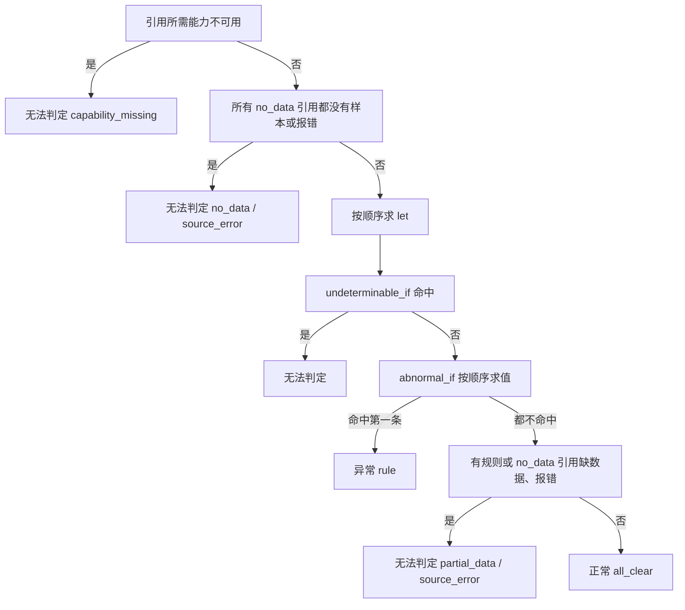

# 编写领域包

领域包只包含数据：告警目录、信号、证据链、检查项、规则提议、处置手册、知识、混沌实验与测试。SreNautix 的进程加载它们，第三方代码不随包运行。`packs/_example` 演示了全部文件，编写新包时从它复制。

SDK 在 `packages/packs-sdk`（Apache-2.0），命令行入口是 `srenautix pack`。

## 目录结构

| 文件 | 结构（`contract/schemas/pack.schema.json`） | 内容 |
|---|---|---|
| `pack.yaml` | 根对象 | 名称、版本、成熟度、`requires` 与 `optional` 能力、最低 SreNautix 版本 |
| `signals.yaml` | `SignalsFile` | 信号与备选查询 |
| `components.yaml` | `ComponentsFile` | 组件类型（按种类与标签匹配拓扑节点）与 operator 约定 |
| `alerts.yaml` | `AlertsFile` | 告警目录：告警名、角色、实体映射、关联的证据链 |
| `chains.yaml` | `ChainsFile` | 证据链：证据卡、排除规则、处置手册 |
| `checks.yaml` | `ChecksFile` | 与告警无关、按实体种类运行的检查项 |
| `rules.yaml` | `RulesFile` | 规则提议：条件满足时提议动作目录中的动作 |
| `remediations.yaml` | `RemediationsFile` | 修复补丁模板：条件满足时生成 GitOps 仓库的补丁，经 `gitops_pr` 开 PR |
| `rca-params.yaml` | `RcaParams` | 根因排序参数；修改需要通过回放门禁 |
| `action-requests.yaml` | `ActionRequestsFile` | 动作启用申请，经 Git PR 合入策略后生效 |
| `knowledge/*.yaml` | `KnowledgeFile` | 知识条目，`learned_from` 写来源链接 |
| `runbooks/*.md` | Markdown | 处置手册，证据卡的 `links` 可以指向其中的锚点 |
| `prompts/*.md` | Markdown | 提示词片段，按低信任处理，启用前需要管理员批准差异 |
| `chaos/*.yaml` | `ChaosFile` | 混沌实验：注入清单、时长、预期根因与告警 |
| `tests/*.yaml` | `PackTestFile` | 夹具测试 |
| `tests/replay/*.json` | `QuerySnapshot` | 录制的查询邻域快照，供 `--replay` 使用 |

目录中出现约定之外的文件时，加载失败。

## 成熟度

| 成熟度 | 要求 |
|---|---|
| `stable` | 每张证据卡都有夹具测试，并且在 Prometheus 与 VictoriaMetrics 上结论一致；只有 stable 的包计入"支持" |
| `beta` | 能通过 `lint`，夹具测试可以不完整 |
| `draft` | 开发中的包 |

## 信号

信号是证据卡引用的数据，每个信号有一组按优先级排列的备选：

```yaml
signals:
  - id: container_memory_limit_ratio
    kind: metrics
    unit: ratio
    alternatives:
      - expr: max by (namespace, pod, container) (example:container_memory_limit:ratio{$selector})
        recording_rule: true
      - expr: >-
          max by (namespace, pod, container) (
            container_memory_working_set_bytes{$selector, container!="", container!="POD"}
            / on (namespace, pod, container)
            kube_pod_container_resource_limits{$selector, resource="memory"}
          )
```

加载时逐个探测备选，按数据源记录选中的一个：

- 指标备选：渲染出的查询中每个指标名在探测窗口内都有序列；声明了 `probe` 时，probe 查询还必须返回非空。
- 日志与链路备选：数据源具备对应能力与方言即选中。
- 没有备选可用时，`srenautix pack doctor` 列出每个备选被拒绝的原因（`capability`、`dialect`、`missing_metric`、`probe`、`error`）。
- `recording_rule: true` 的备选不能是最后一个：录制规则是可选的加速，必须有原始表达式兜底。

**模板变量**

| 变量 | 含义 |
|---|---|
| `$selector` | 按实体展开的标签匹配器（不含花括号）。Deployment、StatefulSet、DaemonSet、Job、CronJob、ReplicaSet 展开为所属 Pod 名的正则 |
| `$namespace`、`$name`、`$node` | 实体的命名空间、名称、所在节点 |
| `$rate_window` | 由抓取间隔推导的 rate 窗口：`max(60s, 4 × 抓取间隔)` |
| `$window` | 卡片窗口的长度，用于 `increase(x[$window])` 这类覆盖整个窗口的查询 |
| `$params.<名>` | 卡片与引用的参数 |

**标签档案**

模板一律用规范标签名书写：`namespace`、`pod`、`container`、`node`、`persistentvolumeclaim`。启动时按数据源探测标签档案（例如 `kubernetes_namespace`、`k8s_pod_name`，以及外部标签 `cluster` 的名字与抓取间隔），执行前用官方解析器改写标签名并注入 cluster 匹配器 `cluster=~"<集群>|"`；不带 cluster 标签的序列（聚合型录制规则的结果）也会匹配。

**严格解析**

方言为 `promql` 的备选用 Prometheus 官方解析器检查，`metricsql` 的用 VictoriaMetrics 官方解析器检查（两者编译为 wasm，随 `integration-sdk` 发布）。`lint` 对每个备选按 `applies_to` 的每种实体渲染一次再解析，并检查：不使用 `@` 修饰符；`range` 模式的查询结果是瞬时向量。同一份包要在 Prometheus 与 VictoriaMetrics 上得出相同结论，由 `pack test` 在两种后端上执行来保证。

## 证据卡

证据卡属于证据链（`chains.yaml`）或检查项（`checks.yaml`），结构见 `contract/schemas/evidence-card.schema.json`：

```yaml
- id: limit-ratio
  applies_to:
    kinds: [Pod, Deployment, StatefulSet]
  window: { before: 30m, after: 5m }
  params:
    limit_ratio: 0.9
  refs:
    - { name: mem, signal: container_memory_limit_ratio, mode: range }
    - { name: oom, signal: container_oom_events, mode: instant, empty_is: normal }
  judge:
    let:
      - { name: peak, cel: max(mem) }
      - { name: ooms, cel: count(oom) }
      - { name: anomaly_started_at, cel: 'first_above(mem, params.limit_ratio)' }
    abnormal_if:
      - cel: ooms > 0
        say:
          zh-CN: '{ooms} 个容器在窗口内被 OOM 终止'
          en: '{ooms} containers were OOM-killed in the window'
  display:
    value: peak
    unit: percent
    threshold: params.limit_ratio
```

**引用**

- `mode`：`instant`（窗口结束时刻）、`range`（整个窗口）、`logs`（日志行，`limit` 为行数上限）。
- `empty_is`：`no_data`（默认）表示没有样本就无法判断；`normal` 表示没有匹配本身就是正常结果，用于"出错的序列""OOM 事件""错误日志行"这类过滤型查询。过滤型引用的指标在数据源中不存在时同样视为空。

**判定顺序**



没有任何样本永远不会得出正常。依赖缺数据引用的 `let` 不可用，引用了它的规则跳过并计入 `partial_data`。表达式求值出错（缺样本之外的错误）时为无法判定，原因 `evaluation_error`。

**let**

`judge.let` 按顺序求值，后面的 `let` 和全部规则、`say`、`display` 都可以引用前面的名字。名为 `anomaly_started_at` 的 `let`（unix 秒）给出异常开始时间。表达式内部的局部绑定用 CEL 标准的 `cel.bind(名, 值, 表达式)`。保留名：`params`、`entity`、`window`、`row`、`cards`、`incident`、`root`。

**CEL 函数库**

序列在 CEL 中是 `{labels, times, values}`，只含有值的点；日志行是 `{labels, time, line}`。

| 函数 | 含义 |
|---|---|
| `max(x)`、`min(x)` | 列表：全部点的最大、最小值；单条序列：该序列的最大、最小值 |
| `max_in(list, from, to)` | 时间在 `[from, to)`（unix 秒）内的点的最大值，没有这样的点时不可求值；`max_in(x, window.from, window.anchor)` 与 `max_in(x, window.anchor, window.to + 1.0)` 对比事件开始前后 |
| `last(x)` | 列表：各序列最后一个点中的最大值；单条序列：最后一个点 |
| `sum(x)` | 列表：各序列最后一个点之和；单条序列：全部点之和 |
| `count(list)` | 有样本的序列数或日志行数 |
| `none(list)` | 列表中没有任何样本 |
| `points(list)` | 展开为点 `{t, v, labels}` 的列表 |
| `any_point(list, p, 谓词)` | 存在满足谓词的点，例如 `any_point(phase, p, p.v == 1.0 && p.labels.phase == "Pending")` |
| `transitions(list)` | 值变化的点 `{t, from, to, labels}` |
| `top_share(list, k)` | 最后值最大的 k 条序列占总量的比例，用于判断问题是否集中在少数对象 |
| `ratio(a, b)` | `sum(a) / sum(b)`，分母为 0 时不可求值 |
| `join(a, b, op)` | 按共同标签配对，两边最后值做 `op`（`+`、`-`、`*`、`/`，除数为 0 的配对丢弃），结果序列带两边的标签 |
| `first_above(list, 阈值)`、`first_below(list, 阈值)` | 第一个越过阈值的点的时间（unix 秒） |
| `label(序列或日志行, 名)` | 标签值，不存在时为空字符串 |
| `abs`、`fmt_pct`、`fmt_bytes`、`fmt_secs`、`fmt_num` | 数值与格式化 |

输入有硬上限：每个引用最多 200 条序列，每条序列最多 1500 个点，日志最多 200 行，超出部分在进入 CEL 前截断。加载时按 AST 计算每个表达式最坏情况下的求值步数，超过 2000 万步的表达式拒绝加载。

**文字与展示**

- `say`、`title`、`note`、表头都是 `zh-CN` 与 `en` 两种语言。`say` 是 ICU MessageFormat，变量取自 `let`，数字格式用 `{x, number, percent}` 等。
- `display.value` 与 `display.threshold` 是 CEL，`unit` 取 `none`、`percent`、`ratio`、`bytes`、`seconds`、`count`、`per_second`。
- `display.table` 是声明式表格：`rows_from` 选择一个引用，每列一个 CEL（`row` 为当前序列），`sort_by` 与 `limit` 控制排序与行数。
- `links` 中的 `explore` 由运行时生成指标查询链接，`runbook` 指向本包的处置手册。
- `egress: deny` 的卡片内容不进入模型上下文。

## 组件的可读名称

组件键以对象名或 id 为名，例如上游服务的 UUID。组件类型可以声明 `display_name`，事件标题、通知、控制台与 issue 优先显示它；组件键本身不变：

```yaml
component_types:
  - id: example.web
    match: { kind: Deployment, labels: { app.kubernetes.io/part-of: example-shop } }
    display_name:
      - alert_annotation: display_name
      - signal: deployment_display_name
        label: label_app_kubernetes_io_display_name
```

来源按顺序尝试，取第一个非空且不等于实体名的值：

| 来源 | 取值 |
|---|---|
| `alert_annotation` | 实体所在告警的注解 |
| `alert_label` | 实体所在告警的标签 |
| `signal` + `label` | 在事件锚点对本包的 metrics 信号做 instant 查询，备选按顺序尝试，取第一条序列的 `label` 标签 |

`lint` 检查 signal 来源是本包的 metrics 信号，并按组件类型的 kind 渲染、严格解析每个备选。server 用 packs-sdk 的 `resolveDisplayName(set, 组件类型, {entity, labels, annotations}, 数据源, 时刻)` 求值；数据源报错只让这个来源落空，名称只用于显示，不影响研判。

## 排除规则与规则提议

**排除规则**：证据链的 `excludes` 是 CEL 列表，命中任意一条时阶段 A 的处置判断为 `ignore`，`say` 写明原因。可用变量 `root`（根因实体）与 `incident`。

**规则提议**：`rules.yaml` 的每条规则只能引用动作目录（`contract/gateway/v1/action-catalog.yaml`）中已有的动作，参数名与类型按目录检查。`when` 与参数值都是 CEL，可用 `incident`、`root`、`cards`（键为 `<包>/<链>/<卡>`，值含 `verdict`）。`packs/workload/rules.yaml` 的 `stuck-init-recreate-pod` 是一个完整示例：Pod 卡在初始化容器、对应证据卡判定异常时提议 `pod_restart`。

## 修复补丁模板

`remediations.yaml` 的模板生成 GitOps 仓库的补丁（git diff 格式，每个文件带 `diff --git` 头），server 把它作为 `gitops_pr` 的 `params.patch` 开 PR，从不合并（ADR 0103）。模板只写仓库角色与文件角色，不写路径；同一套模板用于不同的仓库，差别全部在 server 配置的仓库布局里：

```yaml
remediation:
  repositories:
    gitops:                                   # 仓库角色，模板的 repository
      repo: example-org/shop-gitops
      base_branch: main
      files:                                  # 文件角色 → 路径、格式与逻辑字段
        release_input: { path: apps/shop/release.json, format: json, fields: { image: data.image, release_id: data.release_id } }
        autoscaling: { path: apps/shop/autoscaling.yaml, format: yaml }
        workloads: { path: apps/shop/workloads.yaml, format: yaml }
        alert_rules: { path: 'platform/observability/rules/*.yaml', format: yaml }
        pack_alerts: { path: srenautix/packs/shop/alerts.yaml, format: yaml }
```

一个模板由下面几部分组成：

| 字段 | 内容 |
|---|---|
| `category` | `release_rollback`、`config_resource`、`alert_rule`、`topology_coverage` |
| `when` | 适用条件（CEL）：`incident`、`root`、`cards`（`<包>/<链>/<卡>` → 结论）、`alerts`（成员告警，含 `role`、`source`、`catalog_entry`、`chronic`）、`params` |
| `inputs` | 计划时在事件锚点对本包 metrics 信号的 instant 查询；`entity` 是求实体的 CEL，默认根因 |
| `history` | 读取一个文件角色的 Git 历史，变量 `history` 为最近 `depth` 个修改过它的提交 `{commit, author, time, message, doc}` |
| `let`、`skip_if` | 按顺序求值的绑定；`skip_if` 任一为 true 时不生成补丁，`say` 写明原因 |
| `edits` | 对文件角色的修改：`document`（kind 与 metadata.name）与 `locate` 选定唯一的文档，`set` 按点路径或布局的逻辑字段设值（CEL，`current` 为原值），`append` 向数组追加元素 |
| `change`、`verify`、`rollback` | 写进 PR 描述的改动说明、验证计划（合并同步后应判为正常的卡片与时限）与回滚方法（revert 这个 PR 的提交） |

变量 `files` 是文件角色 → 文档列表（glob 匹配的全部文件与多文档 YAML 的全部文档展开），`fields` 是布局中的逻辑字段。点路径的段为键名、`name[key=value]`、`name[*]` 或 `name[N]`，可以含 `{变量}`。修改保留文件的注释、缩进与其他文档，只替换目标值。目标不存在、不唯一或已经是目标值时模板跳过，并给出原因。模板专用函数：`digest`、`field`、`mem_bytes`、`cpu_cores`、`mebibytes`、`millicores`、`seconds`、`kebab`、`component_ref`。

内置的 `gitops` 包有五个模板：

| 模板 | 类别 | 适用 | 修改 |
|---|---|---|---|
| `release-to-serving-version` | release_rollback | `params.stuck_cards` 中任一卡片异常（默认 `workload/release/init-waiting`、`replicasets`） | 发布输入改回历史中最近一次指向就绪 Pod 镜像 digest 的版本；仓库已经指向它时跳过 |
| `hpa-max-replicas-raise` | config_resource | 根因是 HPA，`workload/capacity/hpa` 异常 | `spec.maxReplicas` 加 `params.step`，不超过 `params.ceiling` |
| `memory-limit-raise` | config_resource | 根因是工作负载，`workload/pod-restarts/memory` 异常 | OOMKilled 容器的内存 limit 乘 `params.factor`，不超过 `params.ceiling` |
| `chronic-alert-relax` | alert_rule | 长期告警以 critical 触发，事件中没有症状告警 | 严重度改为 `params.to_severity`，`for` 至少 `params.min_for` |
| `alert-catalog-entry` | topology_coverage | 成员告警没有命中告警目录 | 按 deployment、statefulset、daemonset、pod 或 component 标签给告警目录加一条条目 |

模板的测试在 `packages/packs-sdk/test/remediation.test.ts`：同一套模板在两种布局的 Git 仓库上生成补丁，补丁必须能 `git apply --check` 到基准提交。

## 用户层

用户在不修改包的前提下用层文件调整，层按声明的顺序合并（组织在前、集群在后），每个层只修改一个包：

```yaml
api_version: srenautix.io/pack-layer/v1
target: _example
params:
  pod-memory/limit-ratio: { limit_ratio: 0.95 }
disable:
  - chains/pod-memory/oom-logs
patch:
  - path: /alerts/entries/0/role
    value: symptom
extend:
  rules: []
```

层内的操作按 `extend → params → patch → disable` 的顺序执行，结果重新按契约校验。`disable` 接受 `alerts/<id>`、`chains/<id>`、`chains/<id>/<card>`、`checks/<id>`、`rules/<id>`。

## 来源与 pack.lock

| 来源 | 写法 | 信任 |
|---|---|---|
| 内置 | `builtin` | 随 SreNautix 发布 |
| Git | `git+<url>@<40 位 commit>` | 以 Git 为信任来源，必须固定到完整的 commit |
| OCI | `oci://<仓库>@sha256:<digest>` | 必须固定到 digest，先通过 cosign 签名校验再拉取 |

`pack.lock` 记录每个包的来源与内容哈希（文件按路径排序后逐个取 sha256），以及每个用户层文件的哈希。每次研判和评测都记录 lock 本身的哈希，回放时据此确认用的是同一批包。

OCI 包是 `oras` 推送的单层制品，`artifactType` 为 `application/vnd.srenautix.pack.v1`，层是包目录本身：

```bash
oras push --artifact-type application/vnd.srenautix.pack.v1 registry.example.org/packs/redis:1.2.0 redis
cosign sign registry.example.org/packs/redis@sha256:<digest>
```

加载端用 `loadOciPack`：先由 `CosignVerifier` 校验签名（keyless 校验需要 `certificate_identity` 与 `certificate_oidc_issuer`；密钥对校验给出公钥文件），再检查制品类型与层数，最后拉取并加载。校验与拉取调用 `cosign` 与 `oras` 可执行文件。

## 以 ConfigMap 挂载

不经 Git 或 OCI 分发的用户包可以放进一个 ConfigMap，由 chart 挂载：

- 一个 ConfigMap 放一个包。顶层文件以文件名为键；子目录中的文件以 `<子目录>__<文件名>` 为键，例如 `runbooks__provider.md`、`tests__edge.yaml`、`tests__replay__memory.json`。加载时还原为子目录路径，内容摘要与源目录相同。
- chart 的 `packs.userConfigMaps` 每项是 ConfigMap 名（包名与它相同），或 `{configMap: <名>, pack: <包名>}`。ConfigMap 挂载为 `/etc/srenautix/packs/<configMap>/<包名>`，`/etc/srenautix/packs/<configMap>` 加入 server 的 `packs.dirs`。
- 挂载点中 kubelet 生成的 `..data`、`..<时间戳>` 条目不属于包内容，加载时跳过。
- ConfigMap 的大小上限是 1 MiB，夹具与快照较大的包改用 OCI 分发。

用户包可以引用内置包的证据链（组件类型或告警目录条目的 `chains` 写 `<包>/<链>`），也可以为内置包没有覆盖的实体 kind 声明组件类型。内置的 node、workload、pvc 包为 Node、Pod、Deployment、StatefulSet、DaemonSet、Job、HorizontalPodAutoscaler、PersistentVolumeClaim、PersistentVolume 声明了只有 kind 约束的组件类型；server 为实体选组件类型时取约束最多的一个，所以用户包中带名字或命名空间约束的类型优先。

## 命令行

```bash
srenautix pack lint                       # schema、交叉引用、CEL、PromQL 严格解析、动作目录
srenautix pack lock --write               # 写 pack.lock；--check 与已有文件比对
srenautix pack test                       # 夹具在 Prometheus 与 VictoriaMetrics 上各跑一遍
srenautix pack test --replay              # 在 tests/replay/*.json 快照上执行
srenautix pack record --prometheus <URL> --card <包/链/卡> --entity <种类/命名空间/名称> --anchor <时间> --out <文件>
srenautix pack doctor --prometheus <URL>  # 信号解析结果、14 天内未映射的告警名、没有证据链的组件
```

通用选项：`--packs <目录>`（默认 `./packs`）、`--pack <目录>`（额外的包，可重复）、`--only <包名>`、`--layer <文件>`（可重复，按出现顺序合并）、`--catalog <文件>`、`--lock <文件>`。`test` 另有 `--test <包名>`（可重复）：只执行这些包的测试，其余包仍然加载，供跨包引用的证据链编译，例如用户包引用内置包的证据链时只测试用户包。

## 测试

夹具用 promtool 的 `input_series` 写法，时间零点为 2026-01-01T00:00:00Z：

```yaml
api_version: srenautix.io/pack-test/v1
interval: 1m
input_series:
  - series: container_memory_working_set_bytes{namespace="shop",pod="web-0",container="web"}
    values: 500000000x20 520000000+22000000x19 950000000x20
input_logs:
  - labels: { namespace: shop, pod: web-2, container: web }
    lines:
      - { offset: 31m, line: 'fatal error: runtime: out of memory' }
tests:
  - name: 内存峰值超过 limit 的 90%
    eval_time: 40m
    card: pod-memory/limit-ratio
    entity: { kind: Pod, namespace: shop, name: web-0 }
    expect: { verdict: abnormal, reason_kind: rule }
```

`srenautix pack test` 的执行方式：

- 夹具装进真实的 Prometheus 与 VictoriaMetrics（版本与 sha256 固定在 `packages/integration-sdk/backends.json`），有日志夹具时装进真实的 Loki。
- 每个测试在两个后端上各跑一遍，结论（verdict、显示状态、原因类型）必须与期望一致，两个后端之间也必须一致。
- 每张卡自动生成三类测试：空后端上必须是无法判定；逐个把 `no_data` 引用换成空结果或数据源错误后不能得出正常；全部 `no_data` 引用报错时不能得出正常，没有判为异常时原因必须是 `source_error`。
- `stable` 的包要求每张卡都有夹具测试。
- 测试的 `params` 字段覆盖卡片参数，用于验证阈值行为。

**录制与回放**：`record` 在真实数据源上执行卡片，把查询与响应写成快照（`srenautix.io/query-snapshot/v1`）。`test --replay` 用快照代替数据源重新判定，快照中没有的查询直接失败，因此修改查询的提交必须重新录制。

**告警目录覆盖**：`alerts-kps` 包覆盖 kube-prometheus-stack 的全部告警规则。CI 按 `packages/packs-sdk/upstream/kube-prometheus-stack.json` 固定的 chart 版本与 sha256 用 Helm 渲染，取出全部 PrometheusRule 告警，检查每个上游告警名都有目录条目、目录里没有上游不存在的告警名，并且条目角色为 `forecast` 当且仅当规则表达式调用了 `predict_linear`。升级 chart 时同时更新固定文件与目录。

## 内置包

| 包 | 内容 |
|---|---|
| `alerts-kps` | kube-prometheus-stack 全部告警的目录条目与证据链映射 |
| `kubernetes-core` | apiserver、etcd 与其他控制面组件 |
| `node` | 节点健康、文件系统、网络、时钟；混沌实验 node-memory-pressure |
| `workload` | 重启与 CrashLoop、Pending、发布进度、发布（等待迁移的 init 容器、新旧 ReplicaSet、正在服务的版本、迁移 Job、开始前后的 5xx 与延迟）、Job、容量；规则提议重建卡在初始化的 Pod；混沌实验 crashloop-bad-config |
| `gitops` | 修复补丁模板：发布输入回到正在服务的版本、HPA 上限、OOMKilled 容器的内存 limit、长期告警的严重度与持续时间、告警目录条目 |
| `pvc` | 卷容量；混沌实验 fill-volume |
| `observability-self` | 抓取、Prometheus TSDB、规则评估、告警投递 |
| `cert-manager` | 证书到期与签发失败 |
| `postgres` | CloudNativePG 与 postgres_exporter：复制、连接、WAL、锁；混沌实验 primary-kill |
| `redis`、`mysql`、`kafka`、`rocketmq`、`nacos` | 各自 exporter 的可用性、延迟、积压与资源 |
| `ingress-nginx`、`envoy-gateway` | 入口错误率、延迟、上游健康 |
| `argocd`、`flux` | 同步失败与健康状态 |
| `longhorn` | 卷健康、副本与节点存储 |
| `_example` | 演示全部文件的示例包，默认不加载 |

全部内置包都是 `stable`。
