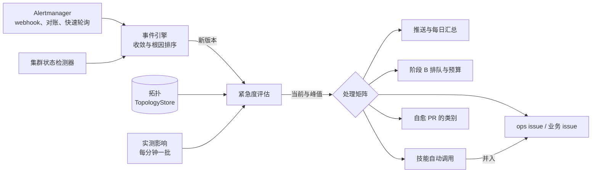

# 按紧急度分级的事件工作流

状态：设计（ADR 0182），未实现；用户已决定的事项（2026-11-03）记在 ADR 0182 的末尾，本文按这些决定写。本文是 ADR 0182 的详细设计：输入、算法、处理矩阵、issue 路由、技能的自动调用、契约与配置、自身可观测性、评测，以及与现有实现的差距。

## 1. 目标与范围

告警（Alertmanager 的 webhook、完整对账与快速轮询）与 SreNautix 自己发现的异常（集群状态检测器合成的 `source: detector` 告警）汇成事件之后，SreNautix 给每个事件一个紧急度，按紧急度决定推送、研判、技能、issue 与 PR，并在消息、控制台与指标里写明紧急度的依据。



紧急度只由确定性数据计算：告警标签、拓扑、指标与证据卡。模型不参与，模型不可用时紧急度照常计算。

## 2. 输入

### 2.1 告警标签

告警的标签契约由部署方定义（CCHP 见 `platform/observability/topology/README.md`）：`severity`、`component`、`role`（symptom、cause、change、meta，SreNautix 另有 forecast）、`chain`、`layer`、`entity_kind`、`entity`，以及序列自带的对象标签（`namespace`、`pod`、`container`）。规则表可以引用任何标签。`layer` 的编号是部署方自己的分层，SreNautix 不解释它的取值。

### 2.2 拓扑

拓扑存储（DESIGN §4，ADR 0144）可以按任意时刻读出子图。紧急度用的是已有的两样东西：

- `TopologyStore.subgraph(cluster, seeds, at, hops)`：从种子出发不超过 hops 跳的子图；
- `dependencyPath(graph, from, to, maxHops)`（`notify/external.ts`，ADR 0150）：from 依赖 to 的最短路径，起点是组件及其全部成员，枢纽可以到达但不再展开，经访问边（`egress_to`）到达的组件不再沿它的依赖展开，命名推断的边（置信度 0.3）不算。

### 2.3 实测业务影响

- **影响指标**：部署方在 `urgency.impact.indicators` 列出领域包的 metrics 信号（错误率或可用性的比值），每个指标带错误预算与三个窗口的信号。信号按备选与标签档案渲染（DESIGN §6.2），与证据卡同一个数据源（`EvidenceSource`）。
- **影响卡**：证据卡定义里 `impact: true` 的卡（ADR 0125、0150），本事件阶段 A 的结果中异常的影响卡。

## 3. 算法

### 3.1 首轮：标签规则

```yaml
urgency:
  label_rules:
    - id: l0-critical
      tier: U0
      floor: U1
      labels: { layer: [L0], severity: [critical] }
```

- 每条规则是 ADR 0166 的匹配器（`labels` 的每个标签取列出的值之一，`exclude_labels` 的任何标签都不取列出的值）加上 `id`、`tier`（U0–U3）与可选的 `floor`（第 3.4 节降级的下限，默认等于 U3，即不限）。
- 每条触发中的成员告警按顺序取第一条命中的规则；`role: forecast` 的告警得到的紧急度最高为 U2。
- 事件的首轮紧急度是全部触发中成员里最紧急的一个；命中这一级的规则 id 与告警 id 进入依据。几个成员都命中同一级时，`floor` 取其中最紧急的一个。
- 没有任何成员命中规则时，首轮由拓扑距离给出（第 3.2 节）。
- 没有触发中的成员（事件恢复）时，紧急度冻结在最后一次评估的结果，峰值不变。

### 3.2 拓扑距离

- **入口**：`urgency.entry_components`，拓扑键的列表（CCHP：`component:edge-caddy`、`component:edge-envoy`）。
- **根因**：研判根因（研判达到 likely 时，ADR 0126），否则为发现根因；根因展开到的拓扑对象（ADR 0130 的逻辑组件到工作负载）都作为终点。
- **距离** `d`：对每个入口求 `dependencyPath(graph, 入口, 根因, max_hops)`，取最短的路径长度；根因属于入口组件时 `d = 0`；没有路径时 `d = ∞`。子图取入口 `max_hops` 跳以内（每个集群一个子图，按拓扑版本缓存 60 秒，与 ADR 0150 的缓存相同）。
- **只来自告警、不在拓扑里的根因**（例如 provider）：按组件键匹配领域包的组件依赖（CCHP 的 `components.yaml` 经 cchp 包进入拓扑）；仍然没有路径时 `d = ∞`。
- **拓扑首轮**：没有规则命中时，`d ≤ near_hops`（默认 1）为 U1，其余为 U2。拓扑首轮不给 U0：仅凭拓扑上接近不能说明业务中断，U0 只来自规则或实测影响。

### 3.3 实测影响的状态

每个指标 `i` 在时刻 `t` 的燃烧率 `burn_w(t) = ratio_w(t) / budget_i`，`w` 为短（5m）、中（30m）、长（1h）三个窗口。

| 状态 | 判定（默认值） |
|---|---|
| `outage` | 最近 `sustain`（3 分钟）的每个点 `burn_5m ≥ 14.4` 且 `burn_1h ≥ 14.4` |
| `degraded` | 最近 `sustain` 的每个点 `burn_5m ≥ 6` 且 `burn_30m ≥ 6`；或本事件有异常的影响卡 |
| `none` | 事件开始之后已过 `settle`（10 分钟），其间没有任何一点满足 degraded，流量（`traffic_guard` 信号）不低于下限 |
| `pending` | 事件开始不到 `settle` |
| `unknown` | 指标没有数据、数据源出错或熔断、流量低于下限、事件 `observability_blind` |

- 事件的实测状态取全部适用指标中最严重的一个（outage > degraded > none）；只要有一个适用指标为 unknown 且其余没有给出 outage 或 degraded，结果为 unknown。
- 指标的 `applies_to`：`any`、`internal`（根因不是外部组件时适用）、`external`（根因是外部组件时适用，ADR 0147 的判定）。CCHP 的边缘错误率对两者都适用；gateway 自身错误率（不含供应商与供给类失败码）只对内部根因适用。
- 阈值与 `sustain` 是部署方按自己的流量校准的：低流量时 5 分钟比值抖动大，`traffic_guard` 与 `sustain` 防止单个错误把事件升级。

### 3.4 相关性

一次影响（指标连续满足 degraded 或 outage 的一段，起点 `s`）与事件 `I` 相关，满足任一条：

1. `I` 的影响卡异常；
2. `I` 的开始时刻在 `[s − within, s + lead]` 之内（`within` 默认 30 分钟，`lead` 默认 10 分钟：告警的 `for` 让事件晚于影响出现）；
3. 没有任何触发中的事件满足第 2 条，`I` 在 `s` 之前开始，且 `d` 有限；多个事件满足时取 `d` 最小的，再取开始最晚的。

起点早于 `I` 开始 `lead` 以上、并已经与另一个事件相关的影响是“既有影响”（`impact_preexisting`）：它不让 `I` 升级，也不让 `I` 降级（业务已经受影响时证明不了 `I` 没有影响）。

### 3.5 校正

```text
P      = 首轮紧急度（规则或拓扑）
F      = 命中规则的 floor（拓扑首轮为 U3）
M      = 实测状态；tierOf(outage) = U0，tierOf(degraded) = U1
near   = 首轮来自规则，或 d ≤ near_hops

if M ∈ {outage, degraded} 且 tierOf(M) 比 P 紧急:
    U = P 升一级（不超过 tierOf(M)）                  # impact_raise_*
elif M = none 且 near 且 P ∈ {U0, U1}:
    U = max_less_urgent(P 降一级, F)                   # impact_lower_none；被 F 挡住时 impact_floor
else:
    U = P                                              # impact_pending / impact_unknown / impact_preexisting
```

每次只移动一级，满足用户决定第 1 条：接近业务但没有实测影响的降一级，规则之外但有实测影响的升一级。更大的移动由第 3.6 节的随时间升级完成，每一步都有原因码。

### 3.6 随时间的变化

| 机制 | 规则（默认） | 上限 |
|---|---|---|
| 升级 | 计算结果比当前紧急时立即生效 | — |
| 降级的保持 | 计算结果比当前不紧急，连续 `deescalate_after`（15 分钟）都如此才生效；期间原因码 `hold` | — |
| 持续影响 | 最近 60 分钟里实测为 degraded 或 outage 的分钟累计不少于 `sustained_after`（30 分钟）时升一级 | U0 |
| 复发 | 同一（根因组件，证据链）在 `recurrence.window`（24 小时）内第 `recurrence.count`（3）次成为事件根因时升一级 | U1 |
| 手动 | responder 及以上在控制台指定；保持到事件结束或被撤销，自动评估照常记录但不生效 | — |

事件保存当前紧急度 `tier` 与峰值 `peak_tier`。推送、研判排队与技能的优先级按当前值；issue 与 PR 的资格按峰值（一个曾经是 U0 的事件，issue 不因后来降级而撤回）。

### 3.7 评估时机与开销

- **何时评估**：事件引擎写入新版本时（首轮与拓扑距离）；研判完成、根因变化时（拓扑距离）；实测影响每分钟一批（`impact.interval`）之后对全部触发中与结束不到 30 分钟的事件重新校正。只有主实例评估。
- **查询**：每个集群每分钟一批，每个指标三个窗口加一个流量信号，与事件数无关。CCHP 的两个指标都是录制规则（`cchp:edge_error_ratio:*`、`cchp:gateway_own_error_ratio:*`），每分钟 7 次即时查询。查询经后端并发限制（ADR 0146 §6），数据源熔断时状态为 unknown，不重试堆积。
- **写入**：紧急度或实测状态变化时才写 `server.incident_urgency` 与 `server.urgency_transitions`；评估时刻只在内存与指标里更新。
- **与 SreNautix 自身的升级无关**：紧急度不进入 SreNautix 的同步与升级门禁（第二阶段章程 §4 第 13 条）；SreNautix 自身的告警（`srenautix_self`）不进入事件，也就没有紧急度。

### 3.8 原因码

原因码登记在 `contract/reason-codes.json`，阶段 `urgency`，分组 `urgency`（ADR 0172）：

| 原因码 | 级别 | 说明 |
|---|---|---|
| `label_rule` | info | 首轮来自标签规则（依据带规则 id 与告警） |
| `topology_near` | info | 没有规则命中，根因离入口不超过 near_hops |
| `topology_far` | info | 没有规则命中，根因离入口较远或没有路径 |
| `impact_raise_outage` | warning | 实测业务中断，升一级 |
| `impact_raise_degraded` | warning | 实测业务降级，升一级 |
| `impact_lower_none` | info | 接近业务但没有实测影响，降一级 |
| `impact_floor` | info | 没有实测影响，规则的下限不允许再降 |
| `impact_pending` | info | 事件开始不久，实测影响尚未判定 |
| `impact_unknown` | warning | 实测影响无法判定（无数据、数据源错误、流量过低或观测失明），保持首轮 |
| `impact_preexisting` | info | 业务影响在本事件之前已经开始，由其他事件解释 |
| `sustained_impact` | warning | 业务影响持续，升一级 |
| `recurrence` | warning | 同一根因 24 小时内反复出现，升一级 |
| `hold` | info | 降级等待保持期 |
| `override` | info | 人工指定 |

时间线（`TimelineEntry.kind = urgency_changed`）的文本为 `U1 → U0：<原因码说明>`，`ref` 为变化记录的 id。

### 3.9 两个例子

数值来自 2026-11-03 对 CCHP VictoriaMetrics 的只读查询，边缘错误预算 0.5%（SLO 99.5%）。事件的划分以重建包为准。

**2026-10-31 公共首页 503**（`PublicEndpointProbeFailed`，`instance=https://ccx.autobits.cc/`，06:50Z–16:35Z）：

1. 首轮：命中 `l0-critical`，U0，下限 U1；根因 `component:edge-caddy`，`d = 0`。
2. 06:50–07:00Z 为 pending，保持 U0，首条消息照常在 60 秒内发出。
3. 07:00Z 起实测为 none（13:46Z 之前边缘与 gateway 指标都没有连续 3 分钟满足 degraded），降为 U1，07:15Z 保持期结束后生效；原因码 `impact_lower_none`。
4. 13:46Z 起 gateway 自身错误率、13:51Z 起边缘错误率进入 degraded，边缘随后连续 26 分钟为 outage；14:00Z 开始的 `CCHPErrorBudgetBurnFast` 事件满足相关性第 2 条，这段影响归它；首页事件仍为 U1。

**2026-11-02 gateway OOM**（`KubeContainerOOMKilled`，gateway-3 00:10Z、gateway-0 00:45Z）：

1. 首轮：命中 `core-termination`，U1，下限 U1；根因为 gateway 的 StatefulSet，`d = 1`（edge-envoy → gateway）。
2. 00:05Z 起边缘错误率满足 degraded（00:07Z 达到连续 3 分钟），起点在事件开始前 5 分钟，与事件相关（第 3.4 节第 2 条），状态 degraded，首轮已是 U1，不变。
3. 最近 60 分钟累计 degraded 43 分钟，超过 30 分钟：升为 U0（`sustained_impact`）。
4. 自 11-01 07:55Z 起第 3 次以 gateway 为根因的 OOM（复发），复发的上限是 U1，已经是 U0，不变。

## 4. 紧急度表

| 紧急度 | 含义 | CCHP 规则（`label_rules` 的 id） | 下限 |
|---|---|---|---|
| U0 业务中断 | 用户请求大面积失败，或计费、数据的正确性正在受损 | `l0-critical`：layer=L0、critical（边缘错误预算快速与慢速燃烧、公共端点探测）<br>`core-slo-critical`：component=gateway\|control\|worker、critical、symptom（gateway 自身错误预算燃烧）<br>`billing-critical`：component=business、critical（用量写入失败、供应商成本屏障超时）<br>`pg-failover`：component=pg、alertname 为没有可写主库、没有主库、主库变化、切换卡住、PostgreSQL 宕机、postmaster 重启 | U1；`pg-failover` 与 `billing-critical` 为 U0 |
| U1 业务降级 | 用户可感知的局部失败或变慢，或核心路径上的部件失效但还有余量 | `l0-warning`：layer=L0、warning<br>`core-termination`：OOM、CrashLoop 与异常退出落在 `cchp-prod` 的 gateway、control、worker 容器上（CCHP 没有驱逐的告警，驱逐由技能的 `kube` 触发发现并挂到事件）<br>`core-degraded`：核心组件的 symptom（critical 或 warning）<br>`core-runtime-critical`：核心组件或 workload 的 critical<br>`data-critical`：component=pg\|dragonfly\|nats、critical<br>`billing-warning`：component=business | `core-termination`、`billing-warning` 为 U1；其余 U2 |
| U2 有风险 | 现在没有业务影响，趋势或冗余的缺失会导致影响 | `provider-external`：component=provider（外部上游，按小时汇总，ADR 0147）<br>`forecast`：role=forecast 或 chain=capacity\|db-backup\|storage<br>`delivery`：layer=delivery（发布、GitOps、证书）<br>其余没有命中的告警按拓扑：`d ≤ 1` 为 U1，其余 U2 | — |
| U3 无业务影响 | 只影响观测、交付流水线或 SreNautix 自身 | `meta`：layer=meta 或 chain=observability<br>`info`：severity=info<br>`e2e`：namespace=operation-* | — |

CCHP 7 天的首轮分布（2026-10-27 至 11-03 的告警片段，不是事件数；一个事件通常包含几个片段）：U0 30、U1 95、U2 263、U3 208。U0 里 21 个是边缘错误预算燃烧，8 个是 gateway 自身错误预算燃烧，1 个是公共首页探测。

## 5. 处理矩阵

### 5.1 推送

| | U0 | U1 | U2 | U3 |
|---|---|---|---|---|
| 新消息 | 即时，带提醒 | 即时 | 不即时；每日汇总 | 不推送 |
| 首条消息期限 | 60 秒（阶段 A 未生成时先发不带证据卡的消息，ADR 0173） | 120 秒 | 汇总时刻 | — |
| 升级到本级时 | 回复原消息发一条提醒（编辑不产生提醒） | 同左 | 下一次汇总列出 | — |
| 仍在触发时 | 每 30 分钟回复提醒一次，最多 4 次 | — | — | — |
| 降级时 | 只编辑原消息 | 只编辑 | 已有消息照常编辑 | 已有消息照常编辑 |

- 消息头条：`<前缀> U0 业务中断 · <严重度> · <根因组件与症状>`；“现状”段第一行写紧急度的依据，例如 `紧急度：U0（首轮 U1 · core-termination；实测边缘错误预算 6 倍以上燃烧累计 43 分钟，持续影响升级）`。数值只取自 `UrgencyAssessment`。
- 不推送的决定写进事件的终态记录：`withheld_urgency`（U2 进入每日汇总、U3 不推送），每个事件每个原因一次（ADR 0172）；已经发出消息的事件照常编辑。
- **每日汇总**（`urgency_digest`，`notify_messages` 新的 kind）：每天 `digest.at`（CCHP 为 Asia/Shanghai 09:30）一条，静默发送，之后不再编辑。内容：最近 24 小时触发过的 U2 事件按根因归组，每组一行（根因、成员告警数、首末时刻、主要证据卡的数值、控制台链接）；超过每小时上限而没有开出 issue 的 U1 事件；U3 只写一行计数。外部上游已在每小时汇总里（ADR 0147），不重复列出。
- 推送的发送优先级（DESIGN §11）：审批与新的 U0 → 新的 U1 → 风暴摘要 → 编辑 → 恢复 → 汇总。
- `notify.severities` 仍然生效：严重度不在推送范围内的事件不推送，与紧急度无关。

### 5.2 研判

| | U0 | U1 | U2 | U3 |
|---|---|---|---|---|
| 队列优先级 | 1 | 2 | 3 | 不进入 |
| 保留槽位 | `urgency_reserved`（默认 1） | — | — | — |
| 当日预算 ≥80% | 照常 | 照常 | 只出阶段 A | — |
| 当日预算 100% | 照常 | 只出阶段 A | 只出阶段 A | — |
| 单次研判的输入上限 | `per_research_input_tokens` | 同左 | 一半 | — |
| 兜底模型路由（ADR 0152） | 允许 | 允许 | 不允许 | — |
| 风暴模式 | 按紧急度、再按根因得分取前 `storm_top_roots` 个进入阶段 B | 同左 | 只出阶段 A | — |

- 队列的排序改为：紧急度 → 严重度 → 吸收的症状数 → 新事件优先 → 等待时长。紧急度在排队之后变化时，下一次认领按新值排序。
- 保留槽位只给 U0；`scheduler.critical_reserved` 在 `urgency.mode: enforce` 时不再生效，`off` 与 `shadow` 时照旧。
- 研判的入队原因增加 `urgency_raised`：紧急度升到 U1 及以上、本版本没有研判时触发一次研判（次数上限 `max_runs_per_incident` 照常约束）。

### 5.3 技能

| | U0 | U1 | U2 | U3 |
|---|---|---|---|---|
| `incident` 触发 | 自动，不等 settle | 自动，等技能的 settle | 只有清单或部署方列出 U2 时 | 不自动 |
| 后端并发的排队 | 最先 | 先于阶段 B 的 U2 与主动优化 | 与主动优化同级 | — |
| 风暴期间 | 开始新运行，同时最多 1 个 | 不开始 | 不开始 | — |

详见第 7 节。

### 5.4 issue

| | U0 | U1 | U2 | U3 |
|---|---|---|---|---|
| ops 事件 issue | 峰值到 U0 时立即开出 | 处置为 escalate 或有改仓库的提议时开出（ADR 0095 的条件） | 只在有改仓库的提议时开出（PR 需要 Refs） | 不开 |
| 达到每小时上限 | 保持等待，10 分钟后重试，不跳过 | 记为 skipped，进入每日汇总 | 保持等待（提议需要它） | — |
| 业务 issue | 有代码位置时开出（第 6 节） | 同左 | 同左 | 不开 |

- U0 的 issue 在事件还没有阶段 B 结论时就开出，正文先写阶段 A 的内容，研判结束后就地更新（ADR 0125）。
- 外部上游的事件照 ADR 0147 不开 issue；有相关业务影响而升到 U1 及以上时照常开出（ADR 0150 的判定与紧急度一致）。

### 5.5 PR

| 紧急度峰值 | 允许的自愈 PR 类别 |
|---|---|
| U0 | `release_rollback`、`config_resource` |
| U1 | `release_rollback`、`config_resource` |
| U2 | `config_resource`、`alert_rule` |
| U3 | `alert_rule` |

- 在 ADR 0170 的准入条件之后判断，不满足时跳过代码为 `urgency_category`（原因码分组 `remediation_admission`）。
- 理由：业务受影响时修改告警规则只会掩盖影响（ADR 0170 本来就要求处置为 ignore）；没有业务影响时回退发布的代价大于收益；容量与资源的调整在 U2 有意义（趋势）。
- PR 只在 ops 仓库（gateway 策略的 `gitops.repositories`），只开不合并，经人审阅（不变量 12）。业务仓库没有 PR（不变量 15）。

## 6. issue 路由与互相引用

### 6.1 根因位置

| 根因位置 | 判定 | issue |
|---|---|---|
| 部署、配置、集群 | `cause_scope` 为 `configuration`、`infrastructure`、`downstream`、`unknown`，或根因由 GitOps 仓库负责（ADR 0170 的 `repository_owned`） | ops 事件 issue |
| 应用代码 | 有确定性的代码位置：技能的 `code.locate@v1` 输出，或主动优化的代码定位（ADR 0146 §3.5），置信度不低于 `routing.business.min_confidence`（默认 medium） | ops 事件 issue + 业务 issue，互相引用 |
| 应用代码，没有代码位置 | `cause_scope` 为 `local`，没有代码位置 | ops 事件 issue，“定位”段写“根因可能在应用代码，未定位到代码” |
| 外部上游 | ADR 0147 | 照 ADR 0147（有业务影响时开 ops issue） |

ops 事件 issue 是每个事件唯一的跟进入口（现状、证据、拓扑、处置、PR、技能结果、业务 issue 的链接）；业务 issue 只描述代码问题，按代码去重，跨事件累计。

### 6.2 业务 issue

- **键**：代码指纹。来自技能时用技能发现的指纹（`sha256(技能名, 集群, outputs.fingerprint)`，ADR 0181 §7.5）；来自主动优化的代码定位时用发现的指纹（ADR 0146 §4.5）。
- **代**：与技能发现相同的规则：没有时开第 1 代；打开时评论；以 completed 关闭后再次出现开下一代，正文开头写“修复后再次出现”并引用上一代；以 not planned 关闭后 30 天内只计数，之后开下一代。
- **内容**（标记 `<!-- srenautix:business=<指纹>/<代> -->`）：`## 现象`（触发它的事件、紧急度峰值、时刻与次数）、`## 定位`（仓库、提交、文件与行号、函数，链接固定到提交）、`## 机制`（技能或领域包声明的机制，标“推断”）、`## 证据`（只有数值与链接，不放日志原文）、`## 运维侧`（`CCH-HQ/cchp-k8s-ops#<n>`）。标签：`srenautix`、`srenautix:incident`、路径映射的 `area/*`。
- **白名单**：业务仓库角色只允许创建 issue、评论、读取与只改 `title`、`body` 的 PATCH（ADR 0146 §6.4），不新增请求种类。

### 6.3 互相引用

- 业务 issue 开出之后，ops 事件 issue 的“定位”段写 `CCH-HQ/claude-code-hub-plus#<n>`（正文就地更新）并追加一条评论；业务 issue 的 `## 运维侧` 写 ops issue。
- 先开出的一边不知道另一边的编号时，引用由后台循环补写（与 ADR 0095 第 6 条给 PR 补 Refs 的方式相同）：读取对方的状态 → PATCH 只改 body。补写的状态记在 `server.github_issue_links.cross_ref`（`pending`、`done`、`failed`）。
- 同一个业务 issue 被多个事件引用时，每个事件的 ops issue 都链接到它；业务 issue 每个事件追加一条评论（“再次出现：事件 <链接>，紧急度 U1”），同一事件只评论一次。
- 引用使用 `owner/name#<n>` 的完整写法，GitHub 在两边都显示交叉引用。

### 6.4 去重与每小时上限

| 仓库 | 计入每小时上限的 issue | 上限 |
|---|---|---|
| ops（`issues.repo`） | 事件 issue、覆盖 issue、没有挂到事件的技能 issue | `issues.max_per_hour`（CCHP 3） |
| 业务（`business` 角色） | 业务 issue、主动优化的业务 issue、没有挂到事件的业务角色技能 issue | `routing.business.max_per_hour`（默认 3） |

评论不计入上限（ADR 0095 第 5 条），技能评论仍受技能自己的每小时评论数约束（ADR 0181 §7.2）。

## 7. 技能的自动调用

### 7.1 触发

技能清单增加触发种类 `incident`（契约 `SkillIncidentTrigger`）：

```yaml
triggers:
  - id: incident-oom
    kind: incident
    match:
      tiers: [U0, U1]                       # 默认的紧急度；部署方可在 skills.auto_invoke 覆盖
      alerts: { alertname: [KubeContainerOOMKilled, SreNautixCrashLoop] }   # 任一触发中的成员告警满足
      chains: [runtime]                    # 可选：成员告警的证据链
      cards: [workload/container-oom]      # 可选：本事件阶段 A 中异常的卡
```

- `match` 的各项同时满足；`alerts` 的写法与 `alert` 触发的匹配器相同。
- **运行对象**：研判根因（没有时为发现根因）展开到的工作负载，种类在清单的 `scope.kinds` 内；`binding.required` 的技能只在有绑定的工作负载上运行（ADR 0181 §5）。
- **评估时机**：事件的新版本与紧急度变化时；同一（技能，事件）只在紧急度第一次进入 `tiers`、或根因变化时登记一次运行。之后同一对象的运行由技能的 debounce 与“只投递新的发生”约束。
- **部署方配置**：`skills.auto_invoke.<技能名>.tiers` 覆盖清单的紧急度；不在 `skills.enabled` 中的技能不运行。

### 7.2 挂到事件

- `incident` 触发的运行直接挂到触发它的事件。
- 其他触发（`alert`、`kube`、`metric`、`manual`）的运行，在开始时查找运行对象所属的事件：对象（或它的 Pod）是某个触发中、或结束不到 30 分钟的事件的组件或成员告警的实体。找到多个时取紧急度最高、再取开始最晚的事件。
- 挂接写在 `server.skill_runs.incident_id`、`incident_version`，审计 `skill.run_started` 带上事件。

### 7.3 预算与优先级

- 每次运行的预算与每小时运行数仍按技能（ADR 0181 §7.2）。U0 事件的 `incident` 运行在每小时运行数达到上限时不推迟，计入超额计数（`srenautix_skill_budget_exhausted_total{budget="hourly_runs_bypassed"}`），每个技能每小时最多 2 次。
- 后端并发（`skills.concurrency` 与 BackendLimiter）按第 5.3 节的顺序排队。
- 技能只用确定性步骤（ADR 0181），不消耗模型预算。

### 7.4 输出合并

| 运行 | 投递 |
|---|---|
| 挂到事件，没有代码位置 | ops 事件 issue 正文的技能段（`<!-- srenautix:issue=skill:<技能名> -->`，按运行就地更新）；发现第一次出现时追加一条评论 |
| 挂到事件，有代码位置 | 同上，另外这个发现就是业务 issue（第 6.2 节），技能段链接到它 |
| 没有挂到事件 | ADR 0181 §7.5：技能自己的 issue，按指纹去重 |

- 事件还没有 ops issue（紧急度或处置不满足开 issue 的条件）时，技能结果先存在运行与发现里，事件的 issue 开出时写入；事件始终没有 issue 时，结果在控制台的事件详情与技能运行页可见，消息的“关键问题”段写一行技能结论。
- 技能运行失败或预算用尽时，技能段写原因码的说明（`skill_run` 分组），不阻塞事件 issue。
- 同一个发现（指纹）挂到不同事件时，每个事件的技能段都引用同一个发现与业务 issue；`server.skill_findings` 的出现次数照常累加。

## 8. 展示

### 8.1 消息

见第 5.1 节。Telegram 的头条与依据行占两个等宽实体以内（ADR 0145 的实体预算）。

### 8.2 控制台

- 事件列表：紧急度徽标与筛选，默认按紧急度、再按开始时刻排序；状态条在有触发中的 U0 事件时显示。
- 事件详情：紧急度面板（当前、峰值、首轮规则与告警、拓扑路径、每个影响指标的三个窗口与阈值、相关性依据、校正与随时间的变化），每项带数据源查询的链接（`links.metrics_explore_url`）。
- 手动指定：responder 及以上，必须选原因码（反馈原因码表，ADR 0174），记为反馈 `urgency_override`，进入评测候选。

### 8.3 指标

| 指标 | 标签 | 含义 |
|---|---|---|
| `srenautix_incident_urgency` | `cluster_id`、`tier` | 触发中事件按当前紧急度的个数 |
| `srenautix_urgency_transitions_total` | `from`、`to`、`code` | 紧急度变化 |
| `srenautix_urgency_impact_state_total` | `state` | 实测状态的评估结果 |
| `srenautix_urgency_impact_query_errors_total` | `indicator` | 影响指标的查询失败 |
| `srenautix_first_message_latency_seconds` | 增加 `urgency` | 首条消息时延按紧急度（ADR 0159、0165） |
| `srenautix_issues_total` | `repo_role`、`kind`（incident、business、skill、coverage）、`tier`、`outcome` | issue 的开出、评论、跳过与失败 |

## 9. 契约变更（2.46.0）

全部是新增的可选字段、枚举值与接口，次版本升到 2.46.0。

| 文件 | 变更 |
|---|---|
| `schemas/incident.schema.json` | `Incident.urgency`：`UrgencyAssessment` |
| `schemas/urgency.schema.json`（新） | `UrgencyAssessment`、`UrgencyTier`（U0–U3）、`UrgencyImpact`、`UrgencyTransition`、`UrgencyOverride` |
| `integrations/notify/v1/notify.schema.json` | `Message.urgency`（`tier`、`label`、`basis` 文本块） |
| `schemas/timeline.schema.json` | `TimelineEntry.kind` 增加 `urgency_changed` |
| `reason-codes.json`、`schemas/reason-codes.schema.json` | 阶段 `urgency`，分组 `urgency`；`remediation_admission` 增加 `urgency_category`；`notify_withheld` 增加 `withheld_urgency`；入队原因增加 `urgency_raised` |
| `schemas/skill.schema.json` | `SkillIncidentTrigger` |
| `schemas/skill-run.schema.json` | `SkillRun.incident_id`、`incident_version`、`attached_via`（`trigger`、`object`） |
| `schemas/eval-snapshot.schema.json`、标注 | `UrgencyFacts`（首轮、拓扑、实测）、标注的 `urgency_expect` |
| `schemas/condition.schema.json` | `UrgencyImpactBlind` |
| `openapi.yaml` | `GET /v1/incidents?urgency=U0,U1`；`GET /v1/incidents/{id}/urgency`（依据与变化历史）；`PUT`/`DELETE /v1/incidents/{id}/urgency-override`（responder 及以上，`x-srenautix-external: false`） |

`UrgencyAssessment` 的结构：

```yaml
tier: U0                 # 当前
peak_tier: U0
since: 2026-11-02T00:52:00Z
assessed_at: 2026-11-02T00:52:00Z
first_pass:
  tier: U1
  source: label_rule     # label_rule | topology
  rule_id: core-termination
  floor: U1
  alert_ids: ["<指纹>@<开始秒>"]
topology:
  root: StatefulSet:cchp-prod/gateway
  distance: 1            # null 表示没有路径
  entry: component:edge-envoy
  path: [component:edge-envoy, StatefulSet:cchp-prod/gateway]
impact:
  state: degraded        # outage | degraded | none | pending | unknown
  related_by: onset_window   # impact_card | onset_window | topology | preexisting
  indicators:
    - signal: cchp/edge_error_ratio
      burn: { short: 9.8, mid: 7.1, long: 4.2 }
      thresholds: { outage: 14.4, degraded: 6 }
      degraded_minutes_60m: 43
  evaluated_at: 2026-11-02T00:52:00Z
adjustments:
  - { code: sustained_impact, from: U1, to: U0, at: 2026-11-02T00:52:00Z }
hold_until: null
override: null
```

## 10. 迁移与配置

### 10.1 迁移

只增不删（ADR 0176）：

- `incident` 轨道：`server.incident_urgency`（`incident_id` 主键，当前与峰值、评估 JSON、时刻）、`server.urgency_transitions`（事件、版本、from、to、原因码、依据、时刻）、`server.urgency_overrides`；
- `github` 轨道：`server.github_issue_links`（`incident_id`、`repo_role`、`repo`、`number`、`kind`、`key`、`cross_ref`、时刻）。`server.github_issues` 仍以 `incident_id` 为主键，保存 ops 事件 issue；业务 issue 的代际记在 `server.skill_findings` 或主动优化的建议投递里，链接表只记“哪个事件引用了哪个 issue”；
- `skills` 轨道：`server.skill_runs` 增加 `incident_id`、`incident_version`、`attached_via`（可为空）；
- `research_queue` 增加 `urgency` 列（可为空，空时按 severity 排序）；
- `notify_messages` 的 kind 增加 `urgency_digest` 与 `urgency_reminder`。

N-1 版本照常运行：旧版本不读这些列与表。

### 10.2 模式

| `urgency.mode` | 评估 | 展示与指标 | 处理矩阵 |
|---|---|---|---|
| `off`（默认） | 否 | 否 | 否：行为与没有紧急度时相同 |
| `shadow` | 是 | 是：消息、控制台、指标、时间线 | 否：推送、研判、issue、PR 照旧按 severity |
| `enforce` | 是 | 是 | 是 |

### 10.3 server 配置

```yaml
urgency:
  mode: off                          # off | shadow | enforce
  entry_components: []               # 拓扑键；为空时拓扑距离都为 ∞
  near_hops: 1
  max_hops: 6
  label_rules: []                    # 有序；为空时首轮都来自拓扑
  impact:
    interval: 60s
    settle: 10m
    sustain: 3m
    within: 30m
    lead: 10m
    impact_cards: true
    traffic_guard: null              # { signal, min }
    indicators: []                   # [{ id, signal_short, signal_mid, signal_long, budget, applies_to, outage_burn, degraded_burn }]
  deescalate_after: 15m
  sustained_after: 30m
  recurrence: { count: 3, window: 24h }
  notify:
    u0_reminder_every: 30m
    u0_reminder_max: 4
    u1_first_message_deadline: 120s
    digest: { at: "09:30", timezone: UTC }
  research:
    urgency_reserved: 1
    u2_input_ratio: 0.5
  remediation:
    categories:
      U0: [release_rollback, config_resource]
      U1: [release_rollback, config_resource]
      U2: [config_resource, alert_rule]
      U3: [alert_rule]
  routing:
    business:
      enabled: false                 # 需要 optimization.repositories.business
      min_confidence: medium
      max_per_hour: 3
skills:
  auto_invoke: {}                    # <技能名>: { tiers: [U0, U1] }
```

chart：`roles.server.config.urgency` 原样渲染；`skills.autoInvoke`。CCHP 的取值见 cchp-k8s-ops 的映射文档（`operations/proposals/2026-11-03-srenautix-urgency-mapping.zh-CN.md`），这里给出要点：

```yaml
urgency:
  mode: shadow
  entry_components: [component:edge-caddy, component:edge-envoy]
  impact:
    traffic_guard: { signal: cchp/edge_requests, min: 0.02 }      # 已有信号
    indicators:                                                    # *_30m、*_1h 为 cchp 包新增的信号，录制规则已有
      - { id: edge, signal_short: cchp/edge_error_ratio, signal_mid: cchp/edge_error_ratio_30m,
          signal_long: cchp/edge_error_ratio_1h, budget: 0.005, applies_to: any }
      - { id: gateway-own, signal_short: cchp/gateway_own_error_ratio, signal_mid: cchp/gateway_own_error_ratio_30m,
          signal_long: cchp/gateway_own_error_ratio_1h, budget: 0.005, applies_to: internal }
  notify: { digest: { at: "09:30", timezone: Asia/Shanghai } }
  routing: { business: { enabled: true } }
skills:
  auto_invoke: { oom-rootcause: { tiers: [U0, U1, U2] } }
```

## 11. 工作流自身的可观测性

- **状态条件**（控制台状态条，`condition.schema.json`）：`UrgencyImpactBlind`：影响指标连续 10 分钟为 unknown（数据源不可用、录制规则缺失或流量低于下限）。这期间不降级，消息的依据行写“实测影响无法判定”。
- **自身告警**（chart 的 PrometheusRule，发往 SreNautix 自身告警的接收方，DESIGN §11）：
  - `SreNautixU0FirstMessageLate`：`srenautix_first_message_latency_seconds{urgency="U0"}` 的 p95 超过 90 秒（30 分钟窗口）；
  - `SreNautixUrgencyImpactBlind`：上面的条件持续 15 分钟；
  - `SreNautixU0IssueBacklog`：U0 事件的 issue 等待超过 30 分钟（`srenautix_issues_total{tier="U0",outcome="deferred"}` 增长而 `opened` 不增长）；
  - `SreNautixUrgencyFlapping`：同一事件 1 小时内紧急度变化超过 6 次。
- **看板**：SreNautix 自身看板增加“紧急度”一行：各紧急度的触发中事件数、变化次数按原因码、首条消息时延按紧急度、影响评估的状态分布与查询失败、issue 按仓库与紧急度。
- **审计**：手动指定写治理审计 `incident.urgency_override`；紧急度的自动变化只进入时间线与 `urgency_transitions`，不写治理审计（不是人的操作，也不改变外部系统）。

## 12. 评测与回放

### 12.1 标注

标注文件（部署方的 `labels-*.yaml`，ADR 0084、0175）的每个用例增加：

```yaml
urgency_expect:
  first: U1          # 首轮
  peak: U0           # 峰值
  final: U0          # 事件结束时
  codes: [label_rule, sustained_impact]   # 必须出现的原因码
  within: 5m         # 达到峰值的时刻与标注时刻的允许误差
```

### 12.2 用例

| 用例 | 窗口（UTC） | 预期（由 2026-11-03 的只读指标计算，事件划分以重建包为准） |
|---|---|---|
| `gateway-oom-loop-2026-10-24`（新导出） | 10-23 15:50 – 10-24 10:20 | 首轮 U1（core-termination）；边缘 degraded 自 17:00 起出现，60 分钟内累计最多 54 分钟 → U0（sustained_impact）；复发 |
| `public-page-503-2026-10-31`（新导出） | 10-31 06:50 – 16:35 | 首轮 U0（l0-critical）；pending 10 分钟后实测 none → U1（impact_lower_none，下限 U1）；13:53 起的中断归 14:00 的边缘燃烧事件（impact_preexisting 不出现在本事件） |
| `gateway-oom-2026-11-01`（新导出） | 11-01 07:50 – 08:30 | 首轮 U1；08:23 起 gateway 自身错误率 degraded 5 分钟，在 30 分钟相关窗口内 → U1 保持 |
| `gateway-oom-2026-11-02a`（新导出） | 11-02 00:05 – 01:15 | 首轮 U1；边缘 degraded 累计 43 分钟 → U0（sustained_impact） |
| `gateway-oom-2026-11-02b`（新导出） | 11-02 15:35 – 17:05 | 首轮 U1；边缘 degraded 12 分钟 → U1 保持 |
| `gateway-oom-2026-11-03`（新导出） | 11-03 10:05 – 11:00 | 首轮 U1；实测 none → 下限 U1 保持（impact_floor）；24 小时内第 3 次（recurrence） |
| `pg-sync-restart-2026-10-14`（已有） | 见标注 | 首轮 U0（pg-failover），下限 U0 |
| `pg-oom-failover-release-2026-10-25`（已有） | 见标注 | 首轮 U0（pg-failover），下限 U0 |
| 外部上游的 13 个用例（已有，`provider-*`） | 见标注 | 首轮 U2（provider-external）；有相关业务影响的升 U1；良性用例保持 U2 |
| `metrics-scrape-blind-2026-10-14`、`business-peak-hpa-benign-2026-10-20`、`gateway-over-provisioned-*`（已有） | 见标注 | 标注由人按重建包的指标确认后写入 |

新导出的重建包按 ADR 0085、0110 从 VictoriaMetrics、状态库与 Loki 只读导出，录制保存在部署方本机（`~/srenautix-seeds/`），不进入仓库。

### 12.3 评分

- 紧急度轴：首轮、峰值、结束时三项的准确率；峰值达到的时刻误差；必需原因码的召回。
- 代价不对称：把 U0 判成 U2 及以下是严重错误（单独计数，门禁要求为 0）；把 U2 判成 U0 计为打扰。
- 回放（ADR 0084）：同一重建包对规则表或阈值的修改给出成绩的差异；修改 CCHP 的 `urgency` 配置前在本机运行 `srenautix eval reconstruct --axis urgency`。
- 处理矩阵的回放：对每个用例输出“会推送、会研判、会开 issue、PR 类别”的决定，与 `mode: shadow` 期间的实际记录比较。

## 13. 不在范围内

- 自动执行任何写操作：紧急度不改变动作的分级与审批（DESIGN §9），U0 也不会自动回退或扩容。
- 电话、短信、邮件等新的通知渠道与值班轮换；Telegram 的按钮与命令（Telegram 的更新接收在正式切换之前由旧系统持有）。
- 模型参与紧急度的判定。
- 业务仓库的 PR；修改业务 issue 的标签、指派或状态。
- 多集群之间的紧急度比较；跨集群的入口组件。
- SLO 与错误预算本身的定义：指标由部署方的录制规则提供。
- 用紧急度替代 `notify.business_impact_alerts`（ADR 0166）：两者回答不同的问题，后者决定处置推导与外部上游汇总，保持不变。

## 14. 与现状的差距

规模：S 为一个模块内的改动与测试；M 为跨两三个模块或含迁移与契约；L 为跨角色、含新的状态机或外部集成。

| # | 能力 | 现状 | 差距 | 规模 |
|---|---|---|---|---|
| 1 | 标签首轮 | 匹配器与文字形式已有（`alerts/business-impact.ts`，ADR 0166） | 规则表、按成员取最紧急、forecast 的上限、`floor` | S |
| 2 | 拓扑距离 | `dependencyPath`、`topologyPaths`、`TopologyStore.subgraph` 已有（ADR 0150、0144） | 多入口、研判根因与展开、按集群缓存子图 | S |
| 3 | 实测影响 | 影响卡（`impact: true`）、证据数据源、后端并发限制已有 | 多窗口燃烧率、状态、相关性与既有影响、每分钟一批 | M |
| 4 | 校正与随时间的变化 | 无 | 状态机（保持、持续影响、复发、峰值、手动）、迁移、时间线与原因码 | M |
| 5 | 契约 2.46.0 | 2.45.0 | 第 9 节的全部 schema、OpenAPI 与生成代码 | M |
| 6 | 推送矩阵 | 一事件一条消息、外部上游每小时汇总、首条消息期限（critical 60 秒） | 头条与依据行、U0 提醒（回复）、每日汇总、`withheld_urgency`、发送优先级 | M |
| 7 | 研判矩阵 | 严重度排序、critical 保留槽位、预算分档、兜底路由 | 排序键与保留槽位按紧急度、预算分档、U2 输入减半、`urgency_raised` 入队 | S |
| 8 | ops issue 矩阵 | 单仓库、escalate 或提议才开、超限 skipped（ADR 0095） | U0 立即开与等待重试、U1 超限进入汇总、U2 只随提议 | S |
| 9 | 业务 issue 与互相引用 | 业务仓库角色与白名单、主动优化的业务 issue、技能的代际去重 | 事件触发的业务 issue、`github_issue_links`、双向补写引用、业务仓库的独立上限 | M |
| 10 | 技能的自动调用与合并 | 技能宿主、四种触发、预算、技能自己的 issue（ADR 0181） | `incident` 触发、挂接事件、事件 issue 中的技能段、U0 的预算放行、风暴例外 | L |
| 11 | PR 类别 | 准入条件（ADR 0170） | 按峰值的类别过滤与跳过代码 | S |
| 12 | 控制台 | 事件列表与详情、时间线 | 徽标、筛选与排序、紧急度面板、手动指定 | M |
| 13 | 自身可观测性 | 自身告警与看板的框架 | 第 8.3 与 11 节的指标、条件、四条告警、看板一行 | S |
| 14 | 评测 | 重建、快照、成绩单、标注（ADR 0084、0175、0180） | `urgency` 轴、标注字段、6 个新重建包、处理矩阵的回放 | M |
| 15 | CCHP 的映射 | 标签契约、两组 SLO 录制规则、cchp 包 | values 的 `urgency`；cchp 包新增 4 个 30m/1h 影响信号；cchp 包的 `conventions` 加 gateway → `cchp-nats` 的边；计费告警带 `service: gateway` 并按 `[service, component]` 取实体，使计费到入口有路径（见映射文档 §2.1） | S |
