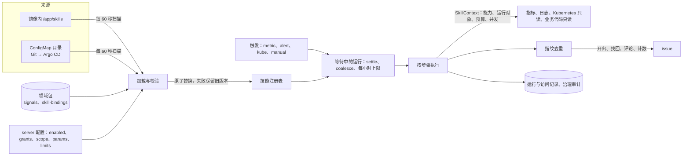

# 技能

技能是一个目录：清单、可选的说明、绑定 schema、输出模板与测试。server 中的宿主按清单执行它的步骤，只经部署方授予的能力访问外部系统，结果按指纹去重之后写成 issue 或评论。决定与理由见 [ADR 0181](../adr/0181-hot-pluggable-skills.md)，第一个技能见 [oom-rootcause.zh-CN.md](oom-rootcause.zh-CN.md)。



## 目录

| 文件（相对技能目录 `<技能名>/`） | 内容 |
|---|---|
| `skill.yaml` | 清单（`contract/schemas/skill.schema.json`） |
| `SKILL.md` | 可选：说明 |
| `binding.schema.json` | 绑定数据的 schema |
| `templates/<名字>.md` | 输出模板（Mustache） |
| `tests/<用例>.yaml` | 测试用例 |

以 ConfigMap 挂载时子目录文件以 `<子目录>__<文件名>` 为键，例如 `templates__issue.zh-CN.md`。目录里出现其他文件时不加载。

## 最小的技能

```yaml
api_version: srenautix.io/skill/v1
name: restart-burst
version: 1.0.0
title: { zh-CN: 重启突增, en: Restart burst }
description: { zh-CN: 容器 OOM 重启时列出上一次退出的日志并开 issue, en: Lists the previous logs and opens an issue on an OOM restart }
maturity: draft
min_srenautix_version: 0.1.0
contract: '>=2.45.0 <3.0.0'
params: { tail: 100 }
inputs: { type: object, additionalProperties: false, properties: {} }
binding: { required: false }
triggers:
  - id: oom
    kind: kube
    match: { terminated_reasons: [OOMKilled] }
  - id: manual
    kind: manual
debounce: { settle: 2m, coalesce: 6h }
scope: { kinds: [Deployment, StatefulSet] }
capabilities:
  kube.read: { objects: [pod_status, pod_logs_previous] }
  issue.write: { repo_role: ops }
budgets:
  run: { duration: 2m, metrics_queries: 0, logs_queries: 0, log_lines: 0, kube_reads: 10, github_requests: 10, code_files: 0, code_bytes: 0 }
  hourly: { runs: 6, issues: 1, comments: 6 }
steps:
  - id: status
    uses: kube.read@v1
    with: { object: pod_status }
  - id: previous
    uses: kube.read@v1
    needs: [status]
    with: { object: pod_logs_previous, pods: { step: status, field: names }, container: app, tail_lines: { param: tail } }
  - id: publish
    uses: issue.publish@v1
    needs: [previous]
    with: { output: issue }
outputs:
  fingerprint: [restart, { step: status, field: names.0 }]
  issue:
    title: { zh-CN: '{{subject.name}} OOM 重启', en: '{{subject.name}} OOM restart' }
    templates: { zh-CN: templates/issue.md, en: templates/issue.md }
    comment_templates: { zh-CN: templates/comment.md, en: templates/comment.md }
    labels: [restart]
```

`with`、`when`、指纹与标签里的值是常量或引用：`{param: 名}`、`{input: 路径}`、`{binding: data.路径}`、`{step: 步骤 id, field: 点分路径}`。引用的步骤必须在 `needs` 里（直接或间接）。宿主支持的步骤类型、需要的能力与参数见 `GET /v1/skill-host`，说明见 ADR 0181 §3。

模板的变量：`subject`（kind、namespace、name）、`params`、`steps.<id>`（步骤的输出）、`finding`（fingerprint、generation、previous_number、occurrences）、`skill`（name、version、digest）、`run`（id、url）、`binding.id`。每个值都经过 Markdown 安全处理；`{{{x}}}`、`{{& x}}` 与 partial 不允许。

## 绑定

技能需要部署方的数据时，清单写 `binding.required: true` 与 `binding.schema: binding.schema.json`，数据放在部署方领域包的 `skill-bindings.yaml`：

```yaml
bindings:
  - skill: oom-rootcause
    id: api-gateway
    workloads: [{ kind: StatefulSet, namespace: shop, name: api-gateway }]
    data:
      runtime: go
      container: gateway
      # 其余字段按技能的 binding.schema.json
```

绑定随领域包加载（启动时），按领域包的分层规则合并并进入 `pack.lock`；data 中名为 `signal` 的字符串必须是加载的领域包里的信号。

## 部署

chart values（写进 server 配置的 `skills`，键名见 `apps/srenautix/src/skills/config.ts`）：

```yaml
skills:
  userConfigMaps: [restart-burst] # 部署方的技能，每个一个 ConfigMap，名字等于技能名
  enabled: [oom-rootcause, restart-burst]
  grants:
    oom-rootcause:
      metrics.query_range: {}
      logs.query: { max_lines: 1000 }
      kube.read: { objects: [pod_status, events, pod_logs_previous] }
      code.read: { repo_role: business }
      issue.write: { repo_role: business }
    restart-burst:
      kube.read: { objects: [pod_status, pod_logs_previous] }
      issue.write: { repo_role: ops }
  scope:
    oom-rootcause: { namespaces: [shop], kinds: [StatefulSet] }
  params:
    oom-rootcause: { rss_limit_ratio: 0.9 }
  limits: { duration: 15m, metrics_queries: 400 }
  maxIssuesPerHour: 3
  titlePrefix: '[技能]'
```

- `kube.read` 用 server 已有的集群只读权限（`roles.server.clusterRead`）；`kube` 触发需要 server 自己的 informer（`topology.source: informer`）。
- `code.read` 与 `repo_role: business` 的 `issue.write` 需要 GitHub App 与 `optimization.repositories.business`（主动优化关闭时也可以配置）；`repo_role: ops` 写到 `issues.repo`。
- 技能 ConfigMap 的变化在 60 秒内生效，不滚动 server；修改 `enabled`、`grants` 等配置会滚动 server。

## 运行与排查

- 接口：`GET /v1/skills`（版本、来源、摘要、状态、有效能力、缺少的授权、最近一次加载的错误）、`GET /v1/skills/{name}/runs`、`GET /v1/skill-runs/{run_id}`（步骤、每次外部访问与发现）、`POST /v1/skills/{name}/runs`（手动运行，可以给参考时刻 `at`）、`PATCH /v1/skills/{name}`（暂停与恢复）。
- 状态条：`SkillLoadFailed`（最新内容没有通过校验，旧版本继续运行）、`SkillCapabilityMissing`（缺少授权）。
- 指标：`srenautix_skill_runs_total`、`srenautix_skill_calls_total`（含 `denied`、`budget`）、`srenautix_skill_budget_exhausted_total`、`srenautix_skill_issues_total`、`srenautix_skill_load_failures_total`、`srenautix_skill_loaded`。
- 运行的终态原因码：`published`、`commented`、`counted`、`no_occurrence`、`budget_exhausted`、`capability_denied`、`datasource_error`、`binding_missing`、`unavailable`、`interrupted`、`step_failed`。

## 边界

- 能力只有只读访问与 issue 写入（创建、评论、读取），没有集群写入、配置修改、Git 内容写入、PR、命令执行与 Secret 读取。
- 日志只保留绑定声明的字段；请求体与用户数据不进入运行记录、模板与 issue。
- 文件只以校验过的文件名出现，命令只写进 issue，SreNautix 不执行。
