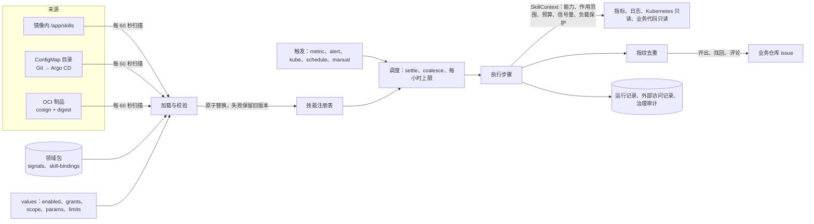

# 技能

技能是一个目录：清单、可选的说明、输出模板、绑定 schema 与测试。server 中的宿主按清单执行它的步骤，只经部署方授予的能力访问外部系统，结果按指纹去重之后写成 issue 或评论。决定与理由见 [ADR 0181](../adr/0181-hot-pluggable-skills.md)，第一个技能见 [oom-rootcause.zh-CN.md](oom-rootcause.zh-CN.md)。



## 目录

| 文件（相对技能目录 `<技能名>/`） | 内容 |
|---|---|
| `skill.yaml` | 清单 |
| `SKILL.md` | 可选：llm 步骤的说明（低信任文本） |
| `binding.schema.json` | 可选：绑定数据的 schema |
| `templates/<输出>.<语言>.md` | 输出模板 |
| `tests/<用例>.yaml` | 用例：夹具与期望输出 |

技能目录里只有数据与说明。可以使用的步骤类型由宿主提供（`GET /v1/skills/host` 列出类型、版本与需要的能力），技能只组合它们，`with` 中的取值与过滤用 CEL。

## 最小的技能

```yaml
api_version: srenautix.io/skill/v1
name: restart-burst
version: 1.0.0
title: {zh-CN: 重启突增, en: Restart burst}
description: {zh-CN: 工作负载 10 分钟内重启超过 3 次时列出退出原因并开 issue, en: Lists exit reasons and opens an issue when a workload restarts more than 3 times in 10 minutes}
maturity: draft
min_srenautix_version: 0.2.0
contract: '>=2.45.0 <3.0.0'
params: {threshold: 3}
inputs:
  type: object
  additionalProperties: false
  required: [namespace, workload_kind, workload]
  properties:
    namespace: {type: string}
    workload_kind: {type: string, enum: [Deployment, StatefulSet]}
    workload: {type: string}
binding: {required: false}
triggers:
  - id: restarts
    kind: metric
    signal: workload/container_restarts
    window: 10m
    condition: value > params.threshold
debounce: {settle: 2m, coalesce: 6h}
scope: {component_types: [Deployment, StatefulSet]}
capabilities:
  metrics.query_range: {}
  kube.read: {objects: [pod_status]}
  issue.write: {repo_role: ops}
budgets:
  run: {duration: 2m, metrics_queries: 10, kube_reads: 10, github_requests: 10}
  hourly: {runs: 6, issues: 1, comments: 6}
steps:
  - id: occ
    uses: trigger.occurrences@v1
  - id: status
    uses: kube.read@v1
    needs: [occ]
    with: {object: pod_status, pods: '${{ steps.occ.output.pods }}'}
  - id: publish
    uses: issue.publish@v1
    needs: [status]
    with: {output: issue}
outputs:
  fingerprint: [inputs.namespace, inputs.workload]
  issue:
    templates: {zh-CN: templates/issue.zh-CN.md, en: templates/issue.en.md}
    labels: [restart]
```

## 绑定

技能需要部署方的数据时，清单写 `binding.required: true` 与 `binding.schema`，数据放在部署方领域包的 `skill-bindings.yaml`：

```yaml
bindings:
  - skill: oom-rootcause
    id: api-gateway
    applies_to:
      workloads: [{kind: StatefulSet, namespace: shop, name: api-gateway}]
    data:
      runtime: go
      container: gateway
      # 其余字段按技能的 binding.schema.json
```

绑定随领域包加载（启动时），按领域包的分层规则合并并进入 `pack.lock`；引用的信号必须在加载的领域包中存在。技能本身每 60 秒重新加载。

## 测试

```
srenautix-skill lint <技能目录> --packs <领域包目录>...
srenautix-skill test <技能目录> --packs <领域包目录>...
```

- `lint`：清单与绑定的 schema、步骤类型与版本、能力与预算、CEL 编译、模板解析与引用的字段、`needs` 没有环、绑定引用的信号存在。
- `test`：每个 `tests/*.yaml` 是一个用例。指标夹具（promtool 的 `input_series` 写法）装进真实的 Prometheus 与 VictoriaMetrics，日志夹具（`input_logs`）装进真实的 Loki，Kubernetes 与 GitHub 的读取用录制的快照；执行整个技能，比较每个步骤的输出（`expect.steps`）、指纹（`expect.fingerprint`）与渲染出的 issue 标题和正文（`expect.issue`，逐字比较）。两种指标后端的结果必须一致。

## 部署

server 配置（chart 的 `skills` 一节生成）：

```yaml
skills:
  sources:                       # 后者覆盖前者的同名技能
    - {kind: builtin}
    - {kind: dir, path: /etc/srenautix/skills}
  reload_interval: 60s
  enabled: [oom-rootcause]       # 允许运行的技能；默认为空
  grants:                        # 授予的能力；清单要求而这里没有的能力使技能不运行
    oom-rootcause:
      metrics.query: {}
      metrics.query_range: {}
      logs.query: {max_lines: 5000}
      kube.read: {objects: [pod_status, pod_logs_previous, events]}
      code.read: {repo_role: business}
      issue.write: {repo_role: business}
  scope:
    oom-rootcause: {namespaces: [shop], component_types: [StatefulSet]}
  params:
    oom-rootcause: {rss_limit_ratio: 0.85}
  limits:                        # 每次运行的上限，与清单的预算取较小者
    duration: 15m
    github_requests: 200
  title_prefix: '[技能]'
```

chart：`skills.userConfigMaps` 列出每个技能的 ConfigMap（整卷挂载到 `/etc/srenautix/skills/<名字>`，子目录文件以 `<子目录>__<文件名>` 为键），`skills.revision` 写提交或内容摘要。技能的 ConfigMap 变化不滚动 server。

## 运行与排查

- 控制台"技能"页：版本、来源、摘要、状态、有效能力、预算、最近的运行与发现；运行详情显示每个步骤与每次外部访问。
- 状态条：`SkillLoadFailed`（加载失败，旧版本继续运行）、`SkillCapabilityMissing`（values 没有授予清单要求的能力）。
- 指标：`srenautix_skill_runs_total`、`srenautix_skill_calls_total`（含 `denied`）、`srenautix_skill_budget_exhausted_total`、`srenautix_skill_issues_total`、`srenautix_skill_load_failures_total`。
- 暂停：`PATCH /v1/skills/{name}`（admin）或控制台按钮，立即生效；回退：在 Git 中回退技能的 ConfigMap，下一轮重新加载生效。

## 边界

- 能力只有只读访问与 issue 写入（创建、评论、读取），没有集群写入、配置修改、Git 内容写入、PR、命令执行与 Secret 读取。
- 日志只保留绑定声明的字段；请求体与用户数据不进入运行记录、模板与 issue。
- 模板的每个值都经 Markdown 转义；文件只以校验过的文件名出现，命令只写进 issue，SreNautix 不执行。
