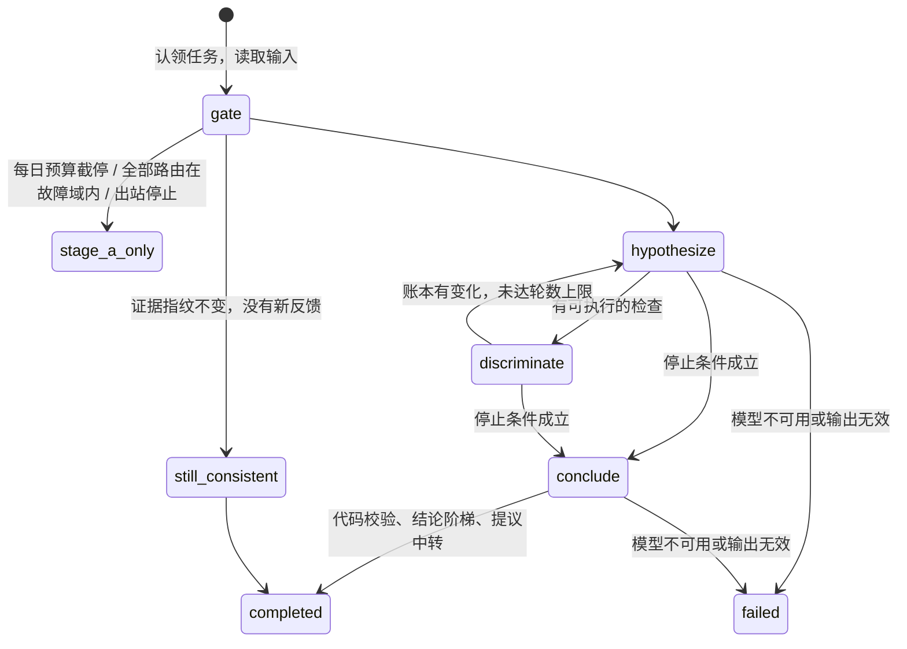

# 阶段 B 的研判过程

## 输入

worker 从中心读取：该版本的事件与成员告警、阶段 A 报告（证据卡、候选根因、确定性 disposition、证据指纹）、两跳拓扑邻域、事件的反馈、本集群启用的动作目录，以及领域包的知识条目、参考案例、查询模板与 pack.lock 摘要（字段见 `docs/server/README.md` 的"阶段 B 的输入与查询模板"）。研判子图从根因出发计算跳数；动作只保留目标类型出现在子图中的；参考案例只用研判开始之前已解决的。

区分性检查中 `type=query` 的检查交给 server 执行（`POST /v1/research/tasks/{run_id}/query`，组件为假设的根因），worker 不直接访问数据源。server 拒绝的请求（参数不合法、组件不在子图中、模板已不存在）成为一张无法判定的卡，原因写进卡的说明，研判照常继续。研判清单的 `pack_lock` 取中心返回的摘要，`retrieved_knowledge`、`retrieved_cases` 列出放入输入的知识条目与参考案例。

## 提示词

模板在 `apps/srenautix/src/prompts/`（zh、en），只含固定指令；事件数据按片段追加，片段带数据类别与出境控制。顺序固定：固定指令 → 目录（查询模板、只读工具、可用动作、runbook）→ 事件、拓扑、告警、变更、阶段 A 证据卡、知识与参考案例、上一次的账本、反馈 → 本步骤的账本与检查卡 → 任务说明。路由上下文小于 64k token 时，只放入异常卡、候选根因上的卡与检查卡，其余卡只列判定。

## 假设账本

| 状态 | 判定 |
|---|---|
| 待检验 | 刚提出，没有支持也没有反驳 |
| 支持 | 范围内（根因组件、它直接依赖的对象、沿 owned_by 向下它拥有的全部对象；边置信度 ≥0.6）有异常卡 |
| 推翻 | 针对它、实体在它范围内的检查结果正常；或没有支持而机制信号上有相反的正常卡 |
| 检验后仍无法判定 | 执行过检查，既没有支持也没有推翻 |

反馈固定的状态不再改变。账本按状态、支持卡数、阶段 A 候选得分、模型给出的顺序排名。

假设的根因使用组件粒度：由控制器拥有的对象（Pod、ReplicaSet 等）沿研判子图的 owned_by 改写为顶层属主，与阶段 A 的 `componentOf` 相同；改写后落在同一组件上的假设合并，被并入的 id 作为别名，检查、结论与提议中的引用按别名改写（ADR 0121）。

## 区分性检查

| type | 目标 | 判定 |
|---|---|---|
| `query` | 领域包的查询模板（`<pack>/<id>`） | 模板附带的卡定义，CEL 判定 |
| `tool` | 只读工具（内置：`knowledge_entry`、`reference_case`；MCP 白名单工具：`<服务器 id>.<工具名>`） | 小模型对照 `refutes_if` 判定，`reason.kind = model_judged` |

工具结果最多 20 个序列 × 60 点、50 行日志、16 KiB；时间范围限定在事件窗口前后各 24 小时（回放时为快照窗口），最长 24 小时，步长不小于 15 秒。

## 结论阶梯

| 档位 | 条件 |
|---|---|
| `evidence_consistent` | 范围内有规则判定的支持卡；异常起始不晚于最早的症状告警 + 2 分钟；没有相反的正常卡；至少检验过一个竞争假设 |
| `likely` | 有支持卡，不满足上面的全部条件（包括只有模型判定的支持卡）；或由代码按账本选中（见下） |
| `inconclusive` | 有假设，没有选中的假设或选中的假设没有支持卡 |
| `undetermined` | 没有假设 |

conclude 返回 `hypothesis_id: null` 时，如果账本中恰好一个假设处于支持状态并且它有范围内的异常卡，代码选中它，档位最高为 `likely`，`validation_notes` 写明模型弃权与代码选中的依据；两个及以上假设处于支持状态时不代选（ADR 0120）。

## 输出

契约 `ResearchOutput`：处置判断、结论（档位、选中的假设、根因组件、四项一致性）、账本、执行过的检查（结果卡与结论）、现状与背景、摘要、修复建议、提议（接受后带 `proposal_id`）与 `validation_notes`。修复建议标注 `generated_by: model`。
