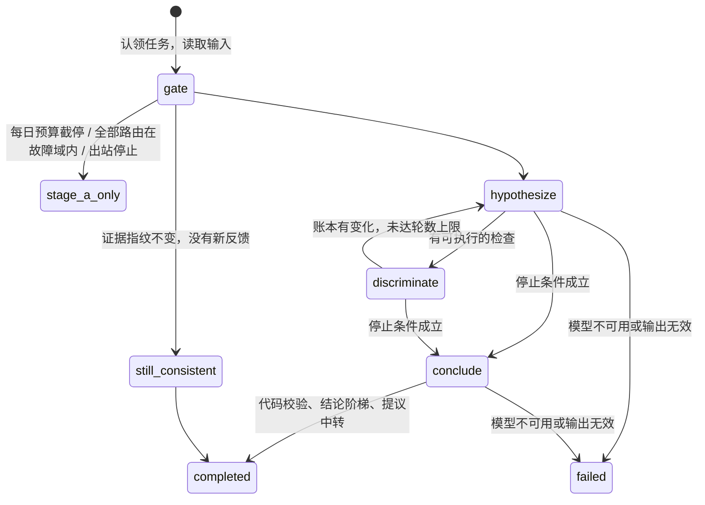

# 阶段 B 的研判过程

## 输入

worker 从中心读取：该版本的事件与成员告警、阶段 A 报告（证据卡、候选根因、确定性 disposition、证据指纹）、两跳拓扑邻域、事件的反馈、本集群启用的动作目录，以及领域包的知识条目、参考案例、查询模板与 pack.lock 摘要（字段见 `docs/server/README.md` 的"阶段 B 的输入与查询模板"）。研判子图从根因出发计算跳数；动作只保留目标类型出现在子图中的；参考案例只用研判开始之前已解决的。

区分性检查中 `type=query` 的检查交给 server 执行（`POST /v1/research/tasks/{run_id}/query`，组件为假设的根因），worker 不直接访问数据源。server 拒绝的请求（参数不合法、组件不在子图中、模板已不存在）成为一张无法判定的卡，原因写进卡的说明，研判照常继续。研判清单的 `pack_lock` 取中心返回的摘要，`retrieved_knowledge`、`retrieved_cases` 列出放入输入的知识条目与参考案例。

## 提示词

模板在 `apps/srenautix/src/prompts/`（zh、en），只含固定指令；事件数据按片段追加，片段带数据类别与出境控制。顺序固定：固定指令 → 目录（查询模板、只读工具、可用动作、runbook）→ 事件、拓扑、告警、变更、阶段 A 证据卡、知识与参考案例、上一次的账本、反馈 → 本步骤的账本与检查卡 → 任务说明。路由上下文小于 64k token 时，只放入异常卡、候选根因上的卡与检查卡，其余卡只列判定。

变更片段中每个变更带代码计算的关联分级（ADR 0169）：`grade`、`basis`、`new_signals`（支撑 high 的成员告警引用 `alert:N`）、`rollback`；不在事件里的相关变更为 low，GitHub 变更另带命中的路径前缀 `paths`。system 提示词说明分级的含义，以及把根因归到变更上时结论受分级约束。

## 假设账本

| 状态 | 判定 |
|---|---|
| 待检验 | 刚提出，没有支持也没有反驳 |
| 支持 | 范围内（根因组件、它直接依赖的对象、沿 owned_by 向下它拥有的全部对象；边置信度 ≥0.6）有不是常态的异常卡，或有角色为 cause、change、symptom 的成员告警（ADR 0122）；依赖对象上的卡与告警只在模型引用时计入 |
| 推翻 | 针对它、实体在它范围内、测的信号属于它的机制的检查结果正常；或没有支持而机制信号上有相反的正常卡 |
| 检验后仍无法判定 | 执行过对应的检查，既没有支持也没有推翻 |

**推翻要有针对性**（ADR 0133）：检查卡的信号类型取检查 id 的卡名或证据链名（例如 `workload/pod-restarts/restarts` 是 crash），假设的症状类型取机制文字中的关键词（例如"初始化""PodInitializing"是 startup）。两者有交集，或检查与假设的某张支持卡是同一个卡片定义时，检查才算对应。对应不上的检查记为无关：不推翻、不算相反的正常卡、不计入 `checks_run`，并写一条 `validation_notes`。任一边归不出类型、或由小模型判定的工具结果，视为对应。

**常态的卡不是证据**（ADR 0153）：阶段 A 与区分性检查的异常卡带证据基线（`novelty`，见 server 文档的"阶段 A 与领域包"）。判为常态（`routine`）的卡与事件之前同样长度的时段相比没有明显升高，只作背景：不计入支持；模型把它引用为支持时，代码删除这条引用并写一条 `validation_notes`。提示词里判为常态或明显异常的卡带 `novelty`（判定、说明与对照时段的主值；无法与基线比较的不写），有常态的卡时另有一段"证据基线与最低取证集合"说明这条规则；没有常态的卡时提示词与之前相同。

研判子图没有任何组件（事件没有根因，例如 `unlabelled`）时不提出假设，直接进入 conclude，档位为 `undetermined`。

反馈固定的状态不再改变。账本按状态、支持卡数、阶段 A 候选得分、模型给出的顺序排名。输出的 `hypotheses` 按这个排名排列，包含全部假设，被推翻的在最后；评测的召回@3 按结论选中的根因加这个完整排序计算（ADR 0133）。

假设的根因使用组件粒度：由控制器拥有的对象（Pod、ReplicaSet 等）沿研判子图的 owned_by 改写为顶层属主，与阶段 A 的 `componentOf` 相同。同一组件上的多个假设是同一根因的不同机制，各自保留，彼此不算竞争假设；停止条件、结论阶梯与代选都按根因组件判断竞争（ADR 0121）。

## 区分性检查

| type | 目标 | 判定 |
|---|---|---|
| `query` | 领域包的查询模板（`<pack>/<id>`） | 模板附带的卡定义，CEL 判定 |
| `tool` | 只读工具（内置：`knowledge_entry`、`reference_case`；MCP 白名单工具：`<服务器 id>.<工具名>`） | 小模型对照 `refutes_if` 判定，`reason.kind = model_judged` |

工具结果最多 20 个序列 × 60 点、50 行日志、16 KiB；时间范围限定在事件窗口前后各 24 小时（回放时为快照窗口），最长 24 小时，步长不小于 15 秒。

一轮 hypothesize 的 `next_checks` 为空、而事件的组件（根因、候选根因、成员告警的组件）上有适用的卡片检查时，控制器补选：依次为待检验的假设各取一项。取的是这个假设根因组件上、测的信号与机制对应（ADR 0133）、本次运行还没有执行过的卡片检查，按候选清单的相关性顺序取第一项，参数取卡片默认值。最多补选 3 项，补选写入 `validation_notes`（ADR 0137）。

## 结论阶梯

| 档位 | 条件 |
|---|---|
| `evidence_consistent` | 范围内有规则判定的支持卡；异常起始不晚于最早的症状告警 + 2 分钟；没有相反的正常卡；至少一个竞争假设经检验被推翻或仍无法判定，并且没有竞争假设同样处于支持状态（ADR 0124） |
| `likely` | 有支持卡，不满足上面的全部条件（包括只有模型判定的支持卡）；只有成员告警支持；或由代码按账本选中（见下） |
| `inconclusive` | 有假设，没有选中的假设或选中的假设没有支持卡与支持告警；或选中的假设有相反证据；或把根因归到没有 high 分级的变更上（见下） |
| `undetermined` | 没有假设；或成员告警的最低取证集合没有覆盖（见下） |

**相反证据的上限**（ADR 0134）：选中的假设满足以下任一项时，档位最高为 `inconclusive`，模型选中与代码代选都一样：

- 它自己的对应检查（实体在范围内）判定为正常，包括成员上不改变账本状态的检查卡；
- 事件有症状告警，并且规则判定的支持卡中已知的最早异常起始晚于最早的症状告警加 2 分钟。

退回的原因写进 `validation_notes`。

**最低取证集合**（ADR 0153）：阶段 A 报告的 `required_evidence` 列出成员告警的目录条目声明的 `required_cards` 中没有在告警实体上得出结论的卡。区分性检查在同一实体上得出了这张卡的结论时算补上；仍有缺口时，不论选中哪个假设，档位都是 `undetermined`，`undetermined_reason` 与 `validation_notes` 写明缺少哪张卡，处置不能是 `act` 或 `ignore`（阶段 A 已判为 ignore 的除外）。提示词的"证据基线与最低取证集合"段同时列出缺口，让模型把缺少的取证写进 investigation 类修复建议。

**变更分级的上限**（ADR 0169，`research/change-cap.ts`）：在最低取证集合之后、处置推导之前执行。选中的假设把根因归到变更上时适用：根因是发布的逻辑组件（`component:release`、`component:<命名空间>/release`，对应证据簿里的全部变更），根因是管理变更目标的 GitOps 应用（子图里有目标到它的 `managed_by` 边，或它在变更的 `refs` 里；对应它管理的目标上的变更），或 `supporting` 引用了 `change:N`（对应被引用的变更）。变更的分级读事件的 `change_links`（core 计算），不在事件里的相关变更按 low。对应的变更中没有 high 时，likely 与 evidence_consistent 改为 `inconclusive`，`validation_notes` 写明每个变更的引用、change_id、分级与缺少的条件；事件没有 `change_links`（契约 2.37.0 之前算出）时不限制，记一条说明。

conclude 返回 `hypothesis_id: null` 时，如果账本中处于支持状态的假设都落在同一个根因组件上并且有范围内的异常卡，代码选中排名靠前的一个，档位最高为 `likely`，`validation_notes` 写明模型弃权与代码选中的依据；支持假设落在两个及以上根因组件上时不代选（ADR 0120）。

## 处置

处置在结论阶梯之后由代码推导，模型给出的处置是输入之一（ADR 0138、0162、0163、0167、0168），依次判断：

1. 观测失明：escalate；
2. ignore 的确定性依据（阶段 A 已判为 ignore，原因是 `planned_retirement` 时依据记为 `planned_retirement`，其余记为 `stage_a`；likely 以上的研判根因是集群外部组件；得出结论的卡全部正常；影响卡全部正常），并且没有规则提议与适用的修复模板，也没有"处置依据的 `business_impact` 中有触发中的业务影响告警（ADR 0166）、同时有规则判定的异常卡（常态的不算）"：ignore。模型给出的有效提议不生效，研判输出的 `proposals` 为空，`validation_notes` 写明提议数与每条提议的动作和假设（ADR 0168）；
3. 最低取证集合没有缺口，并且研判根因 likely 以上，满足下面任一项：act，不论模型给出什么：
   - 研判根因上有适用的修复模板（`release_rollback`、`config_resource`）；
   - 研判根因与发现根因都在处置依据的 `declared` 中（由 GitOps 仓库声明的运行中组件，管理着候选根因的 GitOps 应用与逻辑组件除外），选中的假设有规则判定的支持卡；
4. 模型给出 act：还可以由有效提议、规则提议，或修复模板使用的根因（档位低于 likely 时为事件根因）上的修复模板支撑；都没有时按严重度改写（critical 为 escalate，其余为 undetermined）；
5. 模型给出 ignore 而第 2 步不成立：按严重度改写；
6. 其余保持模型的取值。

每一次改写都写进 `validation_notes`。

## 输出

契约 `ResearchOutput`：处置判断、结论（档位、选中的假设、根因组件、四项一致性）、账本、执行过的检查（结果卡与结论）、现状与背景、摘要、修复建议、提议（接受后带 `proposal_id`）与 `validation_notes`。修复建议标注 `generated_by: model`。

消息与 issue 只用确定性数据说明结论（ADR 0125），输出因此带上：

- `conclusion.consistency_detail`：四项一致性各自的依据，即支持卡、只由模型判定的支持卡、支持的成员告警、最早的异常起点、症状起点与容差、相反的正常卡、检验过的与同样得到支持的竞争假设、结论由模型还是账本选中；
- 假设的 `status_reasons`（账本给出状态的依据）与 `checks_run`；
- `check_cards`：检查产生的证据卡（序列为空，完整序列在运行明细中），`evidence_index`：`card:n`、`alert:n`、`change:n` 到卡片定义与实体、告警、变更的映射；
- `stop_reason` 与检查失败的原因 `next_checks[].error`。

**数值审计**：结论之后，假设机制、现状、摘要、修复建议（标题、理由、步骤）与无法判定的原因中的数值断言（时刻、百分比、带单位的数、小数）必须能在本次证据里找到：卡片的值、表格、理由、观测值、阈值、基线与时间，告警与变更的时间、版本与说明，阶段 A 的时间线与候选得分。找不到的数值在括号内的补充说明里时删除这段括号，否则连同所在分句（以逗号、句号与因果箭头分隔）删除，写一条 `validation_notes`；步骤全部被删除的修复建议整条删除。命令与标识符里的数字（`--tail=50`、`gateway-4`、`card:38`）不算数值断言。实现在 `research/numbers.ts`。
